Tiếng Việt | [English](README_EN.md)

<p align="center">
  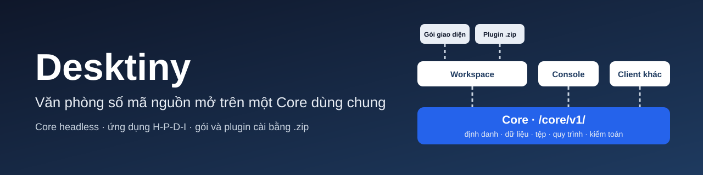
</p>

<h1 align="center">Desktiny</h1>

<p align="center">
  <b>Văn phòng số mã nguồn mở: giao việc, trình duyệt hồ sơ, quy trình tự thiết kế và tài liệu trên một Core dùng chung.</b><br>
  Cơ quan đổi sang nghiệp vụ mới bằng cách cài một gói <code>.zip</code>, không phải viết lại hệ thống.
</p>

<p align="center">
  <a href="LICENSE"></a>
  <a href="https://github.com/Dking2007/DXOS_Desktiny/actions/workflows/ci.yml?query=branch%3Amain"></a>
  <a href="https://github.com/Dking2007/DXOS_Desktiny/releases/latest"></a>
  <a href="https://api.reuse.software/info/github.com/Dking2007/DXOS_Desktiny"></a>
</p>

<p align="center">
  <a href="#dùng-thử-nhanh"><b>Dùng thử nhanh</b></a> ·
  <a href="#tài-liệu"><b>Tài liệu</b></a> ·
  <a href="https://github.com/Dking2007/DXOS_Desktiny/releases"><b>Tải bản phát hành</b></a> ·
  <a href="https://github.com/Dking2007/Desktiny_expansion_pack"><b>Bản mở rộng</b></a> ·
  <a href="docs/doi-chieu-de-thi.md"><b>Đối chiếu đề</b></a>
</p>

Sản phẩm dự thi OLP Phần mềm nguồn mở 2026, chủ đề nền tảng văn phòng số DX-OS Open-Core. Bản phát hành mới nhất:
**v3.1.0**; các thay đổi chờ bản 3.2.0 nằm ở mục `[Unreleased]` của [CHANGELOG](CHANGELOG.md). *Desk + destiny*;
tên cũ DX Workspace, nên mã, cơ sở dữ liệu và container vẫn dùng tên `dx_workspace` / `dx-workspace`.

> Bản pilot. Compose trong kho là cấu hình phát triển, không phải production. Kết quả nghiệm thu và những bước còn
> cần dịch vụ thật: [docs/acceptance.md](docs/acceptance.md).

[Bài toán](#bài-toán) · [Người dùng](#người-dùng) · [Giải pháp](#giải-pháp) · [Tính năng](#tính-năng-chính) ·
[Kiến trúc](#kiến-trúc) · [Luồng nghiệp vụ](#luồng-nghiệp-vụ) · [Bản mở rộng](#bản-mở-rộng) ·
[Bốn nguyên lý](#bốn-nguyên-lý-kỹ-thuật) · [Công nghệ](#công-nghệ-và-giấy-phép) · [Dùng thử](#dùng-thử-nhanh) ·
[Demo](#demo) · [Cài đặt](#cài-đặt) · [Kiểm thử](#kiểm-thử) · [Giới hạn](#giới-hạn) · [Tài liệu](#tài-liệu) ·
[Đội](#đội) · [Giấy phép](#giấy-phép)

## Bài toán

1. **Hồ sơ không biết đang nằm ở bàn ai.** Đơn xin nghỉ phép gửi qua email, ba ngày sau người nộp vẫn phải đi hỏi
   từng phòng xem ai đang giữ.
2. **Dữ liệu thành ốc đảo.** Phòng hành chính một phần mềm, phòng nhân sự một bảng tính, văn thư một sổ giấy; tài
   khoản, tệp và lịch sử xử lý không nối được với nhau.
3. **Mỗi nghiệp vụ mới là một lần viết lại.** Muốn thêm quy trình tiếp nhận hồ sơ một cửa thì phải thuê sửa mã hoặc
   mua thêm một hệ thống nữa.
4. **Bị khóa vào nhà cung cấp.** Dữ liệu nằm trong định dạng đóng; đổi nhà cung cấp là mất lịch sử.

## Người dùng

| Đối tượng | Nhu cầu | Desktiny đáp ứng bằng |
|---|---|---|
| Nhân viên | Biết hôm nay làm gì, trình hồ sơ nhanh | Trang chủ *Việc cần làm hôm nay*; biểu mẫu có trường ẩn/hiện theo điều kiện; tab *Quy trình* cho biết hồ sơ đang chờ ai |
| Trưởng phòng, lãnh đạo | Duyệt đúng hạn, nhìn được việc quá hạn | Duyệt, trả lại, từ chối, xin ý kiến song song; ủy quyền phê duyệt có thời hạn; báo cáo quá hạn, xuất CSV |
| Văn thư, bộ phận một cửa | Lưu và tra tài liệu, tiếp nhận hồ sơ | Kho tài liệu có phiên bản, chia sẻ theo thư mục; bản mở rộng Văn thư và Một cửa |
| Quản trị viên | Đổi quy trình mà không viết mã | Trình thiết kế quy trình kéo thả, chạy thử với dữ liệu mẫu; cài gói và plugin `.zip` |
| Người viết gói, plugin | Thêm nghiệp vụ không sửa Core | Định dạng `desktiny-pack/1`, `desktiny-plugin/1` và `/2`, SDK `desktiny-plugin`, API plugin có phạm vi |

## Giải pháp

Desktiny tách một **Core headless dùng chung** (định danh, dữ liệu, tệp, quy trình, nhật ký kiểm toán) khỏi các
ứng dụng chạy trên nó. Core chỉ có API; ứng dụng Workspace là một client của Core như mọi client khác. Nghiệp vụ
riêng của từng cơ quan nằm trong **gói giao diện** và **plugin**, cài bằng tệp `.zip`.

| Tầng | Thành phần | Vai trò |
|---|---|---|
| Tầng 1: Core headless (chỉ API `/core/v1/`) | `core-api`, `core-worker`, Keycloak, cổng Nginx, PostgreSQL, RustFS | Principal/ACL, schema/record, tệp có phiên bản, workflow, nhật ký kiểm toán |
| Tầng 2: ứng dụng có giao diện | Workspace (`workspace-api`, `workspace-worker`, web Vue) | Tổ chức, việc, hồ sơ, phê duyệt, kho tài liệu, nhắn tin, plugin, AI tùy chọn |
| Tầng 2: công cụ quản trị kỹ thuật | Core admin (`apps/core-admin`, `/console/`) | Chỉ là client của Core API, không chứa logic Core |
| Tích hợp tùy chọn | ONLYOFFICE Docs, ClamAV | Dịch vụ chạy riêng, mặc định tắt |

| Không gian H-P-D-I của đề | Trong Desktiny |
|---|---|
| H, cộng tác người | Giao việc, nhắn tin, bảng tin, tìm kiếm chung |
| P, quy trình | Hồ sơ, phê duyệt nhiều bước, quy trình vẽ trên canvas, ủy quyền |
| D, dữ liệu | Kho tài liệu có phiên bản, báo cáo (một phần), soạn thảo ONLYOFFICE tùy chọn |
| I, trí tuệ | Trợ lý và 19 tính năng AI, mặc định tắt, chỉ đề xuất |

| Điểm nổi bật | Cơ chế cụ thể |
|---|---|
| Core không có giao diện | Workspace gọi Core qua HTTP bằng `CoreClient`, không đọc CSDL của Core; Core vẫn phục vụ client khác khi tắt Workspace ([`examples/core-client`](examples/core-client)) |
| Đổi nghiệp vụ bằng một tệp `.zip` | Gói giao diện đổi từ ngữ, màu, quy trình, biểu mẫu, kiến thức trợ lý; plugin thêm trang, bước quy trình, sự kiện ([packs.md](docs/packs.md), [plugins.md](docs/plugins.md)) |
| Quy trình không cần viết mã | Canvas kéo thả, chạy thử với dữ liệu mẫu, xem lại từng lượt chạy; hồ sơ ghim phiên bản quy trình đã phát hành |
| Dấu vết không sửa lén được | Phiên bản tệp có SHA-256; nhật ký kiểm toán của Core nối chuỗi băm, kiểm bằng `GET /core/v1/audit-logs/verify` |
| Bảo vệ ở biên | Gateway giới hạn tần suất, CSP `default-src 'self'`, `/internal/` trả 404; tệp tải lên kiểm định dạng và chữ ký nội dung, quét ClamAV khi bật; cảnh báo dữ liệu cá nhân trong tệp |
| AI không tự quyết | 19 tính năng bật riêng từng cái, mặc định tắt; dùng được máy chủ AI tự cài (Ollama, vLLM) |
| Chỉ phần mềm nguồn mở | Giấy phép OSI, header SPDX trên từng tệp, kiểm bằng `reuse lint` trong CI |
| Đóng góp ngược | Đã gửi PR cho Keycloak và ONLYOFFICE ([chi tiết](#đóng-góp-ngược-cho-cộng-đồng-nguồn-mở)) |

## Tính năng chính

| Việc cần làm | Desktiny có |
|---|---|
| Giao việc và theo dõi tới khi xong | Giao cho người hoặc đơn vị (bộ chọn người tìm không dấu, chọn cả phòng); việc con, checklist; trả lại, báo vướng, đổi hạn đều cần lý do và ghi lịch sử. Xem dạng giấy (mỗi việc một tờ) hoặc danh sách; trang chủ là *Việc cần làm hôm nay*|
| Trình và duyệt hồ sơ | Biểu mẫu có trường ẩn/hiện theo điều kiện; duyệt, trả lại, từ chối, xin ý kiến song song; ủy quyền phê duyệt có thời hạn; thu hồi hồ sơ khi chưa ai quyết định |
| Tự thiết kế quy trình | Canvas kéo thả: điều kiện, chờ, thông báo, tạo việc, webhook, bước duyệt; sao chép/dán, hoàn tác, sắp xếp tự động; chạy thử với dữ liệu mẫu |
| Quản lý tài liệu | Thư mục, chia sẻ kế thừa theo thư mục, phiên bản, nhãn, sao chép; xem PDF, ảnh, video trong ứng dụng; mở tệp Office bằng ONLYOFFICE (tùy chọn) |
| Trao đổi, tìm và báo cáo | Nhắn tin riêng, nhóm, kênh phòng ban; bảng tin; tìm kiếm gõ không dấu vẫn ra ("bao cao" tìm thấy "Báo cáo") và chỉ trả kết quả người tìm được xem; báo cáo quá hạn, xuất CSV |
| An toàn và vận hành | Đăng nhập một lần qua Keycloak; tài khoản demo `lanh-dao-mfa` bắt buộc mã TOTP ở lần đăng nhập đầu. Quét mã độc tệp tải lên bằng ClamAV (tùy chọn, mặc định tắt). Cảnh báo dữ liệu cá nhân (CCCD, số điện thoại, e-mail…) trong tệp và xem bản đã che. Sao lưu, khôi phục bằng `scripts/backup.py`, `restore.py` (diễn tập 28/11/2026: 3,9 s và 6,2 s ở quy mô demo) |
| Trợ giúp bằng AI (tùy chọn, mặc định tắt) | Trợ lý trả lời từ kho kiến thức do quản trị nhập; đọc tài liệu điền sẵn biểu mẫu, tóm tắt hồ sơ, soạn văn bản theo Nghị định 30/2020, tìm theo ý nghĩa. AI chỉ đề xuất, không tự trình, duyệt hay gửi |
| Cài đặt cá nhân | Sáng/tối, cỡ chữ, mật độ, giảm chuyển động, tăng tương phản, định dạng ngày giờ |

<table>
  <tr>
    <th width="50%">Nhân viên mở “Việc cần làm hôm nay”</th>
    <th width="50%">Hồ sơ xếp thành tập: số, trạng thái, hạn và người đang xử lý</th>
  </tr>
  <tr>
    <td>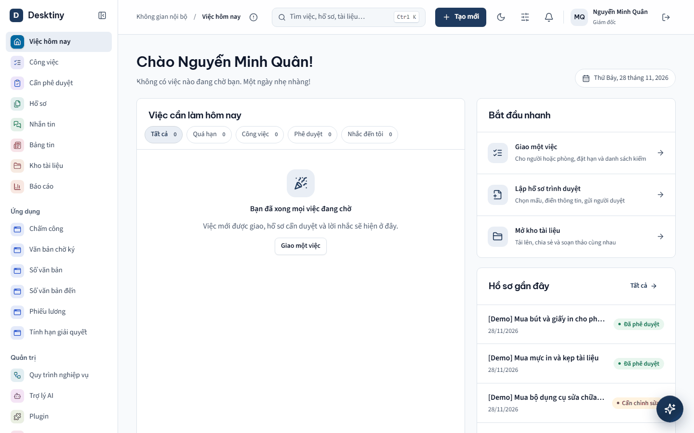</td>
    <td>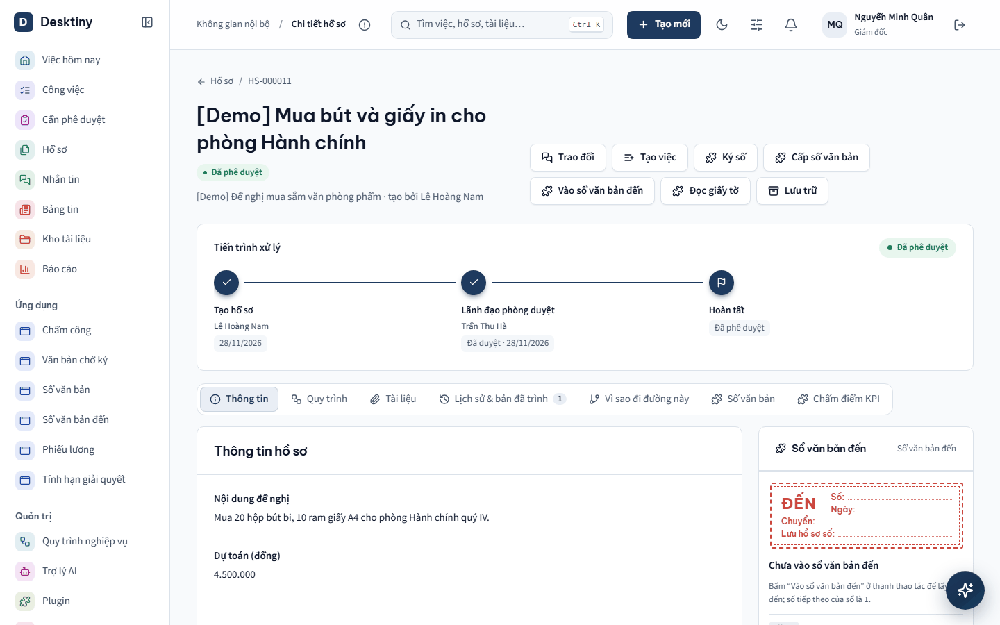</td>
  </tr>
  <tr>
    <th>Quản trị kéo thả quy trình rồi chạy thử với dữ liệu mẫu</th>
    <th>Lãnh đạo xem việc quá hạn và hồ sơ theo trạng thái</th>
  </tr>
  <tr>
    <td>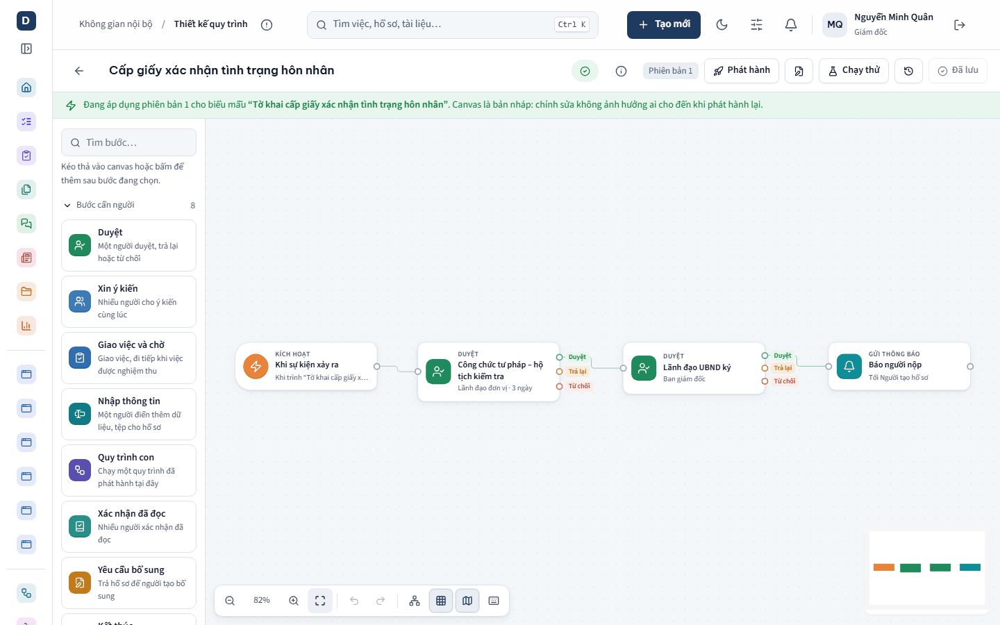</td>
    <td>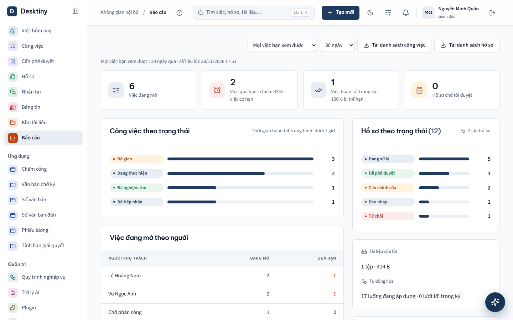</td>
  </tr>
  <tr>
    <th>Trưởng phòng giao việc cho người hoặc cả phòng, theo dõi đến khi xong</th>
    <th>Văn thư tìm tài liệu có phiên bản, chia sẻ theo thư mục</th>
  </tr>
  <tr>
    <td>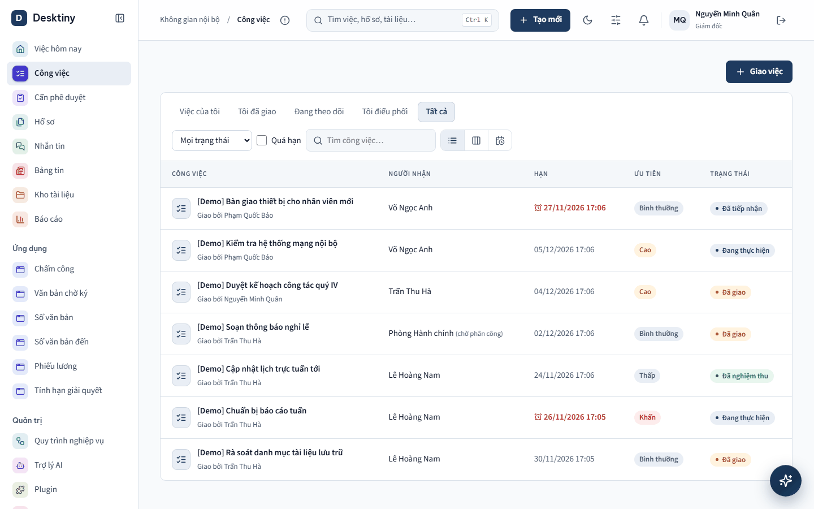</td>
    <td>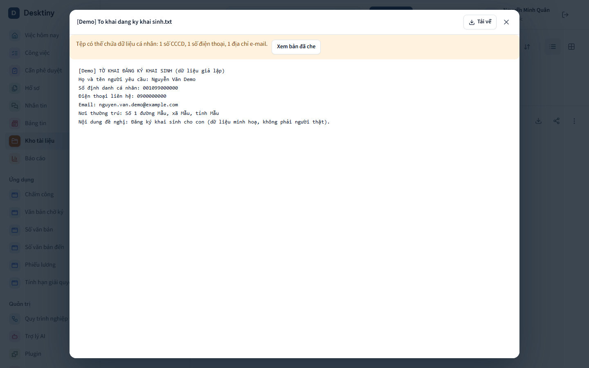</td>
  </tr>
  <tr>
    <th>Cả cơ quan đọc thông báo trên bảng tin</th>
    <th>Mọi người đăng nhập một lần qua Keycloak</th>
  </tr>
  <tr>
    <td>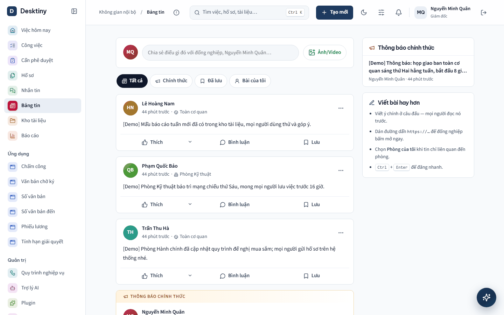</td>
    <td>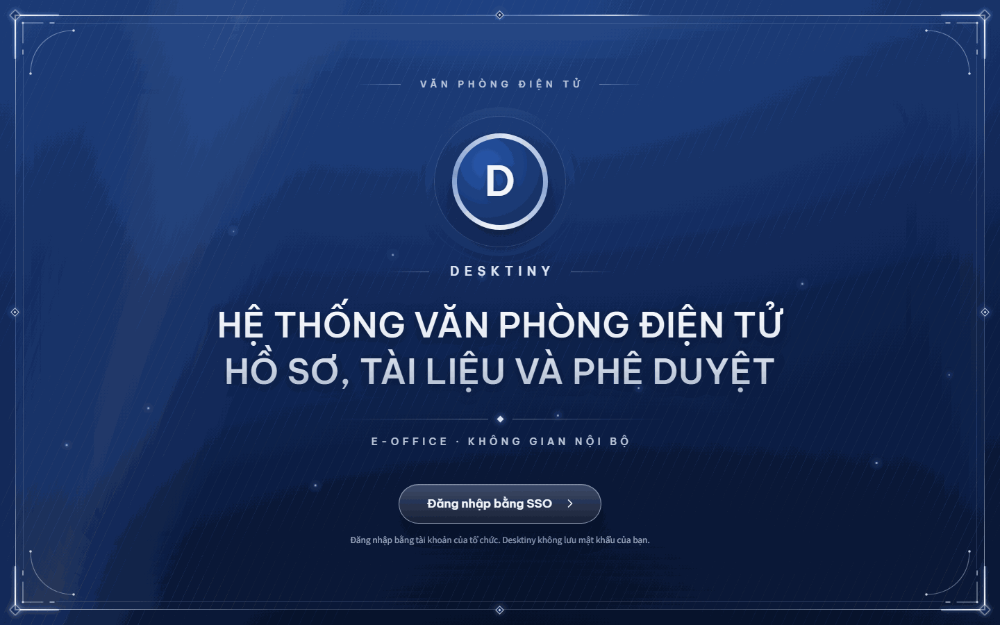</td>
  </tr>
</table>

<p align="center">
  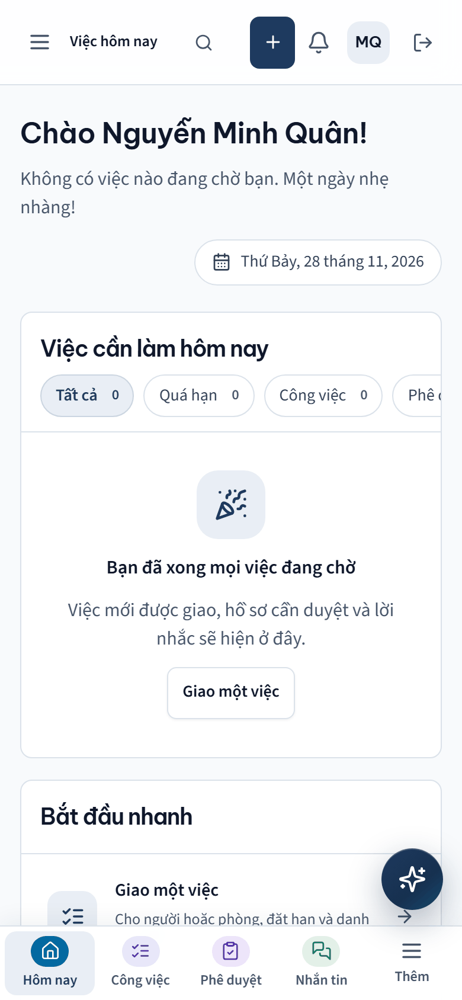<br>
  <sub>Nhân viên xem việc trên điện thoại bằng bản web</sub>
</p>

<sub>Mọi ảnh: dữ liệu mẫu giả. Nguồn gốc ảnh: [docs/images/README.md](docs/images/README.md). Mô tả đầy đủ và phạm vi
từng tính năng: [docs/tinh-nang.md](docs/tinh-nang.md); tính năng AI: [docs/ai-features.md](docs/ai-features.md).</sub>

## Kiến trúc

<p align="center">
  
</p>

<details>
<summary>Sơ đồ dạng chữ (Mermaid)</summary>

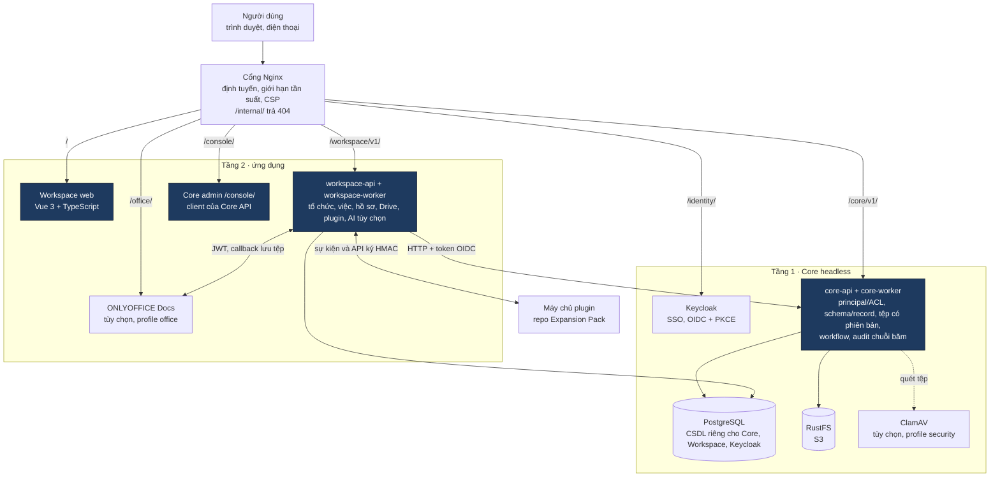

</details>

Khối nền xanh đậm là mã của dự án; các khối còn lại là phần mềm nguồn mở dùng nguyên bản từ image chính thức. Màu
mũi tên: xanh dương là yêu cầu/phản hồi, xanh lá là ghi dữ liệu, nâu vàng là sự kiện, tím là tệp; nét đứt là tùy chọn.

1. Mọi yêu cầu đi qua cổng Nginx (ở cấu hình dev chỉ mở `127.0.0.1:8080`). Cổng chia đường theo tiền tố, giới hạn
   tần suất, gắn CSP và trả 404 cho `/internal/`.
2. Đăng nhập qua Keycloak (OIDC code flow, PKCE). Trình duyệt chỉ giữ cookie phiên do backend cấp, không giữ token.
3. `workspace-api` gọi Core qua HTTP bằng token OIDC (client dịch vụ hoặc thay mặt người dùng); Core vẫn kiểm ACL.
   Ba CSDL tách riêng, không có khóa ngoại hay SQL xuyên tầng.
4. Core lưu record trong PostgreSQL và byte tệp trong RustFS, mỗi phiên bản kèm SHA-256. Khi đặt `CLAMAV_HOST`, Core
   quét tệp trước khi lưu; quét lỗi thì từ chối tệp.
5. `core-worker` đẩy các lượt chạy workflow. `workspace-worker` xử lý outbox: khởi chạy quy trình, đồng bộ quyền
   tệp sang Core, gửi sự kiện plugin, webhook, email.
6. Core admin là ứng dụng web tĩnh gọi thẳng `/core/v1/` như mọi client khác. ONLYOFFICE chỉ nói chuyện với
   `workspace-api` (ký JWT).

### Dữ liệu nằm ở đâu

<p align="center">
  
</p>

Mỗi loại dữ liệu có đúng một nơi sở hữu ([docs/architecture.md](docs/architecture.md), mục *Nguồn sự thật*). Dữ
liệu của plugin kết nối không nằm trong CSDL của Desktiny mà trong volume của máy chủ plugin, nên cần sao lưu riêng.

| Yêu cầu bắt buộc của đề | Thành phần | Cấu hình, mã |
|---|---|---|
| Core headless ở Tầng 1, không có giao diện | `core-api`, `core-worker` | [`services/core-api`](services/core-api), [`contracts/core.openapi.json`](contracts/core.openapi.json) |
| Định danh, SSO | Keycloak 26.2.5, realm sinh bởi bootstrap | [`scripts/bootstrap.py`](scripts/bootstrap.py), [`infra/identity`](infra/identity) |
| API Gateway | Nginx 1.28.0 | [`infra/gateway/nginx.conf`](infra/gateway/nginx.conf) |
| Dữ liệu có cấu trúc | Schema/record có phiên bản, PostgreSQL | [`dx_core/models.py`](services/core-api/src/dx_core/models.py), `/core/v1/schemas`, `/core/v1/records` |
| Dữ liệu phi cấu trúc | Tệp có phiên bản, RustFS (S3) | [`dx_core/storage.py`](services/core-api/src/dx_core/storage.py), `/core/v1/storage/*` |
| Workflow | Engine đồ thị, run, human task | [`dx_core/workflow.py`](services/core-api/src/dx_core/workflow.py), [`packages/flowkit`](packages/flowkit) |
| Ít nhất một ứng dụng H-P-D-I | Workspace | [`apps/workspace-web`](apps/workspace-web), [`services/workspace-api`](services/workspace-api) |
| Triển khai | Docker Compose, image ghim phiên bản | [`infra/compose/compose.yaml`](infra/compose/compose.yaml) |

Core chạy độc lập khi tắt Workspace: profile `core` cùng client mẫu [`examples/core-client`](examples/core-client).
Chi tiết: [docs/architecture.md](docs/architecture.md).

## Luồng nghiệp vụ

Một hồ sơ trình duyệt đi từ đầu đến cuối:

<p align="center">
  
</p>

<details>
<summary>Sơ đồ dạng chữ (Mermaid)</summary>

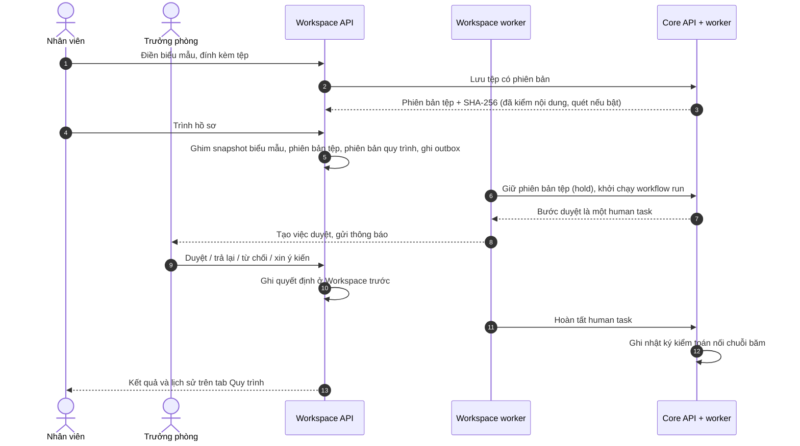

</details>

Sơ đồ động đánh số mười bước theo thời gian; danh sách dưới đây gom các bước theo dịch vụ thực hiện.

1. **Lưu tệp** (`workspace-api` → `core-api`): Core kiểm đuôi, chữ ký nội dung, giới hạn giải nén, quét ClamAV khi
   bật; tệp `.exe` bị từ chối `unsupported_file_type`.
2. **Trình** (`workspace-api`): ghim snapshot nên sửa nháp sau đó không làm đổi bản đã trình; việc khởi chạy ghi vào
   outbox trong cùng giao dịch.
3. **Khởi chạy** (`workspace-worker` → `core-api`): đặt hold lên phiên bản tệp đã trình rồi tạo run;
   `core-worker` đẩy run tới bước cần người quyết định.
4. **Giao việc duyệt** (`workspace-worker`): mỗi human task của Core thành một việc trong *Cần phê duyệt* của đúng
   người, kèm thông báo.
5. **Quyết định** (`workspace-api` → `workspace-worker` → `core-api`): quyết định ghi ở Workspace trước, rồi mới hoàn
   tất human task. Người dùng không gọi được Core để tự đặt hồ sơ thành *đã duyệt*.
6. **Thu hồi**: chỉ người tạo, chỉ khi hồ sơ đang trình và chưa ai ra quyết định (`case_already_decided`); run trên
   Core bị hủy theo.

## Bản mở rộng

Repo [Desktiny Expansion Pack](https://github.com/Dking2007/Desktiny_expansion_pack) chứa các **bản mở rộng**: mỗi
bản gồm một [gói giao diện](docs/packs.md) và các [plugin](docs/plugins.md). Quản trị viên cài tệp `.zip` ở
**Quản trị › Gói giao diện** và **Quản trị › Plugin**; Core không đổi một dòng mã.

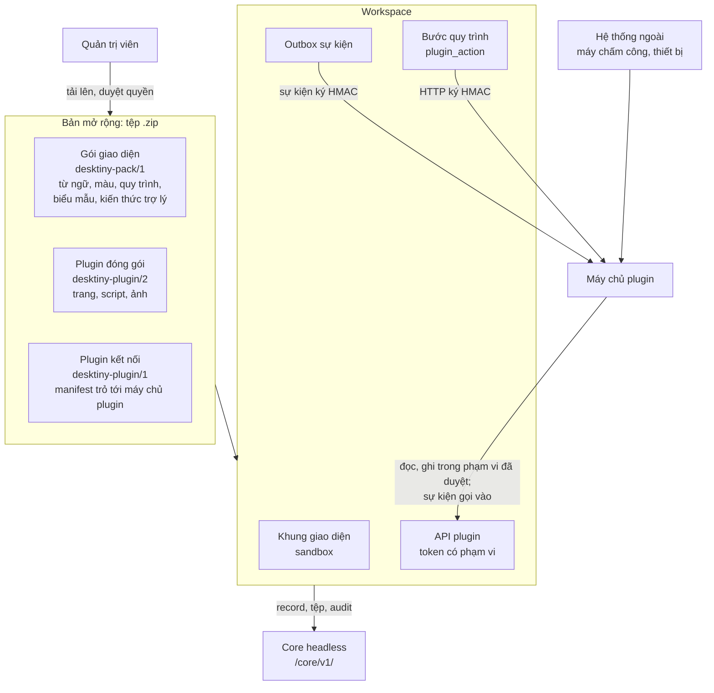

1. Quản trị viên tải `.zip` lên, xem trước, rồi **duyệt quyền**: chỉ những phạm vi, sự kiện, trường ghi mà plugin xin.
2. Gói giao diện và plugin đóng gói chạy ngay trong Workspace; trang của plugin luôn nằm trong khung `sandbox`.
3. Sự kiện nghiệp vụ (hồ sơ được duyệt, việc quá hạn…) đi qua outbox, ký HMAC, gửi lại khi máy chủ plugin lỗi.
4. Máy chủ plugin gọi lại API plugin bằng token; phạm vi luôn là giao của quyền đã duyệt và phạm vi của token, mọi lời
   gọi ghi vào nhật ký plugin.
5. Bước `plugin_action` trong quy trình gọi máy chủ plugin (ký HMAC) và đợi kết quả để rẽ nhánh.
6. Hệ thống ngoài không gọi thẳng Desktiny; chúng đi qua máy chủ plugin, plugin tự xác thực phía nó.

| Bản mở rộng | Dành cho | Plugin đi kèm |
|---|---|---|
| **Một cửa cấp xã** | Bộ phận một cửa của UBND cấp xã: hộ tịch, chứng thực, hòa giải | Sổ văn bản, Ký số, Tiếp nhận trực tuyến, Tính hạn, Đọc giấy tờ |
| **Nhân sự doanh nghiệp** | Bộ phận nhân sự: quy trình đơn từ, quy chế cho trợ lý | Chấm công GPS, Tiền lương và KPI, Nhắc hạn hồ sơ |
| **Văn thư – điều hành** | Văn thư, văn phòng: văn bản đến, văn bản đi, nộp lưu | Sổ văn bản đến; dùng chung Sổ văn bản, Ký số, Tính hạn |
| **Vận hành – giám sát thiết bị** | Thiết bị gửi số đo qua HTTP; vượt ngưỡng thì luồng tạo hồ sơ sự cố, giao người phụ trách | Cảm biến thiết bị |
| **Quản trị dữ liệu** (minh họa) | Hồ sơ đã kết thúc chép ra tệp JSONL theo tháng, nối chuỗi sha256, che dữ liệu cá nhân, truy về hồ sơ gốc; đánh dấu tháng cần chuyển kho lạnh | Lưu trữ lịch sử |

Đây là bản mẫu: tên cơ quan là tên giả, thời hạn và mức tiền chỉ để minh họa, ký số là mô phỏng. **Tương thích:** bản
mở rộng 1.1.0 cần Desktiny **3.1.0** trở lên.

<table>
  <tr>
    <th width="50%">Quản trị cài gói <code>.zip</code>, xem trước rồi bật</th>
    <th width="50%">Sau khi cài “Một cửa cấp xã”: từ ngữ, màu và quy trình đổi theo bộ phận một cửa</th>
  </tr>
  <tr>
    <td>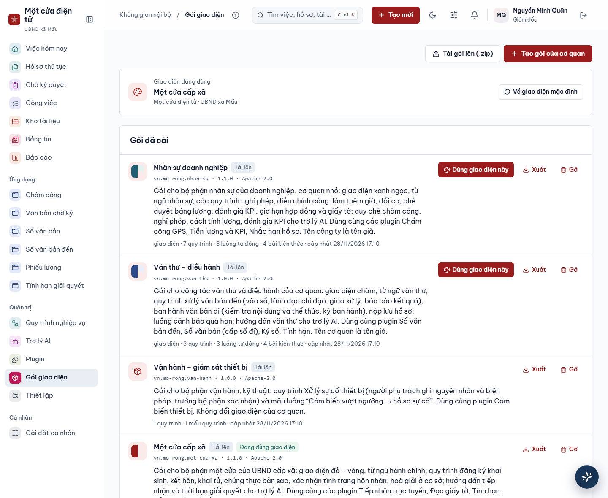</td>
    <td>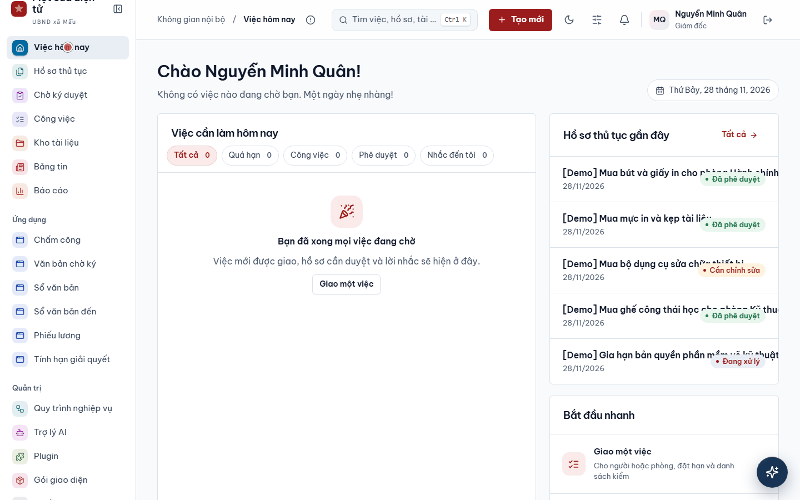</td>
  </tr>
</table>

<sub>Dữ liệu mẫu giả.</sub>

## Bốn nguyên lý kỹ thuật

Đề yêu cầu nền tảng xây trên bốn nguyên lý. Bảng ghi cái đã có, cách tự kiểm và cái còn thiếu. Lệnh `pytest` chạy ở
thư mục gốc sau khi cài `requirements-dev.txt`. Hai plugin minh họa cho (i), (ii), (iii) nằm ở nhánh
`tich-hop/olp-2026-11-28` của repo Expansion Pack, chưa có trong bản phát hành 1.1.0.

| Nguyên lý | Đã có | Cách kiểm | Còn thiếu |
|---|---|---|---|
| (i) Vòng đời dữ liệu, đẩy dữ liệu lịch sử xuống hồ dữ liệu | Tệp và record có phiên bản; hold giữ phiên bản tệp đã trình; `scripts/backup.py`, `restore.py` có manifest SHA-256. Plugin `luu-tru-lich-su` chép hồ sơ đã duyệt/kết thúc ra tệp JSONL theo tháng, đánh dấu tháng cần chuyển kho lạnh | `python -m pytest -q tests/test_backup_restore.py`; trong repo Expansion Pack: `pytest tests/test_luu_tru_lich_su.py` | Chưa có hồ dữ liệu thật, plugin chỉ là bản minh họa; chưa có chính sách xóa hay lưu trữ tự động theo thời hạn |
| (ii) Hội tụ IT/OT, dữ liệu cảm biến | Plugin `cam-bien` (bản mở rộng Vận hành): thiết bị gửi số đo qua HTTP với khóa riêng, vượt ngưỡng phát sự kiện, quy trình tạo hồ sơ sự cố | Trong repo Expansion Pack: `pytest tests/test_cam_bien.py`; giả lập thiết bị `scripts/gia_lap_cam_bien.py` | Chưa có MQTT, OPC-UA, CSDL chuỗi thời gian |
| (iii) Nguồn gốc, phả hệ, chất lượng dữ liệu | Phiên bản tệp có SHA-256 và tác giả; vết quyết định từng lượt chạy (`/workflow-runs/{id}/decision-traces`); nhật ký Core nối chuỗi băm; plugin lưu trữ ghi nguồn, phiên bản và chuỗi sha256 cho từng bản lưu | `python -m pytest -q services/core-api/tests/test_audit_chain.py`; `GET /core/v1/audit-logs/verify` bằng token quản trị | Chưa có đồ thị phả hệ giữa các tập dữ liệu, chưa có chỉ số chất lượng; chuỗi băm không chống được người ghi lại toàn bảng |
| (iv) Zero-Trust, GitOps, quét mã độc ở biên | OIDC cho mọi API, ACL theo tài nguyên, mặc định từ chối; gateway chặn `/internal/`, giới hạn tần suất, CSP; kiểm nội dung tệp, ClamAV tùy chọn; TOTP bắt buộc cho tài khoản `lanh-dao-mfa`; CI và phát hành chạy từ kho, kèm `SHA256SUMS` | `python -m pytest -q services/core-api/tests/test_storage_inspection.py services/core-api/tests/test_malware_scan.py`; khi stack chạy: `curl -i http://localhost:8080/internal/x` trả 404 | Chưa có mTLS giữa dịch vụ, chưa có công cụ GitOps đồng bộ triển khai (Argo CD, Flux); MFA chưa bắt buộc cho mọi người; tệp đã lưu không được quét lại khi có chữ ký mới |

Đối chiếu từng yêu cầu của đề với mã nguồn: [docs/doi-chieu-de-thi.md](docs/doi-chieu-de-thi.md). Tự rà soát theo tiêu
chí PoF: [SELF_REVIEW.md](SELF_REVIEW.md).

## Công nghệ và giấy phép

Phiên bản lấy từ `THIRD_PARTY.md`, `requirements.lock`, `package-lock.json` và tag image trong
[`compose.yaml`](infra/compose/compose.yaml).

| Lớp | Thành phần | Phiên bản | Giấy phép (SPDX) | Vai trò trong Desktiny | Cách dùng |
|---|---|---|---|---|---|
| Định danh | Keycloak | 26.2.5 | Apache-2.0 | SSO, OIDC + PKCE, TOTP | dịch vụ riêng |
| Định danh | PyJWT · cryptography | 2.10.1 · 46.0.2 | MIT · Apache-2.0 OR BSD-3-Clause | Kiểm token, mã hóa khóa lưu trữ | thư viện pip |
| Cổng | Nginx | 1.28.0 | BSD-2-Clause | Định tuyến, giới hạn tần suất, CSP | dịch vụ riêng |
| Dữ liệu | PostgreSQL | 17.5 | PostgreSQL | CSDL của Core, Workspace, Keycloak | dịch vụ riêng |
| Dữ liệu | RustFS | 1.0.3 | Apache-2.0 | Lưu byte tệp, giao thức S3 | dịch vụ riêng |
| Dữ liệu | Valkey | 8.1.1 | BSD-3-Clause | Cấp sẵn cho hàng đợi, cache; mã hiện chưa dùng | dịch vụ riêng |
| Dữ liệu | SQLAlchemy · Alembic | 2.0.43 · 1.16.5 | MIT | ORM, migration | thư viện pip |
| Dữ liệu | psycopg | 3.2.10 | LGPL-3.0-only | Driver PostgreSQL | thư viện pip, liên kết động, không sửa |
| Dữ liệu | boto3 | 1.40.44 | Apache-2.0 | Core gọi kho S3 | thư viện pip |
| Dịch vụ | Python | 3.13.5 | PSF-2.0 | Runtime của API | image nền |
| Dịch vụ | FastAPI · Starlette · Uvicorn | 0.118.0 · 0.48.0 · 0.37.0 | MIT · BSD-3-Clause · BSD-3-Clause | `core-api`, `workspace-api` | thư viện pip |
| Quy trình | dx-flowkit (của dự án) | 0.2.0 | Apache-2.0 | Kiểm và chạy đồ thị quy trình | gói trong kho |
| Quy trình | jsonschema | 4.25.1 | MIT | Kiểm dữ liệu biểu mẫu | thư viện pip |
| Giao diện | Vue · Vue Router · Pinia | 3.5.44 · 4.5.0 · 2.3.1 | MIT | Workspace web, Core admin | thư viện npm |
| Giao diện | TanStack Vue Query · Vue Flow | 5.66.0 · 1.48.2 | MIT | Gọi API có cache; canvas quy trình | thư viện npm |
| Giao diện | pdfjs-dist · lucide-vue-next | 4.10.38 · 0.468.0 | Apache-2.0 · ISC | Xem PDF; icon | thư viện npm |
| Giao diện | Be Vietnam Pro · Source Sans 3 | 5.1.1 | OFL-1.1 | Phông chữ, tự phục vụ | thư viện npm |
| Tài liệu | ONLYOFFICE Docs | 8.3.3 | AGPL-3.0-only | Sửa tệp Office | tùy chọn, mặc định tắt, dịch vụ riêng |
| Tài liệu | pypdf | 6.20.1 | BSD-3-Clause | Đọc chữ trong PDF | thư viện pip |
| An ninh | ClamAV | 1.4.3 | GPL-2.0-only | Quét mã độc tệp tải lên | tùy chọn, mặc định tắt, dịch vụ riêng |
| An ninh | dx-piivn (của dự án) | 0.1.0 | Apache-2.0 | Phát hiện, che dữ liệu cá nhân trong tệp | gói trong kho |
| Trí tuệ | anthropic · httpx | 2.3.0 · 0.28.1 | Apache-2.0 · BSD-3-Clause | Gọi dịch vụ AI do quản trị khai | thư viện pip, tính năng mặc định tắt |
| Mở rộng | desktiny-plugin (của dự án) | 0.3.0 | Apache-2.0 | SDK và CLI kiểm plugin | gói trong kho |
| Vận hành | Node.js | 22.17.0 | MIT | Build frontend | chỉ lúc build |
| Công cụ (không đi vào sản phẩm) | Vite · TypeScript · Vitest · Playwright · ESLint | 6.4.4 · 5.7.3 · 4.1.11 · 1.64.1 · 9.39.5 | MIT · Apache-2.0 · MIT · Apache-2.0 · MIT | Build, kiểm kiểu, test, E2E, lint | thư viện npm |
| Công cụ (không đi vào sản phẩm) | pytest · ruff | 8.4.2 · 0.13.3 | MIT | Test, lint Python | thư viện pip |

Mọi thành phần dùng giấy phép được OSI phê duyệt; không có mã bên thứ ba nào được chép vào kho. Thành phần copyleft
được cô lập: ONLYOFFICE (AGPL-3.0) và ClamAV (GPL-2.0) chạy container riêng, mặc định tắt, chỉ nói chuyện qua
HTTP/JWT và socket TCP; psycopg (LGPL-3.0) dùng như thư viện liên kết động, không sửa. Danh sách đầy đủ (63 gói
Python, 67 gói npm chạy trong sản phẩm, 243 gói npm chỉ để build và test): [THIRD_PARTY.md](THIRD_PARTY.md),
[NOTICE](NOTICE).

## Dùng thử nhanh

Chạy ở thư mục gốc kho:

```bash
python scripts/bootstrap.py                    # 1. sinh .env, realm Keycloak và mật khẩu ngẫu nhiên tại máy
docker compose --env-file .env -f infra/compose/compose.yaml --profile workspace up --build -d   # 2. dựng stack
python scripts/seed.py --confirm-demo          # 3. tổ chức mẫu: vai trò, hai phòng, người dùng demo
python scripts/seed_demo.py --confirm-demo     # 4. (tùy chọn) hồ sơ, việc, bảng tin, tin nhắn, tài liệu minh họa
```

| Yêu cầu hệ thống | Mức |
|---|---|
| Docker Engine + Compose v2 | Bắt buộc |
| Python | 3.13 (bootstrap và seed chỉ dùng thư viện chuẩn) |
| RAM | ≥ 6 GB; bật ONLYOFFICE nên ≥ 8 GB; ClamAV cần thêm khoảng 1–1,5 GB |
| Đĩa trống | ≥ 8 GB |
| Cổng | `8080` (đổi bằng `--base-url` khi bootstrap) |

Mật khẩu từng tài khoản nằm trong `infra/identity/generated/demo-credentials.txt` trên máy bạn; kho không chứa mật
khẩu cố định. Dữ liệu seed là dữ liệu giả có ghi nhãn.

| Tài khoản | Vai trò | Nên thử |
|---|---|---|
| `staff` | Nhân viên phòng Hành chính | Tạo hồ sơ, trình, xem tab *Quy trình*; tải tệp lên Kho tài liệu |
| `manager` | Trưởng phòng Hành chính | *Cần phê duyệt*: duyệt hoặc trả lại; giao việc cho phòng |
| `director` | Giám đốc | Trang Báo cáo: việc quá hạn, hồ sơ theo trạng thái |
| `staff-b`, `manager-b` | Phòng Kỹ thuật | Kiểm tra cách ly: không thấy hồ sơ, tài liệu chưa được chia sẻ |
| `technical-admin` | Quản trị kỹ thuật | Core admin `/console/`, nhật ký hệ thống |
| `lanh-dao-mfa` | Phó giám đốc | Lần đăng nhập đầu bị bắt cài TOTP |

| Địa chỉ (sau gốc `http://localhost:8080`) | Là gì | Cần đăng nhập |
|---|---|---|
| `/` | Workspace web | Có |
| `/console/` | Core admin | Có |
| `/core/v1/docs` | OpenAPI của Core | Xem không cần; gọi API cần token |
| `/identity/admin/` | Keycloak admin (tài khoản trong `demo-credentials.txt`) | Có |
| `/office/` | ONLYOFFICE, khi bật profile `office` | Qua Workspace |

Kịch bản demo 15 phút: [docs/demo.md](docs/demo.md).

## Demo

Chưa có bản chạy trực tuyến; chạy theo [Dùng thử nhanh](#dùng-thử-nhanh).

<table>
  <tr>
    <th width="50%">Nhân viên trình hồ sơ, trưởng phòng duyệt, nhật ký ghi lại</th>
    <th width="50%">Quản trị vẽ quy trình mới và chạy thử</th>
  </tr>
  <tr>
    <td>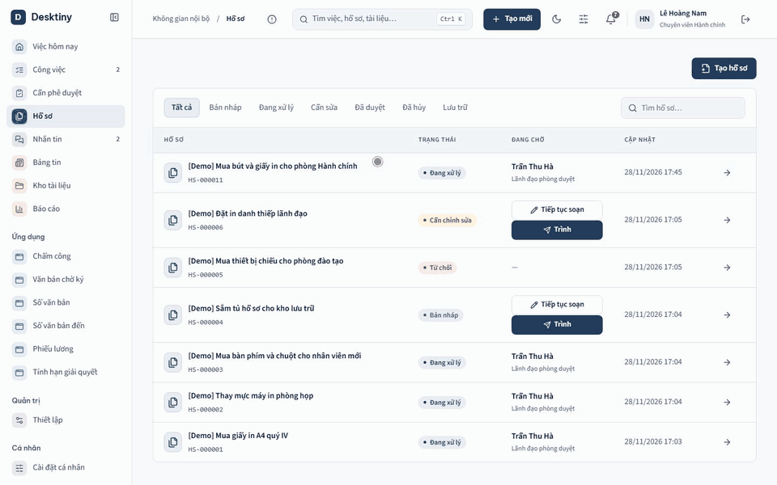</td>
    <td>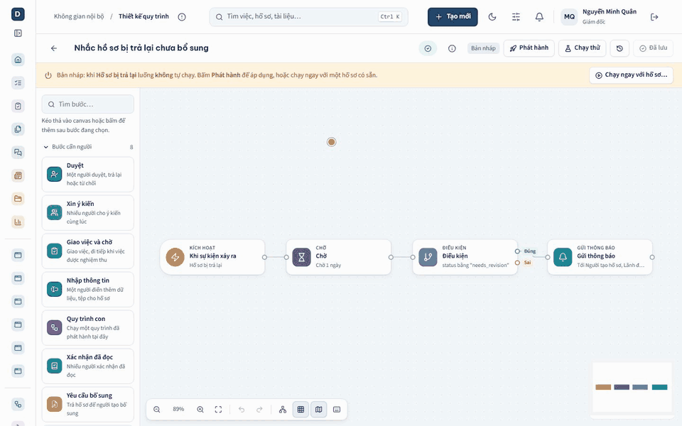</td>
  </tr>
  <tr>
    <th>Cài một bản mở rộng, Desktiny đổi sang nghiệp vụ một cửa</th>
    <th>Người dân nộp hồ sơ trực tuyến, bộ phận một cửa tiếp nhận</th>
  </tr>
  <tr>
    <td>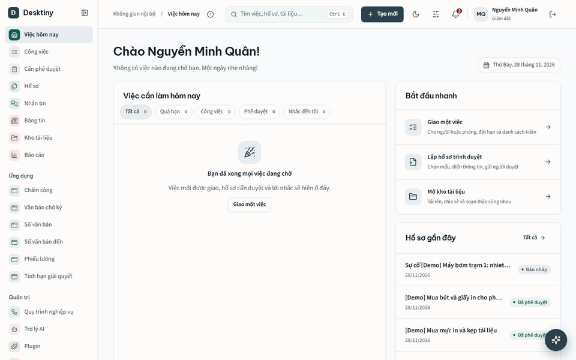</td>
    <td>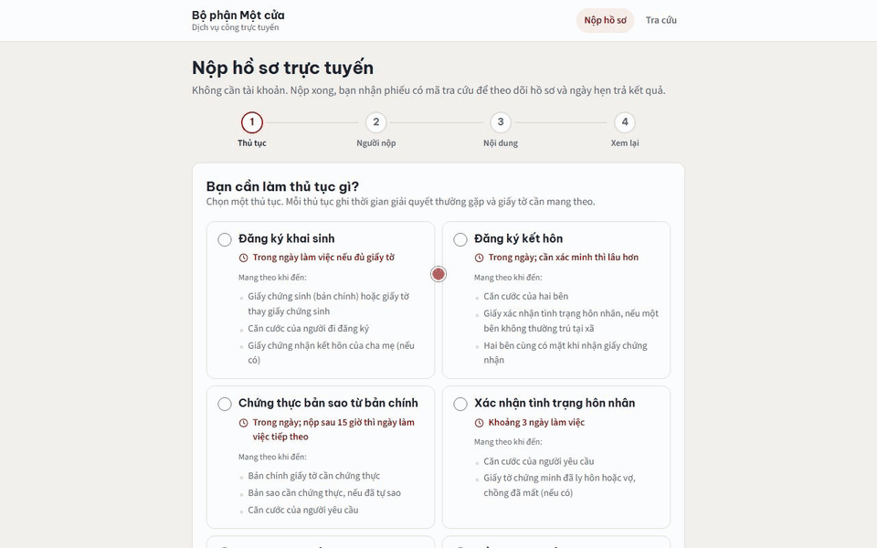</td>
  </tr>
</table>

<sub>Dữ liệu mẫu giả.</sub>

## Cài đặt

Hướng dẫn đầy đủ (Ubuntu, Windows, Docker và chạy cục bộ): [docs/installation.md](docs/installation.md). Biên dịch
từ mã nguồn và cài bằng `make venv deps build test install PREFIX=…`: [BUILD.md](BUILD.md).

<details>
<summary>Đổi cổng, bật ONLYOFFICE, bật ClamAV, chỉ chạy Core</summary>

- **Đổi cổng:** chạy bootstrap ngay từ đầu với `python scripts/bootstrap.py --base-url http://localhost:8090`.
  Bootstrap từ chối ghi đè cấu hình đã có; không dùng nó để provision production.
- **ONLYOFFICE:** đổi `ONLYOFFICE_ENABLED=true` trong `.env`, rồi chạy
  `docker compose --env-file .env -f infra/compose/compose.yaml --profile workspace --profile office up -d`.
  Chờ Document Server sẵn sàng rồi mở tài liệu từ Kho tài liệu. Khi chưa bật, editor không hoạt động.
- **ClamAV:** đặt `CLAMAV_HOST=clamav` trong `.env`, thêm `--profile security`. Khi đã đặt, tải tệp lên phụ thuộc
  ClamAV: quét lỗi thì từ chối tệp ([docs/security.md](docs/security.md)).
- **Chỉ Core:** `docker compose --env-file .env -f infra/compose/compose.yaml --profile core up --build -d`. Core
  **không có giao diện**: gateway chỉ phục vụ API `/core/v1/` (tài liệu ở `/core/v1/docs`) và `/identity/`; `/` và
  `/console/` trả 404. Thử Core bằng [`examples/core-client`](examples/core-client): client `core-example` dùng
  namespace `equipment`, secret `CORE_EXAMPLE_CLIENT_SECRET` trong `.env`. Muốn có công cụ quản trị kỹ thuật Core
  admin (client riêng của Core API, Tầng 2) thì thêm `--profile console`.

</details>

<details>
<summary>Phát triển local</summary>

Cần Python 3.13 và Node.js 22. Backend vẫn cần PostgreSQL, Keycloak và S3 cho tích hợp thật.

```bash
python -m venv .venv            # rồi kích hoạt: .venv/Scripts/activate (Windows) hoặc .venv/bin/activate
python -m pip install -r requirements-dev.txt
npm ci
# Mỗi backend chạy từ thư mục service, DATABASE_URL riêng:
#   services/core-api:      python -m alembic upgrade head && python -m uvicorn dx_core.main:app --port 8001
#   services/workspace-api: python -m alembic upgrade head && python -m uvicorn dx_workspace.main:app --port 8002
npm run dev --workspace apps/workspace-web
```

</details>

<details>
<summary>Xử lý sự cố</summary>

| Hiện tượng | Nguyên nhân và cách xử lý |
|---|---|
| Cổng 8080 đã bị chiếm | Xóa `.env` và `infra/identity/generated/`, chạy lại `python scripts/bootstrap.py --base-url http://localhost:8090` |
| API chưa `healthy`, đăng nhập lỗi lúc mới dựng | Keycloak còn đang import realm; chờ rồi đọc `docker compose … logs identity core-migrate workspace-migrate` |
| Seed báo "Run bootstrap first" | Thiếu `.env` hoặc `demo-users.json`; chạy bootstrap trước |
| Đăng nhập lỗi sau khi sinh lại secret | Realm và CSDL cũ giữ secret cũ; bootstrap không xoay dữ liệu đã lưu |
| Postgres không tạo CSDL trên Windows | Bản clone cũ đổi `init-databases.sh` sang CRLF; kho hiện ép LF qua `.gitattributes`, hãy clone lại |
| Tải tệp lên báo `scan_unavailable` | Đã đặt `CLAMAV_HOST` nhưng ClamAV chưa sẵn sàng (lần đầu tải chữ ký mất vài phút) |
| Editor Office không lưu | Phân biệt URL công khai của trình duyệt và URL nội bộ container ([docs/installation.md](docs/installation.md)) |

</details>

## Kiểm thử

| Lệnh | Kiểm gì | Cần gì |
|---|---|---|
| `python -m ruff check packages services scripts tests examples infra` | Lint Python | `requirements-dev.txt` |
| `python -m pytest -q` | Core, Workspace, flowkit, script | `requirements-dev.txt`; test PostgreSQL thật cần `DX_TEST_POSTGRES_URL` |
| `npm run lint && npm run typecheck && npm run test && npm run build` | ESLint, vue-tsc, Vitest, build | `npm ci` |
| `npm run test:e2e` | Playwright E2E có đăng nhập | Stack đang chạy và đã seed |
| `node scripts/add_spdx_headers.mjs --check` · `reuse lint` | Header SPDX, chuẩn REUSE | Node.js; công cụ `reuse` |
| `node scripts/gen_third_party.mjs && git diff --exit-code THIRD_PARTY.md` | `THIRD_PARTY.md` khớp lockfile | `npm ci` |

CI ([`ci.yml`](.github/workflows/ci.yml)) chạy các bước trên (trừ E2E) cho mỗi lần đẩy và PR. Test doubles kiểm được
logic nhưng không thay nghiệm thu với PostgreSQL, SSO, Office thật hay cài sạch: [docs/acceptance.md](docs/acceptance.md).

## Giới hạn

- **Pilot:** Compose trong kho là cấu hình phát triển, không phải production; chưa cam kết hiệu năng, RPO/RTO khi chưa đo.
- **Một tổ chức** mỗi bản triển khai; chưa có SaaS đa tổ chức, chưa hỗ trợ một người thuộc nhiều đơn vị.
- **Chưa có chữ ký số có giá trị pháp lý.** Quyền phê duyệt và nhật ký kiểm toán không thay chữ ký số; plugin Ký số
  trong bản mở rộng Một cửa là mô phỏng.
- **Chưa có ứng dụng di động native**; trên điện thoại dùng bản web.
- **Quét mã độc là tùy chọn**, mặc định tắt (profile `security`, biến `CLAMAV_HOST`); khi bật, lỗi quét thì từ chối
  tệp. Chỉ quét lúc tải lên, tệp đã lưu không được quét lại khi có chữ ký mới.
- **MFA mới bắt buộc cho một tài khoản demo** (`lanh-dao-mfa`); các tài khoản demo khác không có yếu tố thứ hai để seed
  và e2e chạy được. Production cần bật MFA cho vai trò lãnh đạo, quản trị (xem [docs/security.md](docs/security.md)).
- **Cảm biến** chỉ nhận số đo qua HTTP, chưa có MQTT, OPC UA hay cơ sở dữ liệu chuỗi thời gian; **lưu trữ lịch sử** là
  tệp JSONL minh họa, không phải data lake.
- **Cảnh báo dữ liệu cá nhân** chỉ là gợi ý, không phải công cụ chống rò rỉ dữ liệu (DLP).
- **AI cần dịch vụ bên ngoài** (Claude, OpenAI, Gemini, DeepSeek) hoặc máy chủ AI riêng (Ollama, vLLM) do tổ chức
  cấu hình. Đã kiểm bằng dịch vụ giả và một lần chạy thật với Ollama (31/10/2026); chưa thử với Claude, OpenAI,
  Gemini thật.
- Nhắn tin và thông báo cập nhật bằng polling, chưa có WebSocket; công việc chưa có Gantt hay lịch tháng; luồng tự
  động chưa có node vòng lặp hay connector OAuth2.
- **Lỗi đã biết:** quy trình có nhánh kết thúc ở bước không phải *Kết thúc* (ví dụ *Gửi thông báo*) vẫn phát hành
  được, và hồ sơ có thể kẹt ở *Đang xử lý* sau khi duyệt. Hướng sửa ở [ROADMAP.md](ROADMAP.md).

## Tài liệu

| Tài liệu | Dành cho |
|---|---|
| [Cài đặt](docs/installation.md) · [Biên dịch](BUILD.md) · [Vận hành, sao lưu, khôi phục](docs/operations.md) · [Bảo mật](docs/security.md) | Quản trị hệ thống |
| [Tính năng chi tiết](docs/tinh-nang.md) · [Tính năng AI](docs/ai-features.md) · [Kịch bản demo](docs/demo.md) | Người dùng, người đánh giá |
| [Quy trình nghiệp vụ, chạy thử, truy vết](docs/process-packages.md) · [Gói giao diện](docs/packs.md) · [Plugin](docs/plugins.md) | Người viết gói, plugin |
| [Kiến trúc](docs/architecture.md) · [Thiết kế gốc](docs/design/Thiet_ke_DX_Workspace_FastAPI_Vue3.md) · [Inventory bên thứ ba](docs/third-party-inventory.md) | Nhà phát triển |
| [Đối chiếu đề thi](docs/doi-chieu-de-thi.md) · [Tự rà soát PoF](SELF_REVIEW.md) · [Nghiệm thu](docs/acceptance.md) | Giám khảo |
| [CHANGELOG](CHANGELOG.md) · [V3 khác V2](docs/V3_CHANGES.md) · [V2 khác V1](docs/V2_CHANGES.md) · [Lộ trình](ROADMAP.md) | Mọi người |

## Đóng góp ngược cho cộng đồng nguồn mở

Trạng thái tại thời điểm ghi (30/10/2026); từng bước, link và kết quả ở
[docs/contribution-log.md](docs/contribution-log.md).

| Việc | Dự án nhận | Trạng thái |
|---|---|---|
| Bổ sung 2 ghi chú còn thiếu cho mục "Migrating to 26.7.5" của hướng dẫn nâng cấp | Keycloak: issue [#53650](https://github.com/keycloak/keycloak/issues/53650), PR [#54464](https://github.com/keycloak/keycloak/pull/54464) | Đã gửi 30/10/2026, chờ người bảo trì xét (chưa merge) |
| Plugin kiểm tra thể thức văn bản hành chính theo Nghị định 30/2020/NĐ-CP ([`plugins/vn-document-format`](plugins/vn-document-format)) | ONLYOFFICE marketplace: [PR #730](https://github.com/ONLYOFFICE/onlyoffice.github.io/pull/730) | Đã gửi 30/10/2026, CLA đã ký, chờ người bảo trì xét |
| `dx-flowkit`: kiểm tra và chạy thử đồ thị quy trình JSON ([`packages/flowkit`](packages/flowkit)) | Gói độc lập tách từ Desktiny | Chưa công bố ngoài kho này (chưa lên PyPI) |
| Lỗi quyền volume khi chạy RustFS non-root | RustFS [#8992](https://github.com/rustfs/rustfs/issues/8992) | Đã xem xét, không gửi: người bảo trì đã tự sửa |

## Đóng góp

1. Mở issue bằng mẫu có sẵn (báo lỗi, đề xuất, phản hồi dùng thử).
2. Tạo nhánh từ `main`: `feat/<số-issue>-<mô-tả>`, `fix/…` hoặc `docs/…`.
3. Mở PR có `Fixes #<số>`, cập nhật `CHANGELOG.md`; một người khác duyệt, người viết không tự duyệt.
4. CI xanh mới merge.

Chi tiết: [CONTRIBUTING.md](CONTRIBUTING.md) · [CODE_OF_CONDUCT.md](CODE_OF_CONDUCT.md) · [SECURITY.md](SECURITY.md) ·
[Milestones](https://github.com/Dking2007/DXOS_Desktiny/milestones) · [ROADMAP.md](ROADMAP.md).

## Đội

Nhóm chọn chỉ công khai tài khoản GitHub. Mảng phụ trách lấy từ lịch sử commit.

| GitHub | Phụ trách chính |
|---|---|
| [Dking2007](https://github.com/Dking2007) | Core headless (nhật ký chuỗi băm, quét mã độc, `dx-flowkit`); biên dịch, CI, phát hành; tuân thủ giấy phép; vận hành (sao lưu, khôi phục, MFA); cảnh báo dữ liệu cá nhân; rà soát trải nghiệm người dùng; đóng góp ngược cho Keycloak và ONLYOFFICE |
| [Raphael-Fug](https://github.com/Raphael-Fug) | Workspace web và design system; quy trình nghiệp vụ và 12 quy trình mẫu; trợ lý và tính năng AI; hồ sơ cá nhân, báo cáo; plugin đóng gói `desktiny-plugin/2` |
| [Mai1174](https://github.com/Mai1174) | Gói giao diện `desktiny-pack/1`; plugin kết nối `desktiny-plugin/1`, API plugin bản 2 và SDK; quy trình hồ sơ vẽ trên canvas |

### Cách nhóm làm việc

1. **Issue trước:** mỗi việc có issue, nhãn và milestone trên [bug tracker](https://github.com/Dking2007/DXOS_Desktiny/issues).
2. **Nhánh riêng** cho từng việc, tạo từ `main`.
3. **Commit nhỏ** theo [Conventional Commits](https://www.conventionalcommits.org/), viết tiếng Việt, mỗi người dùng
   tài khoản của mình ([`.mailmap`](.mailmap) gộp tên hiển thị cũ).
4. **Pull request** có checklist; quy ước là một thành viên khác duyệt chéo.
5. **CI** chạy lint, test, build, kiểm SPDX, REUSE và `THIRD_PARTY.md` trên mỗi PR.
6. **Phát hành** bằng tag `vX.Y.Z`: workflow [`release.yml`](.github/workflows/release.yml) đóng gói `.tar.gz` kèm
   `SHA256SUMS`; từ bản 3.2.0 kiểm thêm số phiên bản theo SemVer và đính kèm SBOM CycloneDX.
7. **Lỗi của dự án thượng nguồn** thì gửi về dự án đó (mục [Đóng góp ngược](#đóng-góp-ngược-cho-cộng-đồng-nguồn-mở)).

## Liên hệ

| Kênh | Dùng cho |
|---|---|
| [Issues](https://github.com/Dking2007/DXOS_Desktiny/issues) | Báo lỗi, đề xuất, phản hồi dùng thử |
| [Báo lỗ hổng riêng tư](https://github.com/Dking2007/DXOS_Desktiny/security/advisories/new) | Lỗ hổng bảo mật, không công khai ([SECURITY.md](SECURITY.md)) |
| [Pull requests](https://github.com/Dking2007/DXOS_Desktiny/pulls) | Gửi mã, tài liệu |

## Giấy phép

Mã nguồn do dự án tự viết phát hành theo **Apache License 2.0** (SPDX: `Apache-2.0`).

- **Vì sao chọn Apache-2.0:** giấy phép OSI rộng rãi, có điều khoản cấp quyền bằng sáng chế, tương thích với toàn bộ
  thư viện dùng trong dự án (MIT/BSD/Apache/MPL/PSF/OFL; psycopg LGPL-3.0 dùng như thư viện liên kết động, không
  sửa). Dịch vụ copyleft tùy chọn (ONLYOFFICE AGPL-3.0, ClamAV GPL-2.0) chạy riêng, không liên kết vào mã.
- Toàn văn: [LICENSE](LICENSE) và [LICENSES/](LICENSES/) theo chuẩn [REUSE](https://reuse.software/). Mỗi tệp mã
  mang header `SPDX-License-Identifier`; tệp không ghi được header khai báo trong [REUSE.toml](REUSE.toml). Bộ quy tắc
  ứng xử dùng CC-BY-4.0 theo bản gốc Contributor Covenant. Kiểm bằng `reuse lint`.
- Thành phần bên ngoài (ONLYOFFICE, RustFS, Keycloak…) giữ giấy phép của họ: [THIRD_PARTY.md](THIRD_PARTY.md),
  [NOTICE](NOTICE). Khi phân phối, rà soát artifact, notice, source offer và trademark đúng bản phát hành.
