[Tiếng Việt](README.md) | English

<p align="center">
  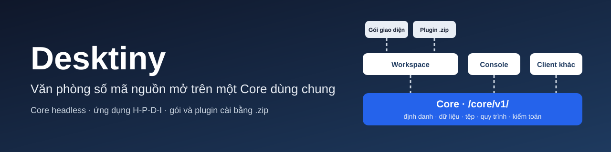
</p>

<p align="center"></p>

<h1 align="center">Desktiny</h1>

<p align="center">
  <b>An open-source digital office: task assignment, case submission and approval, self-designed workflows and documents on one shared Core.</b><br>
  An organisation moves to a new line of business by installing a <code>.zip</code> package, not by rewriting the system.
</p>

<p align="center">
  <a href="LICENSE"></a>
  <a href="https://github.com/Dking2007/DXOS_Desktiny/actions/workflows/ci.yml?query=branch%3Amain"></a>
  <a href="https://github.com/Dking2007/DXOS_Desktiny/releases/latest"></a>
  <a href="https://api.reuse.software/info/github.com/Dking2007/DXOS_Desktiny"></a>
</p>

<p align="center">
  <a href="#quick-start"><b>Quick start</b></a> ·
  <a href="#documentation"><b>Documentation</b></a> ·
  <a href="https://github.com/Dking2007/DXOS_Desktiny/releases"><b>Download a release</b></a> ·
  <a href="https://github.com/Dking2007/Desktiny_expansion_pack"><b>Expansion packs</b></a> ·
  <a href="docs/doi-chieu-de-thi.md"><b>Contest requirements map</b></a> (Vietnamese)
</p>

<p align="center">
  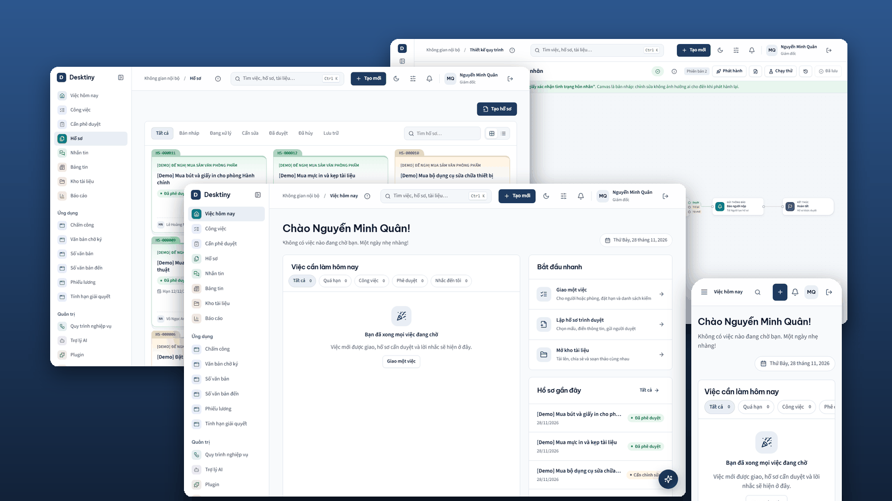
</p>

Entry for the OLP Open Source Software contest 2026, topic: the DX-OS Open-Core digital office platform. Latest
release: **v3.1.0**; changes waiting for 3.2.0 are under `[Unreleased]` in the [CHANGELOG](CHANGELOG.md).
*Desk + destiny*; the former name was DX Workspace, so code, databases and containers still use `dx_workspace` /
`dx-workspace`. The user interface is in Vietnamese only.

> Pilot release. The Compose setup in this repository is a development configuration, not a production one.
> Acceptance results and the steps that still need real services: [docs/acceptance.md](docs/acceptance.md).

[Problem](#problem) · [Users](#users) · [Solution](#solution) · [Features](#key-features) ·
[Architecture](#architecture) · [Business flow](#business-flow) · [Expansion packs](#expansion-packs) ·
[Four principles](#four-technical-principles) · [Technology](#technology-and-licences) · [Quick start](#quick-start) ·
[Demo](#demo) · [Installation](#installation) · [Testing](#testing) · [Limitations](#limitations) ·
[Documentation](#documentation) · [Team](#team) · [Licence](#licence)

## Problem

1. **Nobody knows whose desk a case is on.** A leave request goes out by email; three days later the requester still
   has to ask each department who is holding it.
2. **Data becomes islands.** Administration uses one program, HR a spreadsheet, the records office a paper book;
   accounts, files and processing history cannot be connected.
3. **Every new line of business is a rewrite.** Adding a one-stop intake process means paying for code changes or
   buying yet another system.
4. **Vendor lock-in.** Data sits in closed formats; changing vendor means losing history.

## Users

| Who | Needs | Desktiny provides |
|---|---|---|
| Staff | Know what to do today, submit cases quickly | *Today's work* home page; forms with conditional fields; a *Workflow* tab that shows who the case is waiting for |
| Heads of department, directors | Decide on time, see overdue work | Approve, return, reject, ask for parallel opinions; time-limited approval delegation; overdue reports, CSV export |
| Records office, one-stop desk | Store and find documents, receive applications | Versioned document store with folder sharing; Records and One-stop expansion packs |
| Administrators | Change processes without writing code | Drag-and-drop process designer with test runs on sample data; install `.zip` packs and plugins |
| Pack and plugin authors | Add a line of business without touching the Core | `desktiny-pack/1`, `desktiny-plugin/1` and `/2` formats, the `desktiny-plugin` SDK, a scoped plugin API |

## Solution

Desktiny separates a **shared headless Core** (identity, data, files, workflow, audit log) from the applications
that run on it. The Core has only an API; the Workspace application is one client of the Core like any other.
Each organisation's specific business lives in **interface packs** and **plugins**, installed as `.zip` files.

| Tier | Components | Role |
|---|---|---|
| Tier 1: headless Core (API `/core/v1/` only) | `core-api`, `core-worker`, Keycloak, Nginx gateway, PostgreSQL, RustFS | Principal/ACL, schema/record, versioned files, workflow, audit log |
| Tier 2: user-facing applications | Workspace (`workspace-api`, `workspace-worker`, Vue web) | Organisation, tasks, cases, approvals, documents, messaging, plugins, optional AI |
| Tier 2: technical admin tool | Core admin (`apps/core-admin`, `/console/`) | Only a client of the Core API, holds no Core logic |
| Optional integrations | ONLYOFFICE Docs, ClamAV | Separate services, off by default |

| H-P-D-I space of the brief | In Desktiny |
|---|---|
| H, human collaboration | Tasks, messaging, news feed, unified search |
| P, process | Cases, multi-step approval, canvas-drawn processes, delegation |
| D, data | Versioned document store, reports (partial), optional ONLYOFFICE editing |
| I, intelligence | Assistant and 19 AI features, off by default, suggestions only |

| Highlight | Concrete mechanism |
|---|---|
| A Core without a user interface | Workspace calls the Core over HTTP through `CoreClient` and never reads the Core database; the Core keeps serving other clients when Workspace is off ([`examples/core-client`](examples/core-client)) |
| Change the line of business with one `.zip` | Interface packs change wording, colours, processes, forms and assistant knowledge; plugins add pages, process steps and events ([packs.md](docs/packs.md), [plugins.md](docs/plugins.md)) |
| Processes without code | Drag-and-drop canvas, test runs on sample data, replay of each run; a case is pinned to the published process version |
| A trail that cannot be silently edited | File versions carry SHA-256; the Core audit log is a hash chain, checked with `GET /core/v1/audit-logs/verify` |
| Protection at the edge | Gateway rate limits, CSP `default-src 'self'`, `/internal/` returns 404; uploads are checked by type and content signature, scanned by ClamAV when enabled; personal-data warning on files |
| AI never decides | 19 features switched on one by one, all off by default; works with self-hosted AI servers (Ollama, vLLM) |
| Open source only | OSI licences, an SPDX header on every file, `reuse lint` in CI |
| Contributing back | Pull requests sent to Keycloak and ONLYOFFICE ([details](#contributing-back-to-open-source)) |

## Key features

| Need | Desktiny has |
|---|---|
| Assign work and follow it to completion | Assign to people or units (people picker with accent-insensitive search, whole-department selection); subtasks, checklists; returning, flagging a blocker or changing a deadline all need a reason and are logged. Paper view (one sheet per task) or list; the home page is *Today's work*. |
| Submit and approve cases | Forms with conditional fields; approve, return, reject, parallel opinions; time-limited approval delegation; withdraw a case while nobody has decided |
| Design processes yourself | Drag-and-drop canvas: conditions, waits, notifications, task creation, webhooks, approval steps; copy/paste, undo, auto-layout; test runs on sample data |
| Manage documents | Folders, sharing inherited through folders, versions, labels, copies; view PDF, images, video in the app; open Office files in ONLYOFFICE (optional) |
| Talk, search and report | Direct, group and department channels; news feed; search works without Vietnamese accents ("bao cao" finds "Báo cáo") and returns only what the searcher may see; overdue reports, CSV export |
| AI help (optional, off by default) | Assistant answering from an admin-curated knowledge base; reads documents to pre-fill forms, summarises cases, drafts documents per Decree 30/2020, semantic search. AI only suggests; it never submits, approves or sends |
| Personal settings | Light/dark, font size, density, reduced motion, higher contrast, date and time format |

<table>
  <tr>
    <th width="50%">A staff member opens “Today's work”</th>
    <th width="50%">Cases filed as folders: number, status, deadline and who is handling it</th>
  </tr>
  <tr>
    <td>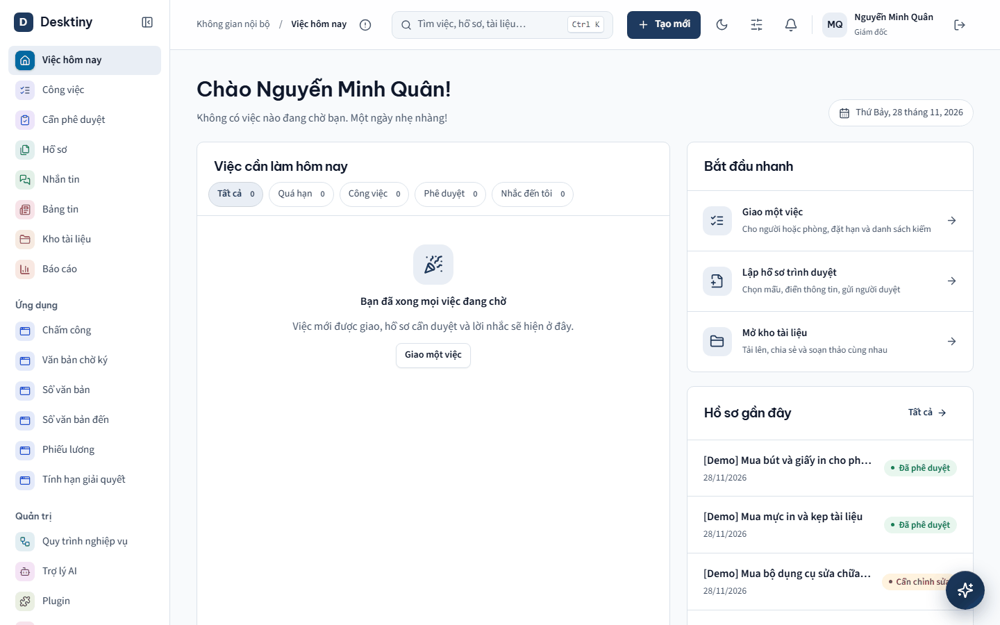</td>
    <td></td>
  </tr>
  <tr>
    <th>An administrator drags a process together and test-runs it on sample data</th>
    <th>A director sees overdue work and cases by status</th>
  </tr>
  <tr>
    <td>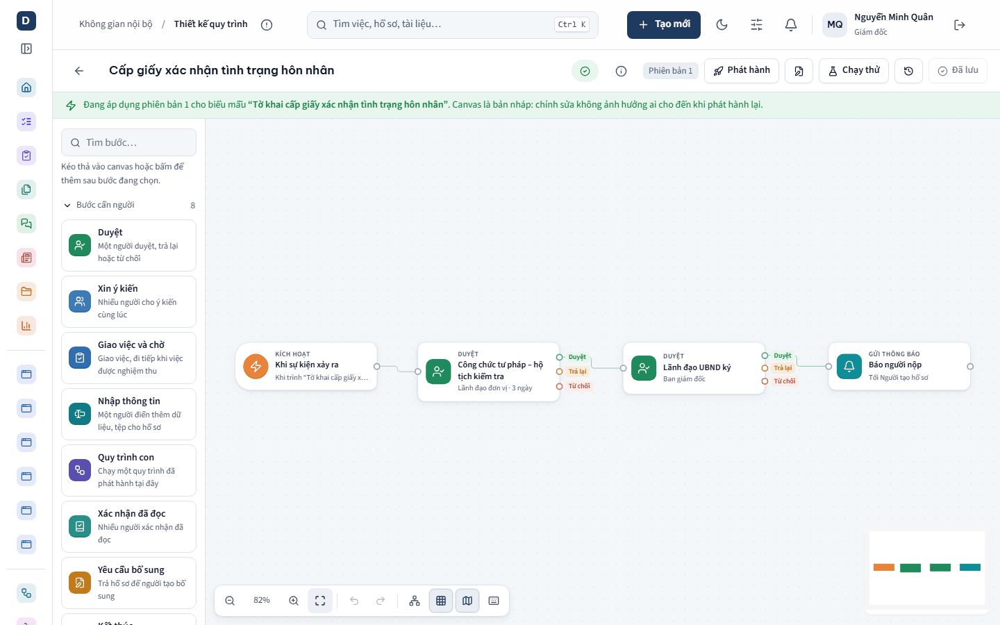</td>
    <td>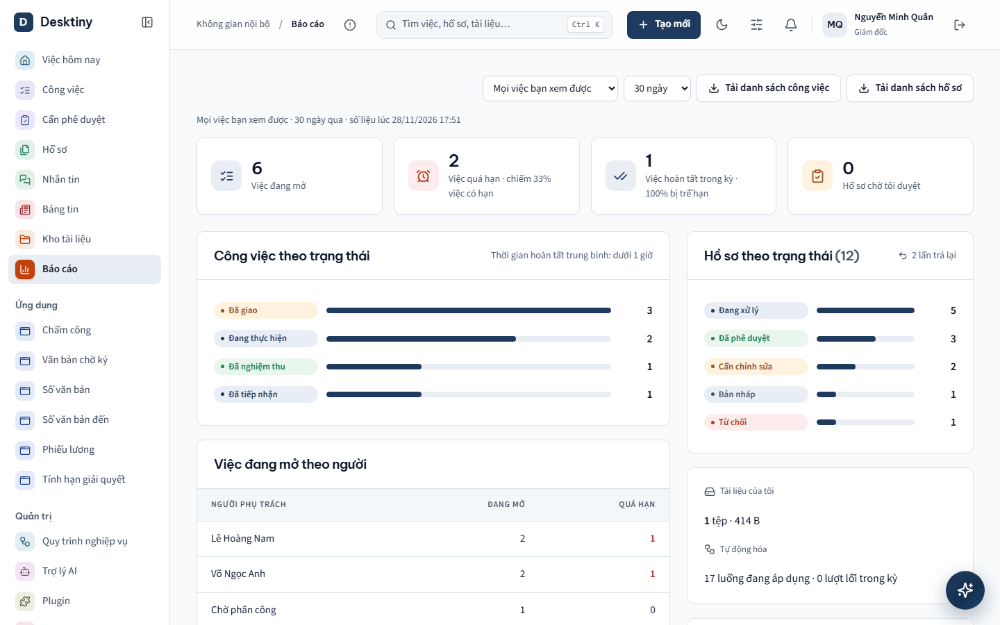</td>
  </tr>
  <tr>
    <th>A head of department assigns work to a person or a whole department and follows it</th>
    <th>The records office finds versioned documents shared by folder</th>
  </tr>
  <tr>
    <td>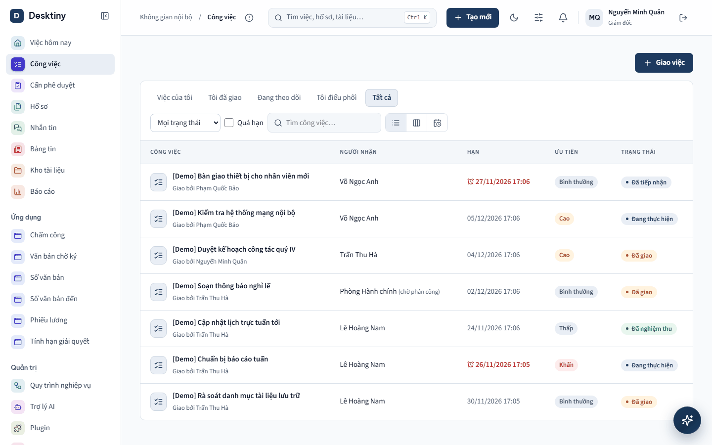</td>
    <td>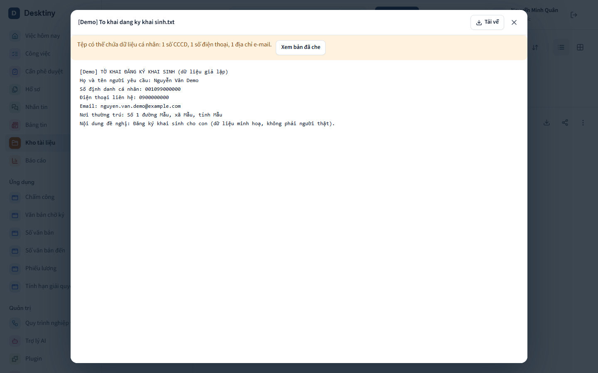</td>
  </tr>
  <tr>
    <th>The whole organisation reads announcements on the news feed</th>
    <th>Everyone signs in once through Keycloak</th>
  </tr>
  <tr>
    <td>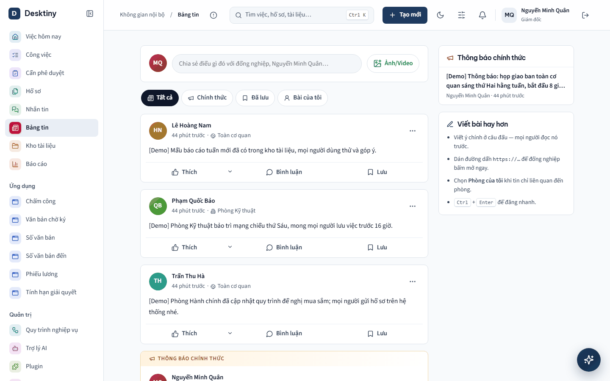</td>
    <td>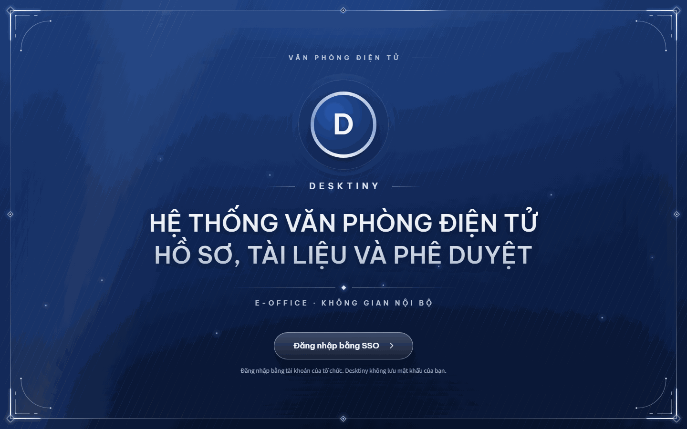</td>
  </tr>
</table>

<p align="center">
  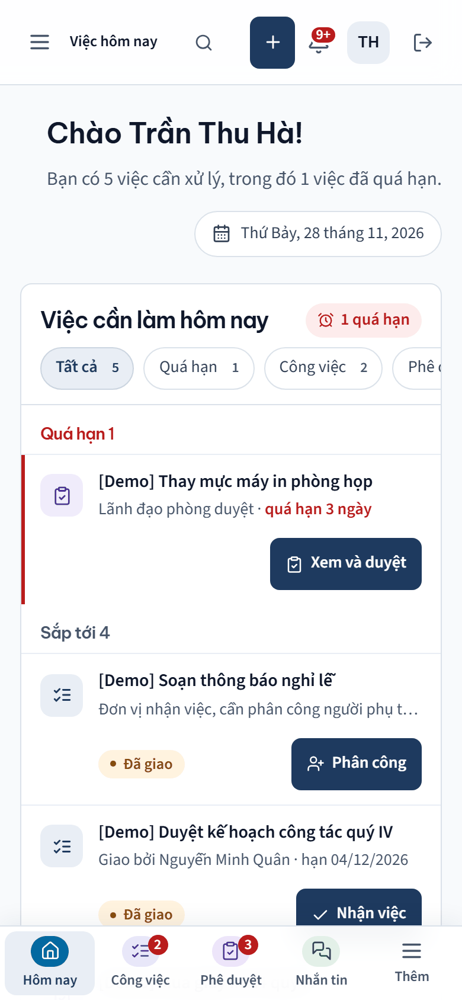
  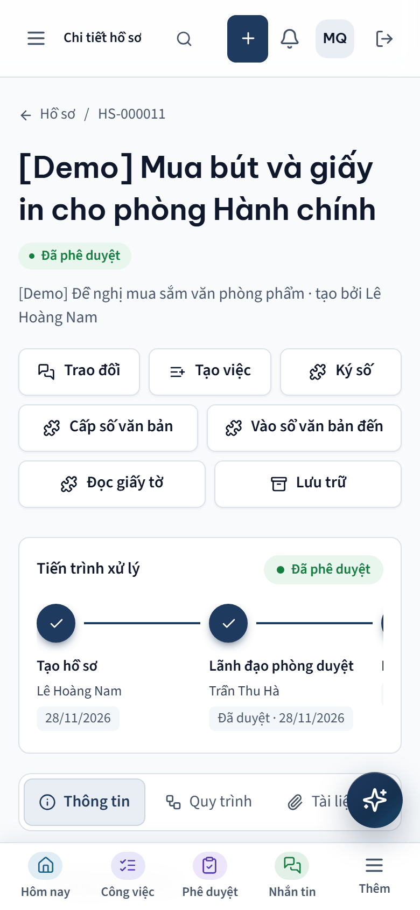
  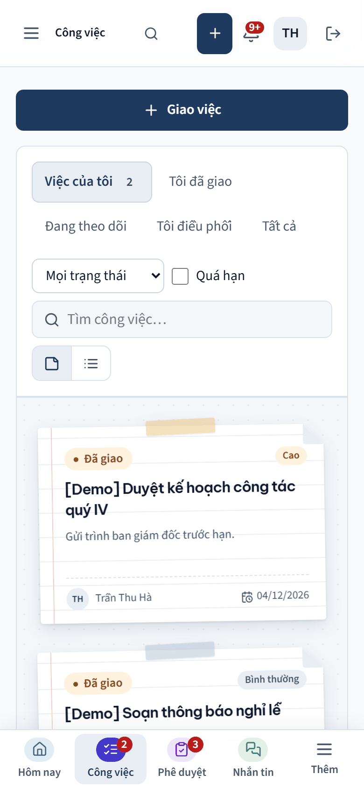
  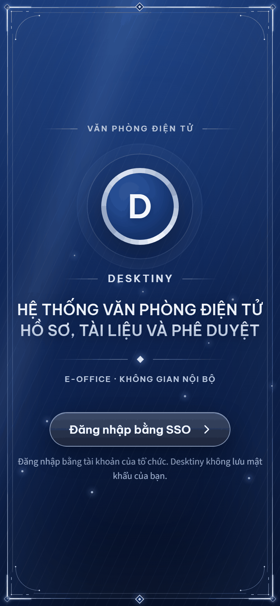
  <br><sub>The web app on a phone: home, cases, tasks, sign-in</sub>
</p>

<table>
  <tr>
    <th width="50%">Case detail: step-by-step progress and who is handling it</th>
    <th width="50%">The same screen in dark mode</th>
  </tr>
  <tr>
    <td>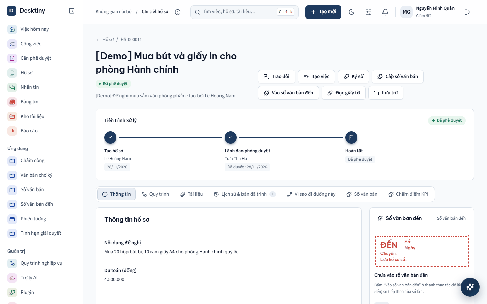</td>
    <td>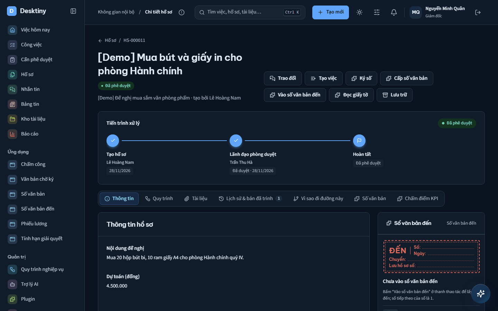</td>
  </tr>
</table>

<sub>All images: synthetic sample data. Image provenance: [docs/images/README.md](docs/images/README.md). Full feature
description and scope (Vietnamese): [docs/tinh-nang.md](docs/tinh-nang.md); AI features:
[docs/ai-features.md](docs/ai-features.md).</sub>

## Architecture

<p align="center">
  
  <br><sub>Animated diagram, labels in Vietnamese: a request travels through the gateway, the two tiers, storage and the plugin server; steps 1–6 match the list below.</sub>
</p>

<details>
<summary>Text diagram (Mermaid)</summary>

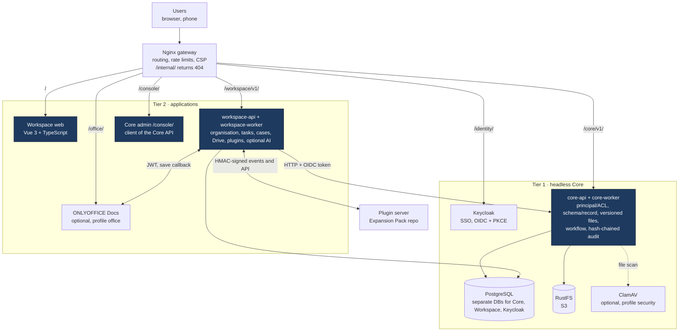

</details>

Dark blue blocks are the project's own code; the others are open-source software used unchanged from official images.
Arrow colours: blue is request/response, green is a data write, brown is an event, purple is a file; dashed means
optional.

1. Every request goes through the Nginx gateway (in the dev configuration it listens only on `127.0.0.1:8080`). The
   gateway routes by prefix, rate-limits, adds CSP and returns 404 for `/internal/`.
2. Sign-in goes through Keycloak (OIDC code flow, PKCE). The browser only holds a session cookie issued by the
   backend, never a token.
3. `workspace-api` calls the Core over HTTP with an OIDC token (service client or on behalf of the user); the Core
   still checks ACLs. The three databases are separate, with no foreign keys or SQL across tiers.
4. The Core stores records in PostgreSQL and file bytes in RustFS, each version with SHA-256. When `CLAMAV_HOST` is
   set, the Core scans each file before storing it; a failed scan rejects the file.
5. `core-worker` advances workflow runs. `workspace-worker` processes the outbox: starts processes, syncs file
   permissions to the Core, delivers plugin events, webhooks and email.
6. Core admin is a static web app that calls `/core/v1/` directly like any other client. ONLYOFFICE talks only to
   `workspace-api` (JWT-signed).

### Where the data lives

<p align="center">
  
  <br><sub>Animated diagram, labels in Vietnamese: user actions on the left, the service that writes in the middle, where each kind of data is stored on the right.</sub>
</p>

Each kind of data has exactly one owner ([docs/architecture.md](docs/architecture.md), section *Nguồn sự thật*).
Connected plugins keep their data in the plugin server's volume, not in Desktiny's databases, so back it up separately.

| Mandatory requirement of the brief | Component | Configuration, code |
|---|---|---|
| Headless Core in Tier 1, no user interface | `core-api`, `core-worker` | [`services/core-api`](services/core-api), [`contracts/core.openapi.json`](contracts/core.openapi.json) |
| Identity, SSO | Keycloak 26.2.5, realm generated by bootstrap | [`scripts/bootstrap.py`](scripts/bootstrap.py), [`infra/identity`](infra/identity) |
| API gateway | Nginx 1.28.0 | [`infra/gateway/nginx.conf`](infra/gateway/nginx.conf) |
| Structured data | Versioned schema/record, PostgreSQL | [`dx_core/models.py`](services/core-api/src/dx_core/models.py), `/core/v1/schemas`, `/core/v1/records` |
| Unstructured data | Versioned files, RustFS (S3) | [`dx_core/storage.py`](services/core-api/src/dx_core/storage.py), `/core/v1/storage/*` |
| Workflow | Graph engine, runs, human tasks | [`dx_core/workflow.py`](services/core-api/src/dx_core/workflow.py), [`packages/flowkit`](packages/flowkit) |
| At least one H-P-D-I application | Workspace | [`apps/workspace-web`](apps/workspace-web), [`services/workspace-api`](services/workspace-api) |
| Deployment | Docker Compose, pinned image versions | [`infra/compose/compose.yaml`](infra/compose/compose.yaml) |

The Core runs on its own with Workspace switched off: profile `core` plus the sample client
[`examples/core-client`](examples/core-client). Details: [docs/architecture.md](docs/architecture.md).

## Business flow

One case, from submission to decision:

<p align="center">
  
  <br><sub>Animated diagram, labels in Vietnamese: who does each of the ten steps and where each step writes its data.</sub>
</p>

<details>
<summary>Text diagram (Mermaid)</summary>

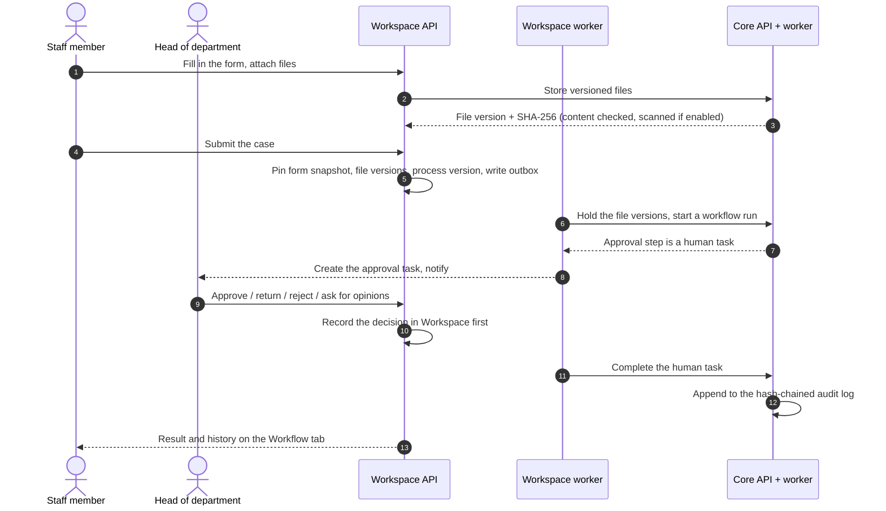

</details>

The animated diagram numbers ten steps in time order; the list below groups them by the service that runs them.

1. **Store files** (`workspace-api` → `core-api`): the Core checks extension, content signature and decompression
   limits and scans with ClamAV when enabled; an `.exe` is rejected with `unsupported_file_type`.
2. **Submit** (`workspace-api`): the snapshot is pinned, so later draft edits never change what was submitted; the
   start job is written to the outbox in the same transaction.
3. **Start** (`workspace-worker` → `core-api`): places a hold on the submitted file versions, then creates the run;
   `core-worker` advances it to the step that needs a person.
4. **Assign the approval** (`workspace-worker`): each Core human task becomes an item in the right person's
   *Awaiting approval* list, with a notification.
5. **Decide** (`workspace-api` → `workspace-worker` → `core-api`): the decision is recorded in Workspace first, then
   the human task is completed. Users cannot call the Core to mark a case *approved* themselves.
6. **Withdraw**: only by the creator, only while the case is submitted and nobody has decided
   (`case_already_decided`); the Core run is cancelled with it.

## Expansion packs

The [Desktiny Expansion Pack](https://github.com/Dking2007/Desktiny_expansion_pack) repository holds **expansion
packs**: each has one [interface pack](docs/packs.md) and several [plugins](docs/plugins.md). Administrators install
the `.zip` files under **Admin › Interface packs** and **Admin › Plugins**; not a single line of Core code changes.

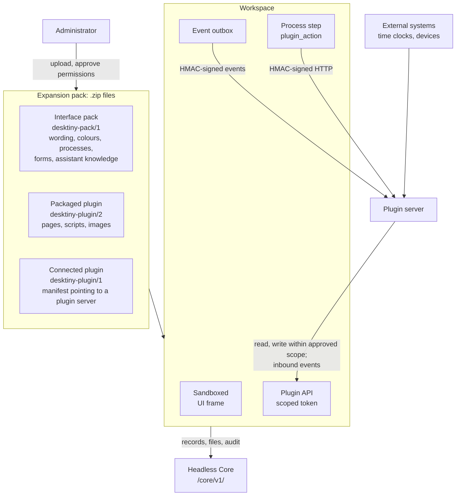

1. The administrator uploads the `.zip`, previews it, then **approves permissions**: only the scopes, events and
   writable fields the plugin asks for.
2. Interface packs and packaged plugins run inside Workspace at once; plugin pages always sit in a `sandbox` frame.
3. Business events (case approved, task overdue…) go through the outbox, HMAC-signed, retried when the plugin server
   fails.
4. The plugin server calls back the plugin API with a token; the scope is always the intersection of the approved
   permissions and the token's scope, and every call is written to the plugin log.
5. A `plugin_action` process step calls the plugin server (HMAC-signed) and waits for the result to choose a branch.
6. External systems never call Desktiny directly; they go through the plugin server, which authenticates them.

| Expansion pack | For | Bundled plugins |
|---|---|---|
| **One-stop desk (commune level)** | One-stop office of a commune People's Committee: civil status, certification, mediation | Document register, Digital signature, Online intake, Deadline calculator, Document reader |
| **Business HR** | HR department: request workflows, policies for the assistant | GPS attendance, Payroll and KPI, Record-deadline reminders |
| **Records and administration** | Records office: incoming and outgoing documents, archiving | Incoming register; shares Document register, Digital signature, Deadline calculator |

These are samples: agency names are fictitious, deadlines and amounts are illustrative, and the digital signature is
simulated. **Compatibility:** expansion packs 1.1.0 need Desktiny **3.1.0** or later.

<p align="center">
  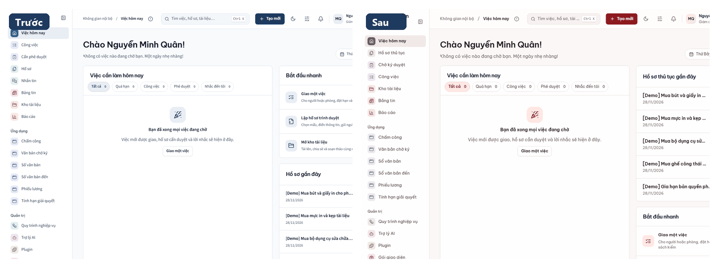<br>
  <sub>The same Desktiny before and after installing the “commune one-stop” pack: colours, terms, menus and processes follow the business</sub>
</p>

<table>
  <tr>
    <td width="33%">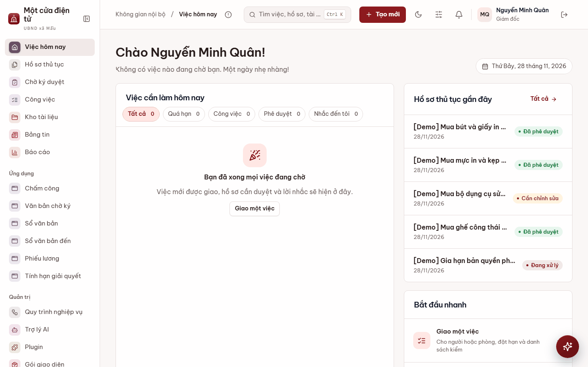<br><sub>Commune one-stop</sub></td>
    <td width="33%">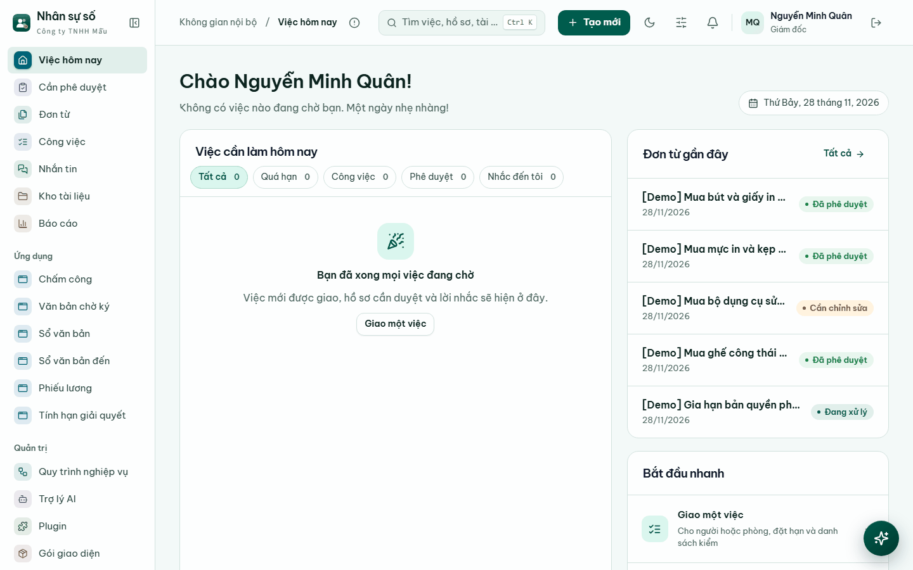<br><sub>Company HR</sub></td>
    <td width="33%">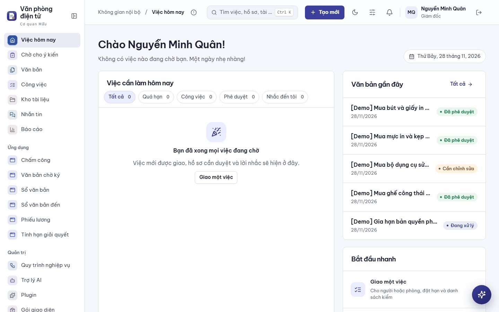<br><sub>Records office</sub></td>
  </tr>
</table>

<sub>Synthetic sample data.</sub>

## Four technical principles

The brief asks for a platform built on four principles. The table shows what exists, how to check it yourself and
what is still missing. `pytest` commands run from the repository root after installing `requirements-dev.txt`. The two
sample plugins for (i), (ii) and (iii) live on the `tich-hop/olp-2026-11-28` branch of the Expansion Pack repository
and are not yet in release 1.1.0.

| Principle | In place | How to check | Still missing |
|---|---|---|---|
| (i) Data lifecycle, moving historical data to a data lake | Versioned files and records; holds on submitted file versions; `scripts/backup.py`, `restore.py` with a SHA-256 manifest. The `luu-tru-lich-su` plugin copies approved/closed cases to monthly JSONL files and flags months due for cold storage | `python -m pytest -q tests/test_backup_restore.py`; in the Expansion Pack repo: `pytest tests/test_luu_tru_lich_su.py` | No real data lake, the plugin is a demonstration; no automatic deletion or retention policy |
| (ii) IT/OT convergence, sensor data | The `cam-bien` plugin (Operations pack): devices send readings over HTTP with per-device keys; crossing a threshold raises an event, and a process opens an incident case | In the Expansion Pack repo: `pytest tests/test_cam_bien.py`; device simulator `scripts/gia_lap_cam_bien.py` | No MQTT, OPC-UA or time-series database |
| (iii) Provenance, lineage, data quality | File versions with SHA-256 and author; per-run decision traces (`/workflow-runs/{id}/decision-traces`); hash-chained Core log; the archive plugin records source, version and a sha256 chain for every entry | `python -m pytest -q services/core-api/tests/test_audit_chain.py`; `GET /core/v1/audit-logs/verify` with an admin token | No lineage graph across datasets, no quality metrics; the hash chain cannot stop someone who rewrites the whole table |
| (iv) Zero Trust, GitOps, malware scanning at the edge | OIDC on every API, per-resource ACLs, default deny; gateway blocks `/internal/`, rate limits, CSP; file content checks, optional ClamAV; TOTP enforced for the `lanh-dao-mfa` account; CI and releases built from the repository, with `SHA256SUMS` | `python -m pytest -q services/core-api/tests/test_storage_inspection.py services/core-api/tests/test_malware_scan.py`; with the stack running: `curl -i http://localhost:8080/internal/x` returns 404 | No mTLS between services, no GitOps sync tool (Argo CD, Flux); MFA not enforced for everyone; stored files are not rescanned when new signatures arrive |

Requirement-by-requirement map of the brief to the code: [docs/doi-chieu-de-thi.md](docs/doi-chieu-de-thi.md)
(Vietnamese). Self-review against the PoF criteria: [SELF_REVIEW.md](SELF_REVIEW.md).

## Technology and licences

Versions come from `THIRD_PARTY.md`, `requirements.lock`, `package-lock.json` and the image tags in
[`compose.yaml`](infra/compose/compose.yaml).

| Layer | Component | Version | Licence (SPDX) | Role in Desktiny | How it is used |
|---|---|---|---|---|---|
| Identity | Keycloak | 26.2.5 | Apache-2.0 | SSO, OIDC + PKCE, TOTP | separate service |
| Identity | PyJWT · cryptography | 2.10.1 · 46.0.2 | MIT · Apache-2.0 OR BSD-3-Clause | Token checks, encryption of stored keys | pip library |
| Gateway | Nginx | 1.28.0 | BSD-2-Clause | Routing, rate limits, CSP | separate service |
| Data | PostgreSQL | 17.5 | PostgreSQL | Databases for Core, Workspace, Keycloak | separate service |
| Data | RustFS | 1.0.3 | Apache-2.0 | File bytes over the S3 protocol | separate service |
| Data | Valkey | 8.1.1 | BSD-3-Clause | Provisioned for queues and cache; not used by the code yet | separate service |
| Data | SQLAlchemy · Alembic | 2.0.43 · 1.16.5 | MIT | ORM, migrations | pip library |
| Data | psycopg | 3.2.10 | LGPL-3.0-only | PostgreSQL driver | pip library, dynamically linked, unmodified |
| Data | boto3 | 1.40.44 | Apache-2.0 | Core access to S3 storage | pip library |
| Services | Python | 3.13.5 | PSF-2.0 | API runtime | base image |
| Services | FastAPI · Starlette · Uvicorn | 0.118.0 · 0.48.0 · 0.37.0 | MIT · BSD-3-Clause · BSD-3-Clause | `core-api`, `workspace-api` | pip library |
| Workflow | dx-flowkit (this project) | 0.2.0 | Apache-2.0 | Validates and runs process graphs | package in this repo |
| Workflow | jsonschema | 4.25.1 | MIT | Form data validation | pip library |
| Interface | Vue · Vue Router · Pinia | 3.5.44 · 4.5.0 · 2.3.1 | MIT | Workspace web, Core admin | npm library |
| Interface | TanStack Vue Query · Vue Flow | 5.66.0 · 1.48.2 | MIT | Cached API calls; process canvas | npm library |
| Interface | pdfjs-dist · lucide-vue-next | 4.10.38 · 0.468.0 | Apache-2.0 · ISC | PDF viewer; icons | npm library |
| Interface | Be Vietnam Pro · Source Sans 3 | 5.1.1 | OFL-1.1 | Self-hosted fonts | npm library |
| Documents | ONLYOFFICE Docs | 8.3.3 | AGPL-3.0-only | Office file editing | optional, off by default, separate service |
| Documents | pypdf | 6.20.1 | BSD-3-Clause | PDF text extraction | pip library |
| Security | ClamAV | 1.4.3 | GPL-2.0-only | Malware scan of uploads | optional, off by default, separate service |
| Security | dx-piivn (this project) | 0.1.0 | Apache-2.0 | Finds and masks personal data in files | package in this repo |
| Intelligence | anthropic · httpx | 2.3.0 · 0.28.1 | Apache-2.0 · BSD-3-Clause | Calls the AI service configured by the admin | pip library, features off by default |
| Extension | desktiny-plugin (this project) | 0.3.0 | Apache-2.0 | Plugin SDK and checker CLI | package in this repo |
| Operations | Node.js | 22.17.0 | MIT | Frontend build | build time only |
| Tools (not shipped) | Vite · TypeScript · Vitest · Playwright · ESLint | 6.4.4 · 5.7.3 · 4.1.11 · 1.64.1 · 9.39.5 | MIT · Apache-2.0 · MIT · Apache-2.0 · MIT | Build, type checks, tests, E2E, lint | npm library |
| Tools (not shipped) | pytest · ruff | 8.4.2 · 0.13.3 | MIT | Python tests and lint | pip library |

Every component uses an OSI-approved licence; no third-party code is copied into the repository. Copyleft components
are isolated: ONLYOFFICE (AGPL-3.0) and ClamAV (GPL-2.0) run in their own containers, off by default, and talk only
over HTTP/JWT and a TCP socket; psycopg (LGPL-3.0) is used as a dynamically linked library, unmodified. Full list
(63 Python packages, 67 npm packages shipped in the product, 243 npm packages for build and test only):
[THIRD_PARTY.md](THIRD_PARTY.md), [NOTICE](NOTICE).

## Quick start

Run from the repository root:

```bash
python scripts/bootstrap.py                    # 1. generate .env, the Keycloak realm and random passwords locally
docker compose --env-file .env -f infra/compose/compose.yaml --profile workspace up --build -d   # 2. build the stack
python scripts/seed.py --confirm-demo          # 3. sample organisation: roles, two departments, demo users
python scripts/seed_demo.py --confirm-demo     # 4. (optional) sample cases, tasks, feed posts, messages, documents
```

| System requirement | Level |
|---|---|
| Docker Engine + Compose v2 | Required |
| Python | 3.13 (bootstrap and seed use the standard library only) |
| RAM | ≥ 6 GB; with ONLYOFFICE ≥ 8 GB recommended; ClamAV needs about 1–1.5 GB more |
| Free disk | ≥ 8 GB |
| Port | `8080` (change with `--base-url` at bootstrap) |

Each account's password is in `infra/identity/generated/demo-credentials.txt` on your machine; the repository holds
no fixed passwords. Seed data is labelled synthetic data.

| Account | Role | Try |
|---|---|---|
| `staff` | Administration staff member | Create a case, submit it, check the *Workflow* tab; upload a file to the document store |
| `manager` | Head of Administration | *Awaiting approval*: approve or return; assign work to the department |
| `director` | Director | Reports page: overdue work, cases by status |
| `staff-b`, `manager-b` | Engineering department | Isolation check: unshared cases and documents stay invisible |
| `technical-admin` | Technical administrator | Core admin `/console/`, system log |
| `lanh-dao-mfa` | Deputy director | First sign-in requires setting up TOTP |

| Address (under `http://localhost:8080`) | What it is | Sign-in needed |
|---|---|---|
| `/` | Workspace web | Yes |
| `/console/` | Core admin | Yes |
| `/core/v1/docs` | Core OpenAPI | Viewing no; calling the API needs a token |
| `/identity/admin/` | Keycloak admin (account in `demo-credentials.txt`) | Yes |
| `/office/` | ONLYOFFICE, when profile `office` is on | Through Workspace |

15-minute demo script (Vietnamese): [docs/demo.md](docs/demo.md).

## Demo

There is no online instance; follow [Quick start](#quick-start).

<table>
  <tr>
    <th width="50%">A staff member submits a case, the head of department approves, the log records it</th>
    <th width="50%">An administrator draws a new process and test-runs it</th>
  </tr>
  <tr>
    <td>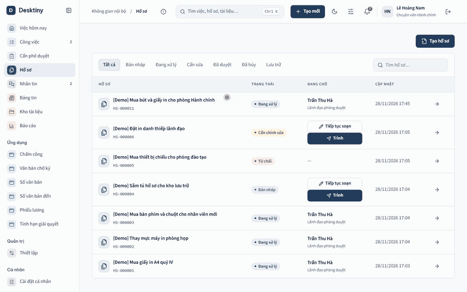</td>
    <td>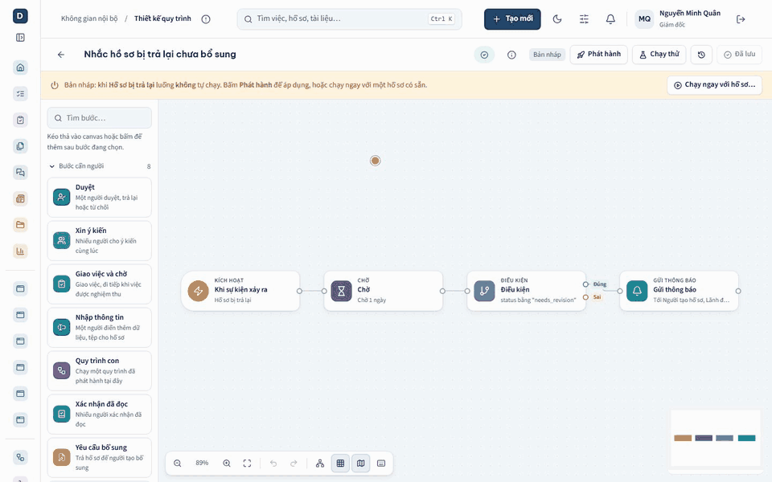</td>
  </tr>
  <tr>
    <th>Switch the theme pack: the whole app turns into one-stop or HR</th>
    <th>A citizen applies online, the one-stop desk receives it</th>
  </tr>
  <tr>
    <td>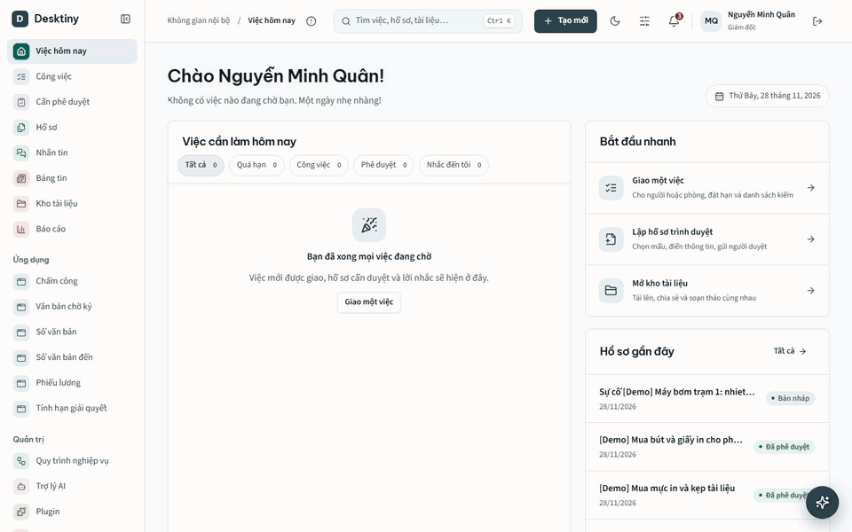</td>
    <td>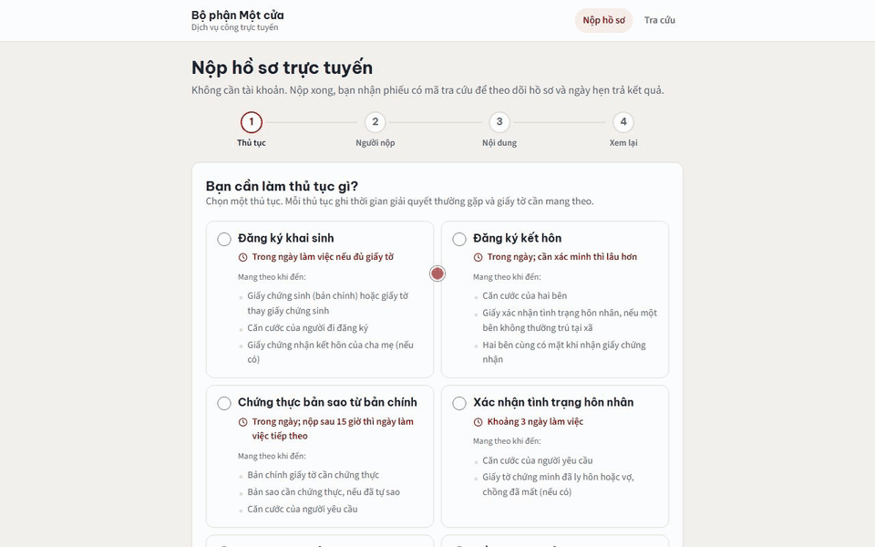</td>
  </tr>
  <tr>
    <th>A device crosses a threshold; a flow opens an incident case</th>
    <th>Staff update a task on a phone</th>
  </tr>
  <tr>
    <td>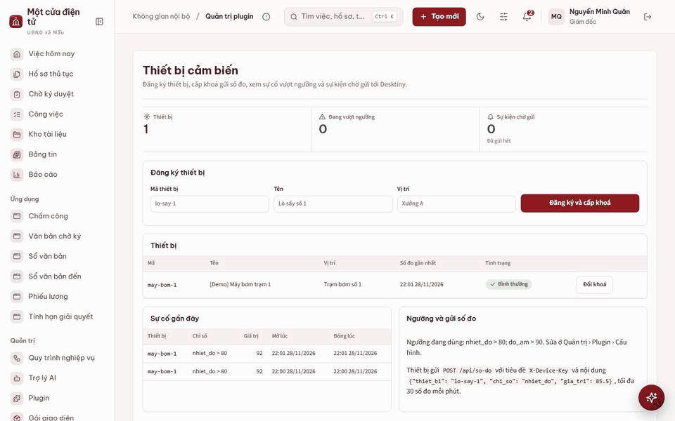</td>
    <td align="center">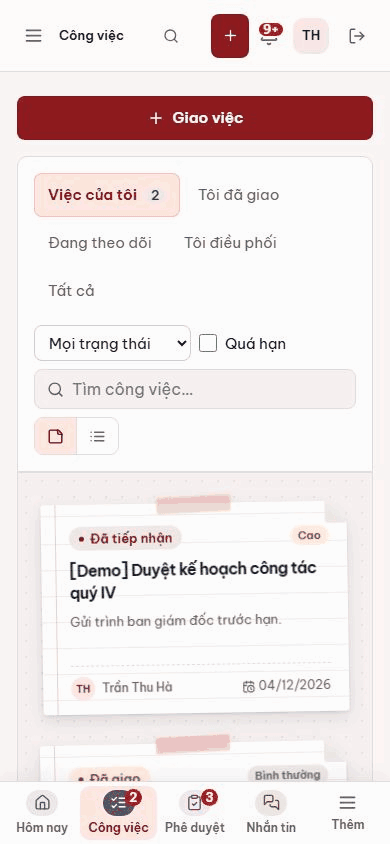</td>
  </tr>
</table>

<sub>Synthetic sample data.</sub>

## Installation

Full guide (Ubuntu, Windows, Docker and local runs, Vietnamese): [docs/installation.md](docs/installation.md).
Building from source and installing with `make venv deps build test install PREFIX=…`: [BUILD.md](BUILD.md).

<details>
<summary>Change the port, enable ONLYOFFICE, enable ClamAV, run only the Core</summary>

- **Change the port:** run bootstrap from the start with `python scripts/bootstrap.py --base-url http://localhost:8090`.
  Bootstrap refuses to overwrite an existing configuration; do not use it to provision production.
- **ONLYOFFICE:** set `ONLYOFFICE_ENABLED=true` in `.env`, then run
  `docker compose --env-file .env -f infra/compose/compose.yaml --profile workspace --profile office up -d`.
  Wait for the Document Server to be ready, then open documents from the document store.
- **ClamAV:** set `CLAMAV_HOST=clamav` in `.env` and add `--profile security`. Once set, uploads depend on ClamAV: a
  failed scan rejects the file ([docs/security.md](docs/security.md)).
- **Core only:** `docker compose --env-file .env -f infra/compose/compose.yaml --profile core up --build -d`. Core
  **has no user interface**: the gateway serves only the API `/core/v1/` (docs at `/core/v1/docs`) and `/identity/`; `/` and
  `/console/` return 404. Try Core with [`examples/core-client`](examples/core-client): the `core-example` client uses
  namespace `equipment` and secret `CORE_EXAMPLE_CLIENT_SECRET` in `.env`. For the Core admin technical console (a separate
  client of the Core API, tier 2) add `--profile console`.

</details>

<details>
<summary>Local development</summary>

You need Python 3.13 and Node.js 22. The backends still need PostgreSQL, Keycloak and S3 for real integration.

```bash
python -m venv .venv            # then activate: .venv/Scripts/activate (Windows) or .venv/bin/activate
python -m pip install -r requirements-dev.txt
npm ci
# Each backend runs from its service directory with its own DATABASE_URL:
#   services/core-api:      python -m alembic upgrade head && python -m uvicorn dx_core.main:app --port 8001
#   services/workspace-api: python -m alembic upgrade head && python -m uvicorn dx_workspace.main:app --port 8002
npm run dev --workspace apps/workspace-web
```

</details>

<details>
<summary>Troubleshooting</summary>

| Symptom | Cause and fix |
|---|---|
| Port 8080 is taken | Delete `.env` and `infra/identity/generated/`, rerun `python scripts/bootstrap.py --base-url http://localhost:8090` |
| APIs not `healthy`, sign-in fails right after start | Keycloak is still importing the realm; wait, then read `docker compose … logs identity core-migrate workspace-migrate` |
| Seed says "Run bootstrap first" | `.env` or `demo-users.json` is missing; run bootstrap first |
| Sign-in fails after regenerating secrets | The old realm and database keep the old secrets; bootstrap does not rotate stored data |
| Postgres creates no databases on Windows | An old clone converted `init-databases.sh` to CRLF; the repository now forces LF through `.gitattributes`, so clone again |
| Upload fails with `scan_unavailable` | `CLAMAV_HOST` is set but ClamAV is not ready yet (the first signature download takes a few minutes) |
| Office editor does not save | Tell apart the browser's public URL and the container-internal URL ([docs/installation.md](docs/installation.md)) |

</details>

## Testing

| Command | Checks | Needs |
|---|---|---|
| `python -m ruff check packages services scripts tests examples infra` | Python lint | `requirements-dev.txt` |
| `python -m pytest -q` | Core, Workspace, flowkit, scripts | `requirements-dev.txt`; real PostgreSQL tests need `DX_TEST_POSTGRES_URL` |
| `npm run lint && npm run typecheck && npm run test && npm run build` | ESLint, vue-tsc, Vitest, build | `npm ci` |
| `npm run test:e2e` | Playwright E2E with sign-in | Running, seeded stack |
| `node scripts/add_spdx_headers.mjs --check` · `reuse lint` | SPDX headers, REUSE compliance | Node.js; the `reuse` tool |
| `node scripts/gen_third_party.mjs && git diff --exit-code THIRD_PARTY.md` | `THIRD_PARTY.md` matches the lockfiles | `npm ci` |

CI ([`ci.yml`](.github/workflows/ci.yml)) runs the steps above (except E2E) on every push and pull request. Test
doubles check the logic but do not replace acceptance with real PostgreSQL, SSO, Office or a clean install:
[docs/acceptance.md](docs/acceptance.md).

## Limitations

- **Pilot:** the Compose setup is a development configuration, not production; no performance or RPO/RTO commitment
  until measured.
- **One organisation** per deployment; no multi-tenant SaaS, no support for one person in several units.
- **No legally valid digital signature.** Approval rights and the audit log do not replace one; the Digital signature
  plugin in the One-stop pack is simulated.
- **No native mobile app**; phones use the web version.
- **Malware scanning is optional** (ClamAV, off by default); stored files are not rescanned when new signatures
  arrive. The personal-data warning is a hint, not DLP.
- **MFA** is enforced only for one demo account (`lanh-dao-mfa`); the other demo accounts have no second factor so seeding
  and e2e tests can log in. Production should enable MFA for managers and administrators ([docs/security.md](docs/security.md)).
- **Sensors** accept readings over HTTP only (no MQTT, OPC UA or time-series database); the **history archive** is an
  illustrative JSONL file, not a data lake.
- **AI needs an external service** (Claude, OpenAI, Gemini, DeepSeek) or a self-hosted AI server (Ollama, vLLM)
  configured by the organisation. Tested with fake services and one real run against Ollama (31/10/2026); not yet
  tried with real Claude, OpenAI or Gemini.
- Messaging and notifications refresh by polling, no WebSocket yet; tasks have no Gantt or month calendar; automations
  have no loop node or OAuth2 connector.
- **Known bug:** a process with a branch that ends on a step other than *End* (for example *Send notification*) can
  still be published, and its cases can get stuck *In progress* after approval. The fix is planned in
  [ROADMAP.md](ROADMAP.md).

## Documentation

Most documents are in Vietnamese.

| Document | For |
|---|---|
| [Installation](docs/installation.md) · [Build](BUILD.md) · [Operations, backup, restore](docs/operations.md) · [Security](docs/security.md) | System administrators |
| [Features in detail](docs/tinh-nang.md) · [AI features](docs/ai-features.md) · [Demo script](docs/demo.md) | Users, reviewers |
| [Business processes, test runs, tracing](docs/process-packages.md) · [Interface packs](docs/packs.md) · [Plugins](docs/plugins.md) | Pack and plugin authors |
| [Architecture](docs/architecture.md) · [Original design](docs/design/Thiet_ke_DX_Workspace_FastAPI_Vue3.md) · [Third-party inventory](docs/third-party-inventory.md) | Developers |
| [Contest requirements map](docs/doi-chieu-de-thi.md) · [PoF self-review](SELF_REVIEW.md) · [Acceptance](docs/acceptance.md) | Judges |
| [CHANGELOG](CHANGELOG.md) · [V3 vs V2](docs/V3_CHANGES.md) · [V2 vs V1](docs/V2_CHANGES.md) · [Roadmap](ROADMAP.md) | Everyone |

## Contributing back to open source

Status as of 30/10/2026; every step, link and result is in [docs/contribution-log.md](docs/contribution-log.md).

| Work | Receiving project | Status |
|---|---|---|
| Add 2 missing notes to the "Migrating to 26.7.5" section of the upgrade guide | Keycloak: issue [#53650](https://github.com/keycloak/keycloak/issues/53650), PR [#54464](https://github.com/keycloak/keycloak/pull/54464) | Sent 30/10/2026, awaiting maintainer review (not merged) |
| Plugin checking administrative document layout per Decree 30/2020/NĐ-CP ([`plugins/vn-document-format`](plugins/vn-document-format)) | ONLYOFFICE marketplace: [PR #730](https://github.com/ONLYOFFICE/onlyoffice.github.io/pull/730) | Sent 30/10/2026, CLA signed, awaiting maintainer review |
| `dx-flowkit`: validate and test-run JSON process graphs ([`packages/flowkit`](packages/flowkit)) | Standalone package split out of Desktiny | Not published outside this repository yet (not on PyPI) |
| Volume permission error when running RustFS as non-root | RustFS [#8992](https://github.com/rustfs/rustfs/issues/8992) | Reviewed, not sent: the maintainers had already fixed it |

## Contributing

1. Open an issue with one of the forms (bug report, proposal, trial feedback).
2. Create a branch from `main`: `feat/<issue-number>-<description>`, `fix/…` or `docs/…`.
3. Open a pull request with `Fixes #<number>` and update `CHANGELOG.md`; someone else reviews, authors do not approve
   their own work.
4. Merge only when CI is green.

Details: [CONTRIBUTING.md](CONTRIBUTING.md) · [CODE_OF_CONDUCT.md](CODE_OF_CONDUCT.md) · [SECURITY.md](SECURITY.md) ·
[Milestones](https://github.com/Dking2007/DXOS_Desktiny/milestones) · [ROADMAP.md](ROADMAP.md).

## Team

The team chose to publish only GitHub accounts. Areas come from the commit history.

| GitHub | Main areas |
|---|---|
| [Dking2007](https://github.com/Dking2007) | Headless Core (hash-chained audit, malware scan, `dx-flowkit`); build, CI, releases; licence compliance; operations (backup, restore, MFA); personal-data warning; user-experience review; contributions to Keycloak and ONLYOFFICE |
| [Raphael-Fug](https://github.com/Raphael-Fug) | Workspace web and design system; business processes and 12 sample processes; assistant and AI features; personal profile, reports; packaged plugins `desktiny-plugin/2` |
| [Mai1174](https://github.com/Mai1174) | Interface packs `desktiny-pack/1`; connected plugins `desktiny-plugin/1`, plugin API v2 and SDK; canvas-drawn case processes |

### How the team works

1. **Issue first:** every piece of work has an issue, labels and a milestone on the
   [bug tracker](https://github.com/Dking2007/DXOS_Desktiny/issues).
2. **One branch** per piece of work, created from `main`.
3. **Small commits** following [Conventional Commits](https://www.conventionalcommits.org/), written in Vietnamese,
   each person under their own account ([`.mailmap`](.mailmap) merges old display names).
4. **Pull requests** with a checklist; the convention is cross review by another member.
5. **CI** runs lint, tests, build, SPDX, REUSE and `THIRD_PARTY.md` checks on every pull request.
6. **Releases** from a `vX.Y.Z` tag: [`release.yml`](.github/workflows/release.yml) packs a `.tar.gz` with
   `SHA256SUMS`; from 3.2.0 it also checks the version number against SemVer and attaches a CycloneDX SBOM.
7. **Upstream bugs** go back to the upstream project ([Contributing back](#contributing-back-to-open-source)).

## Contact

| Channel | Use for |
|---|---|
| [Issues](https://github.com/Dking2007/DXOS_Desktiny/issues) | Bugs, proposals, trial feedback |
| [Private vulnerability report](https://github.com/Dking2007/DXOS_Desktiny/security/advisories/new) | Security vulnerabilities, not public ([SECURITY.md](SECURITY.md)) |
| [Pull requests](https://github.com/Dking2007/DXOS_Desktiny/pulls) | Code and documentation |

## Licence

Code written by the project is released under the **Apache License 2.0** (SPDX: `Apache-2.0`).

- **Why Apache-2.0:** a permissive OSI licence with an explicit patent grant, compatible with every library the
  project uses (MIT/BSD/Apache/MPL/PSF/OFL; psycopg LGPL-3.0 used as a dynamically linked library, unmodified).
  Optional copyleft services (ONLYOFFICE AGPL-3.0, ClamAV GPL-2.0) run separately and are not linked into the code.
- Full texts: [LICENSE](LICENSE) and [LICENSES/](LICENSES/) following the [REUSE](https://reuse.software/) standard.
  Every code file carries an `SPDX-License-Identifier` header; files that cannot carry one are declared in
  [REUSE.toml](REUSE.toml). The code of conduct is CC-BY-4.0, as is the original Contributor Covenant. Checked with
  `reuse lint`.
- External components (ONLYOFFICE, RustFS, Keycloak…) keep their own licences: [THIRD_PARTY.md](THIRD_PARTY.md),
  [NOTICE](NOTICE). When redistributing, review artifacts, notices, source offers and trademarks for the exact release.
