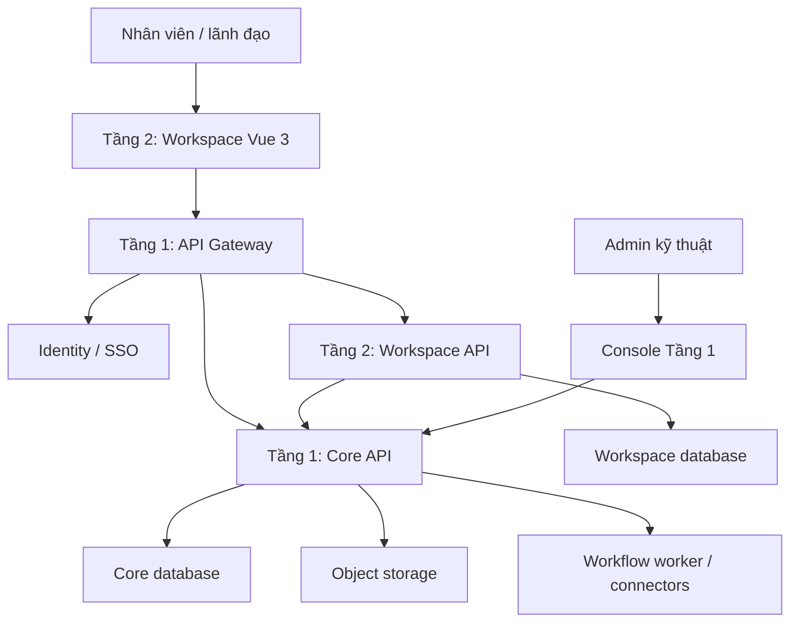
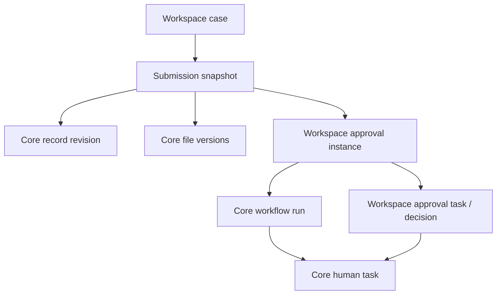

# THIẾT KẾ CHI TIẾT NỀN TẢNG DX WORKSPACE

**Core dịch vụ dùng chung và ứng dụng làm việc số theo DX-OS Open-Core**  
**Backend:** Python + FastAPI · **Frontend:** Vue.js 3 + TypeScript  
**Phiên bản:** 3.0 — viết lại thống nhất · **Ngày:** 18/10/2026  
**Tên làm việc:** DX Workspace. Nexora là tên thương hiệu gợi ý, chưa coi là tên đã được người dùng chốt.  
**Trạng thái:** Đặc tả thiết kế để hiện thực; không phải báo cáo xác nhận mã nguồn đã đạt chuẩn hoặc BTC đã phê duyệt sản phẩm.

---

## Mục lục

1. Mục tiêu và phạm vi sản phẩm
2. Căn cứ đề thi và nguyên tắc tuân thủ
3. Kiến trúc tổng thể và ranh giới hai tầng
4. Công nghệ và cấu trúc triển khai
5. Định danh, tổ chức và mô hình phân quyền
6. Dịch vụ dữ liệu cấu trúc của Core
7. Dịch vụ file, Drive và vòng đời tài liệu
8. Tích hợp ONLYOFFICE
9. Giao việc và điều hành công việc
10. Biểu mẫu, hồ sơ và phê duyệt
11. Bộ tích hợp và tự động hóa kiểu n8n
12. AI, OCR và hỏi đáp tri thức
13. Nhắn tin và bảng tin nội bộ
14. Thông báo, tìm kiếm, báo cáo và dashboard
15. Thiết kế cơ sở dữ liệu và nguồn sự thật
16. Thiết kế API, sự kiện và realtime
17. Thiết kế frontend Vue 3
18. Thiết kế backend FastAPI và cấu trúc repository
19. Tính nhất quán, xử lý lỗi và phục hồi
20. Bảo mật và quản lý bí mật
21. Triển khai, giám sát, sao lưu và hiệu năng
22. Giấy phép, nguồn mở và bộ bàn giao
23. Phạm vi dự thi, lộ trình và phân công
24. Kiểm thử, nghiệm thu và demo
25. Quyết định kiến trúc, điểm cần chốt và tài liệu tham khảo

---

## 1. Mục tiêu và phạm vi sản phẩm

### 1.1. Bài toán

Tổ chức thường sử dụng nhiều công cụ rời rạc: file ở một nơi, giao việc qua tin nhắn, hồ sơ chuyển duyệt thủ công, báo cáo nhập lại và AI không có nguồn dữ liệu thống nhất. DX Workspace kết nối các hoạt động này bằng dịch vụ nền dùng chung và quy trình cấu hình được.

Sản phẩm gồm **Core ở Tầng 1** cung cấp năng lực kỹ thuật độc lập nghiệp vụ và **Workspace ở Tầng 2** cung cấp trải nghiệm làm việc cho tổ chức. Đổi loại hồ sơ, cách chọn người duyệt hoặc thêm ứng dụng phải tận dụng được Core mà không sửa luật nghiệp vụ vào bên trong Core.

### 1.2. Các yêu cầu người dùng

| Mã | Yêu cầu | Kết quả mong muốn |
|---|---|---|
| R01 | Quản lý file như Drive | Thư mục, tìm kiếm, chia sẻ, phiên bản, thùng rác |
| R02 | ONLYOFFICE | Tạo và chỉnh sửa tài liệu ngay trong giao diện |
| R03 | Giao việc theo cấp quản lý | Cá nhân/phòng ban nhận việc, theo dõi và nghiệm thu |
| R04 | Nhắn tin linh hoạt | Cá nhân, nhóm, phòng ban, liên phòng và theo hồ sơ/công việc |
| R05 | Ba mẫu vai trò | Ban giám đốc/admin, lãnh đạo phòng, cán bộ/nhân viên |
| R06 | Phân quyền tùy biến | Theo vai trò, phòng, nhóm, người, tài nguyên và hành động |
| R07 | Tự có tính linh hoạt kiểu n8n | Cấu hình sự kiện, điều kiện, API, AI và hành động |
| R08 | Kết nối local và dịch vụ ngoài | Endpoint, credential, adapter và schema được cấu hình |
| R09 | AI gắn từng chức năng | OCR, điền nháp, hỏi đáp, tóm tắt, gợi ý |
| R10 | Chuyển duyệt hồ sơ/báo cáo | Chọn cấp/người nhận hợp lệ, theo dõi và truy vết |
| R11 | Mạng xã hội nội bộ | Bài đăng, bình luận, cảm xúc và thông báo |
| R12 | FastAPI và Vue 3 tách riêng | Backend Python, frontend Vue 3/TypeScript |

R07 là khả năng tự động hóa của chính sản phẩm, không phải yêu cầu kết nối hoặc phụ thuộc n8n. Mỗi chức năng phải liên thông với file, quyền và sự kiện dùng chung.

### 1.3. Phạm vi và giả định

- Pilot một tổ chức trong mỗi lần triển khai. Core có application namespace; `organization_id` không đồng nghĩa đã hoàn thiện SaaS đa khách hàng.
- Giao diện chính tiếng Việt, responsive; lưu thời gian UTC và hiển thị theo múi giờ tổ chức/người dùng.
- Có thể triển khai nội bộ. AI local hoặc API ngoài là lựa chọn profile, không chuyển ra ngoài ngầm.
- Không bao gồm ERP/kế toán/lương, mobile native, họp video, chữ ký số pháp lý hoặc IoT trong phạm vi đầu tiên.
- Phê duyệt bằng tài khoản và audit không mặc nhiên có giá trị tương đương chữ ký số chuyên dụng.
- Phạm vi sản phẩm đầy đủ lớn hơn phạm vi ưu tiên dự thi; các mục hoãn vẫn được giữ trong backlog.

### 1.4. Các nguyên tắc xuyên suốt

1. Core tổng quát, Workspace sở hữu luật nghiệp vụ.
2. API và trạng thái bền vững là nguồn sự thật; UI và realtime chỉ là lớp thể hiện.
3. Đổi cấu hình phải có version, validation và quyền phát hành.
4. Quyền được kiểm tra trên API, worker, tìm kiếm, AI, file và subscription.
5. Không mất lịch sử khi đổi tên tài liệu, phòng ban hoặc biểu mẫu.
6. Retry phải có idempotency; không hứa “exactly once” với dịch vụ ngoài không hỗ trợ.
7. Kết quả AI là đề xuất có nguồn; dữ liệu xác nhận được lưu riêng.

## 2. Căn cứ đề thi và nguyên tắc tuân thủ

### 2.1. Nguồn sử dụng

- Đề thi Phần mềm nguồn mở OLP 2026 do người dùng cung cấp [S1].
- Quick-guide-to-DXOS (1).pdf do người dùng cung cấp [S2].
- Đoạn hỏi đáp BTC ngày 06–16/10/2026 do người dùng dán trong cuộc trao đổi [S3]. Chưa xác minh độc lập trên Telegram; không suy ra câu trả lời cho câu hỏi chưa được trả lời.

Khi xác định phạm vi, dùng đề chính thức và giải thích BTC đã cung cấp. Quick-guide dùng để định hướng HPDI, vận hành và chuẩn bị nguồn mở; không lấy câu mô tả rộng trong guide để đảo ngược câu trả lời rõ của BTC.

### 2.2. Ma trận phạm vi

| Nội dung | Cách hiểu áp dụng | Minh chứng sản phẩm |
|---|---|---|
| Tầng 1 và Tầng 2 | Cần cả lõi và ứng dụng minh họa | Hai entrypoint, hợp đồng, ownership và bộ cài |
| Dịch vụ lõi | Identity/SSO, API Gateway, dữ liệu cấu trúc/phi cấu trúc, workflow | API và kịch bản kiểm chứng từng nhóm |
| Headless | Không UI tác nghiệp end-user ở Tầng 1 | UI nghiệp vụ ở Workspace; console kỹ thuật được giữ |
| Core độc lập nghiệp vụ | Dùng được cho bài toán khác | Generic schema/record, storage và workflow; không import case/task |
| Không gian HPDI | Một không gian cũng đủ theo hỏi đáp | e-Office [P]; H/D/I có thể nối trong cùng ứng dụng |
| Bốn nguyên lý mục 4 | Định hướng, đội chọn giải pháp | Chọn quyền, nguồn gốc, vòng đời và phục hồi phù hợp |
| Bảy lớp công nghệ | Ví dụ tham khảo | Không cần cài đủ danh sách |
| Dịch vụ ngoài/AI API | Được BTC cho phép trong đoạn hỏi đáp | Adapter/config; mô tả dependency và điều kiện sử dụng |
| Mã nguồn dự án | Theo giấy phép OSI-approved và tính tương thích | LICENSE, notice, inventory và hướng dẫn build |

Không coi quy mô microservice, Kubernetes, tự host LLM, cảm biến, Lakehouse hoặc đủ bốn không gian là điều kiện tự đặt thêm cho bài dự thi.

### 2.3. Lựa chọn áp dụng nguyên lý

- Vòng đời dữ liệu: tách blob/OLTP, version bất biến, tác vụ báo cáo chạy nền, chính sách archive.
- Nguồn gốc/chất lượng: validate schema, snapshot submission, OCR có vị trí nguồn, dashboard truy ngược.
- Bảo vệ và vận hành: token đúng audience, quyền tài nguyên, secret tách biệt, cấu hình tái lập và test restore.
- IT/OT: giữ khả năng nhận event/API tổng quát; chưa xây digital twin hay cảm biến nếu không phục vụ bài toán.

Đây là quyết định giải pháp của đội, không phải chứng nhận đã hiện thực các nguyên lý ở mọi mức độ.

## 3. Kiến trúc tổng thể và ranh giới hai tầng

### 3.1. Thành phần

| Thành phần | Tầng | Trách nhiệm |
|---|---|---|
| IdP/SSO | 1 | Đăng nhập tập trung, client/service identity |
| API Gateway | 1 | Route, auth biên, giới hạn, correlation và log |
| Core API/worker | 1 | Generic data, file/version, policy, workflow, connector, event |
| Core admin/console dịch vụ | 1 | Cấu hình và vận hành kỹ thuật |
| Workspace API/worker | 2 | Phòng ban, hồ sơ, công việc, chat, bảng tin, AI nghiệp vụ |
| Workspace web Vue 3 | 2 | Tác nghiệp end-user và quản trị nghiệp vụ |
| ONLYOFFICE Docs | Dịch vụ tích hợp | Editor; giao diện được mở trong Workspace |
| Ứng dụng chuyên ngành | 3, tương lai | Ngoài phạm vi tối thiểu |



Sơ đồ là quan hệ logic. Gateway có thể định tuyến cả API hai tầng. Worker/broker/outbox và callback Office được trình bày ở các mục riêng, không phải tất cả hành động đều đồng bộ qua request này.

### 3.2. Ranh giới bắt buộc trong thiết kế

- Core không biết ai là trưởng phòng, loại hồ sơ công văn hay trạng thái nghiệm thu công việc.
- Core nhận principal, resource, schema, policy, graph và action theo hợp đồng tổng quát.
- Workspace quyết định luật giao việc, chọn người duyệt, tự duyệt, hồ sơ trả lại và nội dung báo cáo.
- Workspace không truy vấn SQL trực tiếp bảng Core. Tích hợp qua API/event đã công bố.
- Không có transaction ACID chung giữa hai service; dùng outbox và idempotency.
- Có thể dùng cùng máy PostgreSQL pilot nhưng tách database, tài khoản và migration.
- Một monorepo là đủ; mỗi backend có thể modular monolith nội bộ. Không cần microservice cho từng module.

### 3.3. Chứng minh tái sử dụng

Đội chuẩn bị một client kỹ thuật: khi Workspace tắt, client gọi Core tạo schema `equipment_check`, tạo record, upload file và chạy workflow tổng quát. Không cần viết ứng dụng nghiệp vụ thứ hai đầy đủ. Core không cần sửa source/migration khi nhận schema mới.

Đây là phương án minh chứng của đội, không phải điều kiện BTC yêu cầu thêm. Core tạm chờ action của Workspace đang dừng phải giữ trạng thái hợp lệ, không khiến cả nền tảng ngừng phục vụ.

### 3.4. Console và màn hình nghiệp vụ

Console IdP/Gateway/Core thuộc Tầng 1 và chỉ dành admin kỹ thuật. Màn hình quản lý phòng ban, mẫu hồ sơ, người duyệt thuộc Tầng 2 dù người dùng có tên vai trò “admin”. Canvas generic workflow có thể ở Core admin; bộ chọn “lãnh đạo phòng người gửi” thuộc Workspace và tạo cấu hình/resolver ứng dụng.

## 4. Công nghệ và cấu trúc triển khai

### 4.1. Stack đề xuất

| Thành phần | Lựa chọn đề xuất | Ghi chú |
|---|---|---|
| Core và Workspace API | Python, FastAPI, Pydantic | Hai ứng dụng độc lập |
| ORM/migration | SQLAlchemy, Alembic | Session, transaction và migration riêng |
| Database | PostgreSQL | JSONB, version, outbox, dữ liệu nghiệp vụ |
| Identity | Keycloak qua OIDC | Tích hợp, không tự viết lại IdP |
| Gateway | Apache APISIX hoặc giải pháp tương đương | Chốt sau thử nghiệm route/auth/WebSocket |
| Background | Celery và broker Redis-compatible | DB runtime là nguồn trạng thái bền vững |
| Cache/realtime | Redis-compatible | Tách queue/cache khi cần và kiểm tra license bản cụ thể |
| File | Object storage S3-compatible | Private bucket, upload tạm, version |
| Office | ONLYOFFICE Docs Community hoặc edition phù hợp | Chốt edition/license/version trước đóng gói |
| Frontend | Vue 3, TypeScript, Vite | Hai app web nếu tự xây Core admin |
| Router/state | Vue Router, Pinia | Session/UI; cache server theo query |
| UI | Một bộ component Vue thống nhất | Chọn theo giấy phép và thử nghiệm |
| Graph canvas | Thư viện graph editor tương thích Vue 3 | Registry/schema/runtime do sản phẩm cung cấp |
| Vector | pgvector | Tách index theo embedding model |
| Observability | Structured logs, OpenTelemetry, metric/dashboard phù hợp | Không bắt buộc mọi công cụ trong đề |
| Deploy | Docker Compose cho pilot | Image pin version/digest, không dùng latest |

Tên công cụ là đề xuất. Không coi toàn stack đã được kiểm tra license hoặc bảo đảm tương thích chỉ vì xuất hiện trong bảng. Dependency và image thực tế phải khóa trong bản phát hành.

### 4.2. Đơn vị chạy

`identity`, `gateway`, `core-api`, `core-worker`, `core-dispatcher`, `workspace-api`, `workspace-worker`, `workspace-web`, `core-admin` nếu cần, `postgres`, `broker/cache`, `object-storage`, `onlyoffice`. AI local là profile tùy chọn hoặc máy dịch vụ riêng.

Compose profile `core` chạy độc lập; profile `workspace` chạy ứng dụng cùng Core; profile `ai-local` thêm provider. Trình duyệt phải tới được editor; Document Server phải gọi được file URL và callback trên địa chỉ có thể định tuyến, không dùng nhầm localhost của container khác.

## 5. Định danh, tổ chức và mô hình phân quyền

### 5.1. SSO và session

SSO thuộc bản dự thi, không để thành tùy chọn sau MVP. IdP quản lý xác thực; Core ánh xạ subject vào principal; Workspace lưu profile và quan hệ tổ chức.

Khuyến nghị BFF: Vue dùng cookie phiên HttpOnly/Secure; backend xử lý authorization-code flow theo client/PKCE, kiểm tra issuer/audience/state/nonce đúng vai trò giao thức. Token lưu server-side; endpoint thay đổi dữ liệu được chống CSRF. Cookie session app không thay thế token service khi gọi Core.

Mỗi client có audience/scope hợp lệ. Không gửi token chỉ có audience Workspace vào Core rồi bỏ kiểm tra audience. Service-to-service dùng client identity; thao tác thay mặt người dùng không được vô tình nâng quyền lên service account.

Khóa tài khoản: thu hồi phiên Workspace, ngắt subscription và áp dụng cơ chế token/revocation của deployment. Token kiểm tra offline chỉ hết hiệu lực theo cơ chế đã chọn; phải đo và công bố độ trễ thu hồi, không hứa tức thì nếu không hỗ trợ.

### 5.2. Tổ chức Workspace

Cây phòng ban không có chu trình; membership có thời hạn, phòng chính, vị trí và quản lý trực tiếp. Một người thuộc nhiều phòng/nhóm; mỗi nhiệm vụ chọn đúng ngữ cảnh. Chuyển phòng không sửa lịch sử quyết định đã thực hiện.

### 5.3. Ba vai trò mặc định

| Mẫu | Phạm vi mặc định | Có thể tùy chỉnh |
|---|---|---|
| Ban giám đốc/admin | Điều hành tổ chức hoặc quản trị theo quyền được bật | Tách quyền quản trị kỹ thuật và đọc nội dung |
| Lãnh đạo phòng | Công việc/hồ sơ trong phạm vi được giao | Giao liên phòng, ủy quyền, báo cáo |
| Cán bộ/nhân viên | Việc được giao và tài nguyên được cấp | Tạo hồ sơ, cộng tác, dùng AI |

Không hard-code tên vai trò vào Core. Có thể tạo văn thư, quản trị tài liệu, người thiết kế workflow từ bộ quyền. Admin kỹ thuật không mặc định đọc tin nhắn riêng hoặc mọi hồ sơ.

### 5.4. Quyền gồm hành động, phạm vi và điều kiện

```json
{
  "subject": {"type": "role", "id": "department_manager"},
  "action": "workspace.task.assign",
  "effect": "allow",
  "scope": {"type": "department_tree", "id": "dep_a"},
  "conditions": {"classification_in": ["internal"]}
}
```

Ví dụ trên là policy nghiệp vụ Workspace; Core dùng generic grants/capabilities và principal/resource ID. Workspace phân giải cây phòng ban, không bắt Core truy vấn `departments`.

Phạm vi: own, assigned, participating, department, department_tree, group, organization, resource-list. ACL file/folder có kế thừa, có thể ngắt; không bỏ qua giới hạn ứng dụng/tổ chức và phân loại dữ liệu.

### 5.5. Tính quyền hiệu lực

1. Xác thực tài khoản/principal, application namespace và trạng thái tài nguyên.
2. Lấy binding vai trò, nhóm, ACL và ủy quyền đang hiệu lực.
3. Workspace phân giải điều kiện nghiệp vụ; Core kiểm tra generic policy theo contract.
4. Explicit deny áp dụng thì từ chối; còn lại cần allow hợp lệ.
5. Kiểm tra trạng thái khóa, quyền chia sẻ, tự duyệt và thời hạn.
6. Mặc định deny; ghi nguồn quyết định nếu cần audit.

Người chia sẻ không cấp quyền vượt khả năng ủy quyền. Với automation, quyền là giao giữa principal hiện tại, capability được publish và phạm vi tài nguyên; khi on-behalf-of thêm giới hạn quyền người dùng.

Cache policy có version/TTL và sự kiện vô hiệu hóa. Backend có `check` và `explain` cho quản trị viên; check ở UI không thay kiểm tra tại action API. Row filtering thực hiện trước pagination, aggregate và trả snippet.

### 5.6. Ủy quyền

Ghi người ủy quyền, người nhận, action, phạm vi, bắt đầu/kết thúc, lý do và thu hồi. Người nhận không có quyền cao hơn nguồn. Quyết định lưu cả actor thật và actor được đại diện. Khi hết hiệu lực, nhiệm vụ duyệt được xử lý lại theo policy chứ không xóa lịch sử.

## 6. Dịch vụ dữ liệu cấu trúc của Core

### 6.1. Mục tiêu

Cung cấp quản lý schema/record có version, validation, query và quyền cấp bản ghi cho ứng dụng bất kỳ. Core không biến `cases`, `tasks`, `posts` thành API tổng quát chỉ bằng đổi tên.

### 6.2. Đối tượng

`Application`, `Principal`, `Schema`, `SchemaVersion`, `Record`, `RecordVersion`, `Resource`, `Grant`. Mọi dữ liệu thuộc namespace ứng dụng và tổ chức khi áp dụng; namespace không lấy từ body tùy ý mà được đối chiếu với token.

Schema công bố bất biến; draft sửa được; record tham chiếu version cụ thể. Query cho phép các trường/toán tử đã đăng ký, có pagination và limit; không nhận SQL tùy ý. Lịch sử giữ tác giả, revision và nội dung cần phục hồi.

### 6.3. Ví dụ

```json
{
  "name": "office_request_payload",
  "schema": {
    "type": "object",
    "properties": {
      "title": {"type": "string", "minLength": 1},
      "amount": {"type": "number", "minimum": 0}
    },
    "required": ["title"],
    "additionalProperties": false
  }
}
```

JSON Schema chỉ xác thực kiểu/cấu trúc. “Số tiền trên ngưỡng phải lên giám đốc” là luật Workspace/workflow config, không nhét vào hard-code Core.

### 6.4. Dữ liệu hồ sơ dùng Core thế nào?

Chọn một nguồn sự thật: payload form và các version nằm trong Core records; Workspace lưu `payload_record_id`, `payload_revision`, metadata giao dịch và snapshot submission đã trình. Không duy trì hai payload live để chỉnh song song.

Mở hồ sơ đọc qua Core API; gửi duyệt xác nhận revision và lưu snapshot bất biến. Trường báo cáo thường dùng có projection ở Workspace, kèm revision nguồn và thời điểm cập nhật. Projection có thể rebuild, không nhận sửa trực tiếp.

### 6.5. Thay đổi schema

Đổi label không đổi key; đổi kiểu tạo schema version mới và kế hoạch migration. Record cũ vẫn đọc bằng schema cũ. Không sửa hàng loạt ngầm các hồ sơ đã duyệt. API hỗ trợ optimistic concurrency; write dùng expected revision, xung đột trả 409.

## 7. Dịch vụ file, Drive và vòng đời tài liệu

### 7.1. Phân tách trách nhiệm

**Core Storage:** blob, phiên upload, version bất biến, ticket tải, quota kỹ thuật, metadata và generic access grants.

**Workspace Drive:** cây thư mục theo cá nhân/phòng/dự án, tên hiển thị, nhãn, đánh dấu, tìm kiếm UI, quan hệ với hồ sơ/công việc và quy tắc chia sẻ nghiệp vụ.

Một file logic ở Workspace ánh xạ một `storage_file_id` trong Core. Quyền đọc bytes luôn kiểm tra tại Core bằng grant/capability tương ứng. Không coi việc ẩn file trên Drive là đã bảo vệ object URL.

### 7.2. Chức năng Drive

Tạo/đổi tên/di chuyển thư mục; upload, preview, tải, sao chép, chia sẻ cá nhân/nhóm, version history, thùng rác, nhãn và tìm kiếm. Chia sẻ công khai ngoài tổ chức mặc định tắt, mở khi có policy cụ thể. Chuẩn P.A.R.A có thể là mẫu tổ chức thư mục, không bắt người dùng tuân cấu trúc cố định.

Đính kèm dùng reference, không copy bytes mỗi lần. Ghim version cho hồ sơ; tham chiếu “bản mới nhất” chỉ dùng nơi nghiệp vụ cho phép. Khôi phục version cũ tạo version mới từ nội dung cũ.

### 7.3. Upload

1. Workspace kiểm tra quyền thư mục và xin Core upload session.
2. Core giữ chỗ quota, tạo object tạm và chính sách upload có hạn.
3. Client upload multipart hoặc stream qua API tùy deployment.
4. Core kiểm tra object/size/checksum/MIME thực và hoàn tất tiếp nhận.
5. Nếu bật kiểm dịch: `quarantined → scanning → clean/rejected/scan_failed`. Chỉ clean được tải/preview/OCR; scan lỗi không tự cho qua.
6. Core commit version, ghi outbox; Workspace nhận `file.version.ready` để cập nhật Drive.
7. Worker tạo preview/OCR/index theo quyền và profile.

File đang upload hay quarantine không được phát sự kiện ready. Quota tính phần đặt trước để tránh upload đồng thời vượt giới hạn. Đối soát và dọn upload bỏ dở theo lịch.

### 7.4. Storage contract

- Object key sinh bằng ID, không ghép trực tiếp tên file vào path.
- Core giữ sha256, size, MIME, storage location, nguồn tạo, base revision.
- Ticket tải giới hạn file/version/action, thời hạn ngắn, audience phù hợp; URL hết hạn phải xin lại.
- Bucket private; S3 credential không đưa frontend.
- Di chuyển thư mục hiển thị tác động quyền kế thừa và cập nhật policy version.
- Thùng rác không xóa bytes nếu còn hồ sơ pin version hoặc retention lock.

### 7.5. Hai tầng đồng bộ quyền

Workspace là nơi tính phạm vi phòng ban; Core enforcement dựa trên principal/resource grants hoặc capability ngắn hạn được ký theo contract. Phương án pilot chọn grant được cập nhật qua API có idempotency, kèm policy epoch; nếu trạng thái grant đang cập nhật/thu hồi không cho phát ticket mới trước khi xác nhận đồng bộ.

Ticket đã cấp có cửa sổ hiệu lực; file proxy hoặc cơ chế thu hồi được dùng nếu cần chặn tức thì. Công bố rõ độ trễ thu hồi cho từng đường truy cập. Không tuyên bố pre-signed URL tự hết hiệu lực ngay khi xóa ACL trong CSDL.

## 8. Tích hợp ONLYOFFICE

### 8.1. Cách dùng

Chạy ONLYOFFICE Docs như dịch vụ riêng, không sửa source editor trong phạm vi dự án. Workspace nhúng editor qua component Vue/API, tự giữ quản lý file và luật hồ sơ. Core quản lý bytes/version.

Component Vue chính thức công bố Apache-2.0 [S6]. Docs Community được công bố theo AGPL v3 [S5], một giấy phép được OSI chấp thuận [S7]. Phải rà soát đúng edition/version/artefact sử dụng; không suy ra toàn bộ sản phẩm ONLYOFFICE có một giấy phép duy nhất.

### 8.2. Chức năng

Tạo tài liệu từ mẫu, mở văn bản/bảng tính/trình chiếu, cùng chỉnh sửa, bình luận/rà soát theo edition hỗ trợ, lưu về Drive, xem phiên bản. Thử nghiệm tài liệu tiếng Việt, font, bảng biểu và công thức trước cam kết mức tương thích.

Không bỏ logo/notice gốc hoặc thay bằng thương hiệu đội khi chưa có quyền tương ứng. Script/SDK đưa vào frontend được kiểm tra riêng với Document Server. Xem thêm mục 22.

### 8.3. Luồng mở editor

1. Vue gọi Workspace `POST /drive/files/{id}/office-sessions`.
2. Workspace kiểm tra quyền, trạng thái khóa và version đang dùng; xin capability file hẹp từ Core.
3. Tạo/tham gia office session, ánh xạ file, base version, document key và callback context.
4. Backend ký cấu hình, trả URL editor, quyền và thông tin user tối thiểu.
5. Document Server tải nội dung qua route service được cấp phép; không nhận token đăng nhập dài hạn của người dùng.
6. Vue mở editor. Các người cùng cộng tác dùng chung key của phiên.

Key không đổi mỗi lần người khác mở cùng phiên và không đổi giữa phiên chỉ vì force-save. Sau phiên hoàn tất tạo phiên mới dựa trên version đã lưu và key mới.

### 8.4. Callback lưu

Theo giao thức [S4]: status 2 là sẵn sàng lưu, 6 là force-save, 3/7 là lỗi lưu, 1/4 là trạng thái phiên. Thành công trả `{"error":0}` theo giao thức.

Workspace Office adapter:

- Kiểm tra JWT/chữ ký, session, document key và trạng thái hợp lệ.
- Chỉ tải URL lưu từ host Document Server được phép, kiểm tra redirect và giới hạn tải.
- Tải dữ liệu rồi lưu version/checkpoint qua Core API, dùng idempotency key theo session/save fingerprint.
- Chỉ xác nhận save thành công sau khi đã lưu bền vững đủ để phục hồi. Callback không có nội dung xử lý riêng.
- Callback trùng trả kết quả cũ; callback đến muộn không ghi đè phiên bản mới hơn.
- Force-save tạo checkpoint trong cùng session; final save chốt phiên, tránh nhân bản version cùng nội dung.
- Nếu lỗi Core/storage, hiển thị chưa đồng bộ và giữ trace lỗi; không báo “đã lưu” giả.

### 8.5. Chốt tài liệu gửi duyệt

Workspace yêu cầu save, chờ kết quả xác nhận và chốt `file_version_id`. Nếu chưa lưu xong, không gửi bản cũ âm thầm. Có thể đặt barrier khóa chỉnh sửa trong bước chốt, xác định version cuối cùng được trình.

Submission giữ version/hash; chỉnh sửa sau đó tạo nháp/version mới. Quyền editor được tính server-side. Thu hồi edit phải kiểm chứng khả năng dừng phiên/quản lý session của edition; đổi nút Vue không đủ.

### 8.6. Điều kiện nghiệm thu

Hai người cộng tác cùng file, callback lặp không tạo version trùng, lưu lỗi được phát hiện, version trình duyệt đúng, định dạng/font đạt bộ tài liệu thử và service restart không làm mất bản đã báo lưu thành công.

## 9. Giao việc và điều hành công việc

### 9.1. Mô hình

Task có tiêu đề, nội dung, người giao, đơn vị nhận, người chịu trách nhiệm chính, phối hợp/theo dõi, ưu tiên, hạn, checklist, việc cha, nhãn, custom fields, file và kết quả.

Giao cho phòng tạo trạng thái chờ tiếp nhận. Trưởng phòng/điều phối được cấp quyền chọn người chính; không tự coi mọi thành viên phòng là assignee. Giao liên phòng có quyền và tập đơn vị nhận hợp lệ.

### 9.2. Trạng thái

`draft → assigned → accepted → in_progress → submitted → completed`, nhánh `blocked`, `returned`, `cancelled`. Có thể cấu hình trạng thái nhưng phải ánh xạ nhóm chuẩn cho báo cáo và xác định transition/action hợp lệ.

| Action | Điều kiện | Kết quả |
|---|---|---|
| Giao việc | Người giao có quyền, người/đơn vị nhận hợp lệ | Ghi assignment, thông báo |
| Tiếp nhận | Người nhận hoặc điều phối hợp lệ | Xác định trách nhiệm |
| Nộp kết quả | Đủ checklist/trường bắt buộc theo loại việc | Tạo lần nộp và chờ nghiệm thu |
| Hoàn tất | Người có quyền nghiệm thu | Chốt thời gian và kết quả |
| Trả lại | Có lý do | Mở lại xử lý, giữ lịch sử |
| Đổi hạn | Có quyền, lý do | Giữ hạn cũ/mới và người thay đổi |

Việc con không có chu trình; luật hoàn tất việc cha cấu hình rõ. Người nghỉ việc được chuyển trách nhiệm qua action audit, không sửa actor lịch sử.

### 9.3. Liên kết

Tạo task từ chat, hồ sơ được duyệt hoặc automation action. Mọi nguồn đi qua Workspace Task service. Core chỉ gọi action được đăng ký, không hiểu trạng thái `submitted/completed` của task.

UI gồm danh sách, Kanban, lịch, “việc của tôi”, chi tiết, bình luận, hoạt động và file. Gantt/phụ thuộc phức tạp triển khai sau.

## 10. Biểu mẫu, hồ sơ và phê duyệt

### 10.1. Form builder

Trường text, textarea, số, tiền tệ, ngày/giờ, lựa chọn, chọn nhiều, checkbox, user, department, file và bảng dòng. Có key ổn định, label, bắt buộc, default, validation, điều kiện hiện/ẩn, quyền xem/sửa, OCR mapping.

Core quản lý schema data; Workspace quản lý UI schema, bộ chọn theo tổ chức, layout và validation nghiệp vụ. Backend kiểm tra cả trường ẩn; client không được tự sửa trường hệ thống bằng cách gửi payload.

Draft/published/archived; published bất biến. Thay label không đổi key. Thay kiểu có version/migration; hồ sơ cũ đọc schema cũ.

### 10.2. Hồ sơ

Case gồm mã, loại, người/đơn vị tạo, Core payload reference, file reference, trạng thái, hạn, độ ưu tiên, người phụ trách và workflow binding.

Submission gồm snapshot payload, form/schema version, danh sách file version, người gửi, thời điểm và số lần trình. Mã sinh bằng sequence/quy tắc khóa chống trùng, không `count + 1`.

Trạng thái: `draft`, `pending_workflow_start`, `submitted`, `processing`, `needs_revision`, `approved`, `rejected`, `withdrawn`, `cancelled`, `archived`.

### 10.3. Các kiểu duyệt

Tuần tự, song song all/any/quorum, nhánh điều kiện, người duyệt động, người gửi chọn trong danh sách hợp lệ, ủy quyền, trả lại và escalation. Pilot chọn tuần tự + điều kiện + trả lại trước.

Resolver Workspace xác định người duyệt từ phòng ban/quản lý. Khi kích hoạt bước chụp tập người hợp lệ và căn cứ chọn; không có người thì configuration_error, không bỏ bước ngầm. Quy tắc tự duyệt cấu hình theo loại hồ sơ.

### 10.4. Phân chia engine

Core runtime quản lý graph, token thực thi, generic human task, wait/timer và kết quả tổng quát. Workspace Approval service sở hữu quyết định nghiệp vụ, kiểm tra hồ sơ, người duyệt và ghi audit.

Không cho người dùng gọi một endpoint Core để tự làm case approved. Người dùng gửi quyết định qua Workspace; service commit decision/outbox rồi gọi Core complete human task với idempotency key. Chỉ một nguồn quyết định có hiệu lực.

### 10.5. Giao dịch gửi và duyệt

Gửi hồ sơ: xác nhận payload revision và file saves → chụp snapshot → transaction Workspace lưu submission/outbox → dispatcher tạo Core run với khóa submission ID → liên kết run và trạng thái. Khi Core chưa trả kết quả, UI pending; retry đối soát run theo khóa.

Duyệt: khóa approval task/revision → kiểm tra quyền và trạng thái → lưu decision/outbox → hoàn tất human task Core → tiếp tục bước. Hai decision đồng thời chỉ một thắng; request cũ nhận 409. Quy tắc any/quorum đóng nhiệm vụ dư theo policy.

Đổi workflow version áp dụng run mới. Hồ sơ đang chạy pin bản cũ; migration là thao tác riêng có kiểm tra ánh xạ, không sửa graph ngầm.

## 11. Bộ tích hợp và tự động hóa kiểu n8n

### 11.1. Mục tiêu

Admin/người được cấp quyền cấu hình trigger → điều kiện → xử lý → hành động qua UI. Không cần sửa source cho mỗi endpoint/model/nhánh xử lý. Runtime vẫn bảo vệ quyền, hạn mức và tính đúng của dữ liệu.

Bộ máy automation thuộc Core. Các luật hồ sơ và action công việc do Workspace đăng ký. Workflow UI có thể có trình thiết kế kỹ thuật và trình cấu hình nghiệp vụ đơn giản.

### 11.2. Các thành phần

Connector registry, credential store, node registry, workflow designer, compiler/validator, runtime, scheduler, action registry và execution monitor. Mỗi node có type/version, input/output schema, capability, timeout và retry policy.

| Nhóm | Node đầu tiên |
|---|---|
| Trigger | Event, lịch, thủ công, webhook |
| Điều khiển | If, switch, merge, wait |
| Dữ liệu | Map, lọc, chuyển kiểu, validate |
| Dịch vụ | HTTP request, OCR/LLM adapter |
| Generic Core | Create/update record, file metadata, human task |
| Action ứng dụng | Workspace create draft, assign task, send notification |

DAG trước; loop nâng cao phải có giới hạn vòng/thời gian/khối lượng. DSL biểu thức chỉ truy cập path và toán tử allowlist; không `eval` hay chạy Python/JS người dùng trực tiếp trên worker.

### 11.3. Connector

```json
{
  "name": "AI nội bộ",
  "type": "openai_compatible",
  "base_url": "https://ai.internal.example/v1",
  "credential_ref": "cred_local_ai",
  "network_policy_ref": "ai_internal",
  "timeout_seconds": 120,
  "limits": {"max_concurrency": 2, "requests_per_minute": 20}
}
```

Host là minh họa. Cấu hình gồm adapter, endpoint, headers không bí mật, secret reference, timeout, quota, scope, version và health test. Hỗ trợ API key/Bearer/Basic; OAuth2 mở rộng sau. Test chạy từ worker/backend trong cùng policy mạng với run thật.

Quyền use credential khác quyền quản trị credential. Không trả plaintext secret qua API; không đưa secret vào workflow export, log hoặc prompt.

### 11.4. Action đăng ký từ Workspace

```json
{
  "action_ref": "workspace.case.create_draft",
  "version": 1,
  "endpoint": "https://workspace.internal.example/internal/actions/case-create-draft",
  "required_scope": "workspace.case.create",
  "input_schema_ref": "workspace.case.draft.input.v1",
  "output_schema_ref": "workspace.case.draft.output.v1",
  "idempotency_supported": true
}
```

Endpoint chỉ do người có quyền đăng ký, phù hợp network policy và application ownership. Workspace tự kiểm tra principal/token, quyền hiện tại, payload và idempotency trước tạo hồ sơ. Core không ghi bảng case.

### 11.5. Workflow minh họa

```json
{
  "schema_version": 1,
  "name": "Tạo hồ sơ nháp từ file",
  "execution_principal_ref": "svc_intake",
  "trigger": {"type": "event", "event_type": "file.version.ready"},
  "nodes": [
    {"id": "extract", "type": "document.extract", "version": 1,
     "inputs": {"file_version_id": "${event.data.version_id}"}},
    {"id": "structure", "type": "ai.extract_fields", "version": 1,
     "inputs": {"text_ref": "${nodes.extract.output.text_ref}"},
     "config": {"ai_profile_ref": "intake_extract", "schema_ref": "incoming_v1"}},
    {"id": "create", "type": "application.action", "version": 1,
     "config": {"action_ref": "workspace.case.create_draft"},
     "inputs": {"fields": "${nodes.structure.output.fields}"}}
  ],
  "edges": [{"from": "extract", "to": "structure"},
            {"from": "structure", "to": "create"}]
}
```

Đây là định nghĩa đề xuất, không phải API đã hiện thực. Payload lớn dùng artefact reference; mapping không đưa cả file/base64 vào DB mỗi node.

### 11.6. Runtime

Run: queued/running/waiting/succeeded/failed/cancelled/timed_out. Node: pending/running/waiting/succeeded/failed/skipped/cancelled. Attempt riêng cho từng lần thử.

- Pin workflow/node/action version, principal và giới hạn run.
- Claim job bằng lease/heartbeat; worker chết được đối soát trước chạy lại.
- DB runtime giữ checkpoint; Celery result không là nguồn trạng thái duy nhất.
- Wait lưu wake_at/correlation; không giữ worker sleep nhiều ngày.
- Join quy định rõ all/any và nhánh skipped; không merge mơ hồ.
- Hủy chặn bước chưa chạy, không tự đảo ngược tác động ngoài đã thực hiện.
- Resume cần kiểm tra version, quyền hiện tại và trạng thái bước.

### 11.7. Retry, idempotency và chống vòng lặp

Delivery ít nhất một lần. Khóa thao tác theo run/node/logical operation; unique constraint lưu request hash và result. Retry cùng intent dùng cùng khóa; manual run mới là intent mới, UI phải hiển thị tác động.

HTTP thay đổi dữ liệu chỉ auto-retry nếu endpoint có idempotency/đối soát. Timeout sau khi bên ngoài có thể đã ghi là unknown outcome; không tự tạo lại. Backoff+jitter, max attempts, per-step deadline và toàn run; lỗi quyền/cấu hình không retry vô hạn.

Event có event_id/correlation_id/causation_id/origin_run_id, dedupe theo workflow version+event ID, giới hạn sâu và số lần kích hoạt. Workflow có thể bỏ event do chính nó sinh để tránh tự lặp.

### 11.8. Thiết kế, test và publish

Draft → validate → test → publish → enable. Published bất biến; rollback kích hoạt bản cũ cho run mới. Compiler kiểm tra graph, schema, quyền connector/action, secret reference và budget.

Test mặc định mock tác động ghi; test thật có thao tác chọn rõ và quyền tương ứng. Monitor có trạng thái từng node, input/output đã che bí mật, attempt, duration và lỗi. Export/import giữ version/schema nhưng yêu cầu ánh xạ lại credential/service identity.

## 12. AI, OCR và hỏi đáp tri thức

### 12.1. AI profile và adapter

Các interface `ChatProvider`, `OCRProvider`, `EmbeddingProvider`, `RerankProvider`. Local/remote dùng adapter đúng API; không coi mọi dịch vụ có key là cùng request schema.

Profile theo chức năng gồm connection, model, prompt version, output schema, timeout, token budget, source scope, rate limit và chính sách gửi dữ liệu. Không bắt self-host theo yêu cầu cuộc thi; không fallback remote ngầm khi local lỗi.

### 12.2. OCR và điền form

1. Nhận file version bất biến; xác định trang và loại tài liệu.
2. Kiểm tra text layer từng trang. Trang đủ chất lượng trích trực tiếp; scan/lỗi text mới OCR.
3. Render trang cần OCR, gọi provider, lưu text và vị trí/trang nguồn.
4. Normalize, trích xuất theo schema form, validate kiểu/ngày/số tiền.
5. UI hiển thị nguồn bên cạnh giá trị đề xuất; người kiểm tra sửa/xác nhận.
6. Lưu suggested/confirmed riêng, actor, prompt/model, extraction version.
7. Tạo/cập nhật nháp qua Workspace action, không tự trình duyệt nếu chưa có policy.

Job trạng thái queued/extracting/ocr_running/structuring/needs_review/completed/partial/failed/cancelled. Có cache/resume theo trang với key gồm content hash, model/provider và pipeline config. Trang lỗi không được coi là trang trắng. Confidence chỉ lưu khi có căn cứ từ provider, không bịa điểm tự tin.

### 12.3. Knowledge và RAG

Document tham chiếu file/version/extraction version. Chunk có text, page range, vị trí nguồn và thứ tự. Embedding giữ model ID, số chiều, index version; đổi model phải reindex, không trộn không gian vector khác nhau.

Pipeline: xác thực → lọc nguồn có quyền → lexical/vector retrieval → rerank tùy chọn → kiểm tra lại quyền trước context → LLM → trả nguồn file/version/trang. Thiếu căn cứ thì thông báo, không suy diễn dữ liệu nội bộ.

Collection là cách tổ chức, không thay ACL file. Thu hồi quyền phải chặn ở policy ngay cả khi index chưa dọn. Cache câu trả lời theo người/phạm vi/policy version; lịch sử chat có trích đoạn cũng phải kiểm soát khi đọc lại.

Chỉnh OCR thủ công tạo extraction version mới và index lại; không sửa bytes gốc. Xóa tài liệu có tiến trình dọn chunk/vector nhưng chặn truy xuất trước.

### 12.4. AI hành động

Ưu tiên tạo nháp/tóm tắt/gợi ý. Khi bật agent, chỉ cấp tool schema/allowlist gọi action nghiệp vụ, budget số bước/thời gian, quyền hiện tại và checkpoint. Nội dung tài liệu/API là dữ liệu không đáng tin để ra lệnh; không được dùng nó để mở quyền hay đọc secret.

Lưu trace tool call đã che dữ liệu nhạy cảm. Việc gửi email/tin nhắn hoặc sửa hồ sơ đi qua action và policy đã cấu hình, không để model tự gọi URL bất kỳ.

## 13. Nhắn tin và bảng tin nội bộ

### 13.1. Nhắn tin

Hội thoại một-một, nhóm tự tạo theo quyền, kênh phòng ban/liên phòng và hội thoại gắn task/case. Hỗ trợ reply, mention, reaction, file, read receipt, edit/delete theo policy.

Tin nhắn được ghi DB trước phát realtime. `client_message_id` và unique constraint chống trùng khi retry. Sequence theo conversation; tải lịch sử bằng cursor. Read cursor chỉ cập nhật khi client thực sự hiển thị/phát tín hiệu đọc, không do socket online.

Quyền xem dựa membership và phạm vi lịch sử. Khi thêm thành viên có thể cấu hình xem từ lúc vào hoặc toàn lịch sử. Admin không mặc định đọc chat riêng. File đính kèm phải được cấp quyền phù hợp; URL trong tin nhắn không tự cấp ACL.

Typing/presence là dữ liệu tạm có TTL. Reconnect dùng REST tải bù; broker Pub/Sub không lưu lịch sử chat. Kick thành viên phải hủy subscription và chặn API đọc tiếp.

### 13.2. Bảng tin

Bài viết toàn tổ chức, phòng, nhóm; rich text, ảnh/file, comment, reaction, ghim, lưu bài và thông báo chính thức. Có thể bật kiểm duyệt theo phạm vi.

Sanitize nội dung; giới hạn visibility áp dụng cho bài/comment/file và search snippet. Thay audience kiểm tra lại tài nguyên đính kèm. Không sao chép toàn bộ nội dung riêng tư vào notification gửi cho người chưa có quyền.

### 13.3. Liên kết công việc

Từ message/post tạo task qua action Workspace. Lưu source reference và snapshot cần thiết; không tự cấp quyền xem hội thoại cho mọi người nhận task. Xóa nguồn giữ thông tin nguồn đã xóa, không làm task mất dữ liệu nghiệp vụ độc lập.

## 14. Thông báo, tìm kiếm, báo cáo và dashboard

### 14.1. Notification

Thông báo trong app mặc định, email/dịch vụ ngoài qua connector nếu cấu hình. Nhóm loại giao việc, deadline, mention, cần duyệt, trả lại, OCR xong và workflow lỗi. Có preference người dùng, loại bắt buộc theo tổ chức, trạng thái đọc và khóa event+recipient chống gửi trùng.

Core có delivery primitive generic; Workspace tính người nhận và nội dung nghiệp vụ. Không để Core suy ra trưởng phòng từ event. Tác vụ gửi giữ trace và trạng thái, không dùng notification làm nguồn quyết định hồ sơ.

### 14.2. Search

Metadata/full text của file, task, case, chat, post theo quyền. Search service nhận query và scope; filter quyền trước pagination/tổng số. Index có source revision, trạng thái cập nhật và khả năng rebuild.

Tìm semantic theo RAG dùng chung chính sách file. Gợi ý autocomplete cũng không lộ tiêu đề tài liệu không có quyền. Index chậm không làm policy cũ tiếp tục cấp quyền.

### 14.3. Dashboard

Widget theo vai trò: task theo trạng thái, quá hạn, case chờ xử lý, thời gian từng bước, số lần trả lại, dung lượng, workflow lỗi và AI usage có dữ liệu nguồn.

Ví dụ tỷ lệ task đang quá hạn = task chưa xong có due_at < hiện tại / task chưa xong có due_at. Tách với tỷ lệ task hoàn thành trễ. Chỉ số cần định nghĩa rõ khoảng thời gian, timezone, việc bị hủy và ngày nghỉ.

Projection/report job chạy theo sự kiện hoặc lịch; hiển thị thời điểm cập nhật, không gọi “thời gian thực” nếu chỉ cập nhật theo batch. Cho truy ngược aggregate tới danh sách nguồn theo quyền. Export lớn chạy nền, file có hạn và kiểm tra lại quyền khi tải.

## 15. Thiết kế cơ sở dữ liệu và nguồn sự thật

### 15.1. Quy ước

UUID, timestamp timezone UTC, revision cho optimistic concurrency, state có constraint. Mỗi service có database/schema và DB user riêng. FK chỉ trong phạm vi database sở hữu; ID qua Core/Workspace là external reference được kiểm tra qua API và đối soát, không FK xuyên database.

JSONB cho schema/config/payload; trường định tuyến/lọc thường dùng có cột/index riêng. Không dùng tên người/file làm khóa nối. Soft delete theo nghiệp vụ, không dùng một cờ để thay mọi chính sách retention.

### 15.2. Core database

| Bảng | Trường/quan hệ trọng tâm |
|---|---|
| applications | id, namespace, status, quota, allowed_scopes |
| principals | id, issuer, subject, type, status |
| application_principals | app_id, principal_id, capability, scope |
| resources | app_id, owner_principal_id, type, classification, policy_epoch |
| resource_grants | resource_id, subject_id, action, effect, valid_from/to |
| schemas/schema_versions | app_id, key, schema_json, version, state |
| records/record_versions | resource_id, schema_version_id, payload, revision, author |
| storage_files | resource_id, current_version_id, state |
| storage_versions | file_id, version_no, blob_id, base_version_id, source |
| blobs | object_key, size, checksum, mime, state |
| upload_sessions | app_id, file_id, quota_reservation, expires_at, state |
| download_tickets | file_version_id, principal_id, action, expiry, revoke_state |
| connections | app_id, type, config, credential_ref, network_policy_ref |
| credentials | ciphertext, key_version, usage_scope, rotated_at |
| action_registrations | app_id, action_ref, version, schema, endpoint, scope |
| node_type_versions | type, version, input/output schema, executor_ref |
| workflow_definitions/versions | app_id, graph_json, published_at, state |
| workflow_runs | version_id, principal_id, event_id, state, deadline |
| node_runs/node_attempts | run_id, node_id, state, lease_until, input/output_ref |
| human_tasks | run_id, node_id, assigned_principal, external_business_ref, state |
| workflow_waits | run_id, correlation_key, wake_at, state |
| idempotency_records | app_id, principal, operation, key, request_hash, result_ref |
| outbox_events/consumed_events | payload, event_id, dispatched_at; consumer dedupe |
| audit_logs | actor, app, action, resource, result, trace, timestamp |

Core không lưu các bảng departments/tasks/cases của ứng dụng. Từ tiếng Anh trong schema là tên kỹ thuật; console hiển thị nhãn tiếng Việt phù hợp.

### 15.3. Workspace database

| Bảng | Trường/quan hệ trọng tâm |
|---|---|
| organizations/departments | name, timezone; parent_id, code |
| users | core_principal_id, display_name, status |
| memberships/groups/group_members | user, department, manager, primary, valid_from/to |
| roles/role_permissions/role_bindings | template, action, scope, subject |
| business_policies/delegations | điều kiện nghiệp vụ, phạm vi ủy quyền |
| drive_spaces/folders | loại không gian, owner/department/group, parent |
| drive_files | core_file_id, folder_id, name, labels, deleted_at |
| business_resource_links | task/case/post reference, core file/version reference |
| office_sessions/office_save_events | file_id, document_key, base_version, state; fingerprint |
| tasks/task_participants | title, status, receiving_unit, assignee, due_at, revision |
| task_checklists/comments/events | checklist, trao đổi, lịch sử |
| form_templates/form_versions | core_schema_version_id, ui_schema, version, state |
| case_types/cases | form, approval binding, payload_record_id/revision, status |
| case_submissions | payload snapshot, source revision, submission_no, author |
| submission_files | submission_id, core_file_version_id, checksum |
| approval_bindings/instances | resolver config, core workflow version/run, state |
| approval_tasks/decisions | core human task ref, assignee, state; actor, reason |
| conversations/members/messages | visibility, history_from; sequence, client_message_id |
| read_cursors/reactions/attachments | đọc, tương tác, file references |
| posts/audiences/comments/reactions | nội dung, phòng/nhóm, tương tác |
| ai_profiles/prompt_versions | connection reference, model, limits, schema, source scope |
| extraction_jobs/pages/field_values | file version, config hash, text ref, suggested/confirmed |
| collections/documents/chunks/embeddings | source version, page, text, model/index version |
| ai_conversations/messages/usage | query/answer, sources, state, token counts |
| notifications/preferences | recipient, type, reference, read_at |
| projections/report_jobs | source revision, filters, state, result_ref |
| outbox/consumed_events/audit_logs | transaction riêng Workspace |

### 15.4. Quan hệ hồ sơ và workflow



Mũi tên qua hai database là reference/API contract, không phải FK SQL. Decision Workspace là nguồn quyết định nghiệp vụ; Core human task là trạng thái tiến trình generic. Projection chỉ phục vụ đọc, có thể rebuild.

### 15.5. Index và constraint

- Unique IdP issuer+subject; unique namespace ứng dụng.
- Unique schema key+app+version, record revision, file version_no.
- Unique upload completion/idempotency key và callback fingerprint theo session.
- Index task theo organization/assignee/status/due_at; department và creator theo query thực.
- Unique submission number theo case, một decision hiệu lực cho nhiệm vụ đã đóng.
- Unique conversation+sequence; sender+client_message_id trong conversation.
- Unique workflow version+trigger event ID, node logical execution; index lease/wake_at.
- Index outbox chưa phát và consumer+event ID.
- JSONB/FTS/vector index theo truy vấn thực, không index mọi trường mặc định.

### 15.6. Retention và dọn dữ liệu

Blob chỉ xóa khi không còn version được giữ/pin. Workspace thông báo giữ/thả reference tới Core theo API có idempotency; Core có retention hold và đối soát trước GC. Pilot có thể giữ toàn bộ version hồ sơ để tránh GC sai.

Chat, hồ sơ, AI history, OCR và workflow payload có retention riêng. Audit chỉ ghi qua service và có quyền đọc riêng; nếu tuyên bố bất biến phải có cơ chế kiểm chứng/chống sửa thực tế. Backup/index tham gia kế hoạch retention.

## 16. Thiết kế API, sự kiện và realtime

### 16.1. Quy ước

Public prefix `/core/v1` và `/workspace/v1`; IdP OIDC routes riêng. OpenAPI tách hai file. UUID, ISO 8601, cursor pagination, `items/next_cursor/has_more`. Lỗi có status/code/detail/trace_id; request sửa nhận expected_revision hoặc If-Match.

Job dài trả 202 và job URL. Request có tác động hỗ trợ Idempotency-Key khi cần; cùng key khác body hash trả conflict. 401 chưa xác thực, 403 không đủ quyền, 409 xung đột, 422 payload không hợp lệ, 429 quá giới hạn. Không để thông báo lỗi tiết lộ tài nguyên không có quyền.

### 16.2. Core API

| Method/path tương đối | Nhiệm vụ |
|---|---|
| GET/POST /applications | Đăng ký application namespace |
| GET /principals/me | Principal và capabilities hiện tại |
| POST /authorization/check | Kiểm tra generic action/resource |
| POST /authorization/explain | Giải thích cho admin được phép |
| GET/PUT /resources/{id}/grants | Generic grants có revision |
| GET/POST /schemas | Schema definition |
| POST /schemas/{id}/versions; POST /schema-versions/{id}/publish | Tạo/phát hành version |
| GET/POST /records; GET/PATCH /records/{id} | Generic CRUD/filter |
| GET /records/{id}/versions | Lịch sử |
| POST /storage/uploads; POST /storage/uploads/{id}/complete | Upload |
| GET /storage/files/{id}; GET /storage/files/{id}/versions | File metadata/version |
| POST /storage/files/{id}/versions | Lưu version từ service hợp lệ |
| POST /storage/versions/{id}/download-tickets | Ticket |
| POST /storage/versions/{id}/holds | Giữ version theo reference |
| GET/POST /connections; POST /connections/{id}/test | Connector |
| POST /credentials; POST /credentials/{id}/rotate | Secret; không GET plaintext |
| GET/POST /actions | Đăng ký action theo application |
| GET /node-types | Node registry |
| GET/POST /workflows; POST /workflows/{id}/versions | Definition/version |
| POST /workflow-versions/{id}/validate; POST /workflow-versions/{id}/publish | Kiểm tra/publish |
| POST /workflows/{id}/runs; GET /workflow-runs/{id} | Run/monitor |
| POST /workflow-runs/{id}/cancel | Hủy |
| POST /human-tasks/{id}/complete | Chỉ service/action có quyền, expected revision |
| POST /hooks/{hook_id} | Webhook có xác thực |
| GET /audit-logs; GET /jobs/{id} | Quản trị và theo dõi |

### 16.3. Workspace API

| Method/path tương đối | Nhiệm vụ |
|---|---|
| GET /auth/login; GET /auth/callback; POST /auth/logout | BFF/OIDC theo client cấu hình |
| GET /me; GET /me/capabilities | Phiên, profile, quyền giao diện |
| GET/POST /departments; PATCH /departments/{id} | Cơ cấu |
| GET/POST /users; POST /users/{id}/memberships | Profile/membership |
| GET/POST /roles; POST /role-bindings | Vai trò nghiệp vụ |
| POST /delegations | Ủy quyền |
| GET/POST /drive/folders; GET /drive/files | Drive |
| POST /drive/files/{id}/shares; POST /drive/files/{id}/download | Quyền chia sẻ/tải |
| POST /drive/files/{id}/office-sessions | Editor config |
| POST /office/callback/{session_id} | Callback ký xác thực |
| GET/POST /tasks; PATCH /tasks/{id} | Task |
| POST /tasks/{id}/assign; POST /tasks/{id}/transitions | Assignment/state |
| POST /tasks/{id}/comments | Trao đổi |
| GET/POST /forms; POST /forms/{id}/versions | Form layout/nghiệp vụ |
| GET/POST /cases; PATCH /cases/{id} | Hồ sơ nháp |
| GET /cases/{id}/eligible-recipients | Tập người nhận hợp lệ |
| POST /cases/{id}/submit; POST /cases/{id}/withdraw | Gửi/thu hồi |
| GET /approval-tasks; POST /approval-tasks/{id}/decisions | Hộp duyệt/decision |
| GET/POST /conversations; GET/POST /conversations/{id}/messages | Chat |
| POST /conversations/{id}/read-cursor | Read receipt |
| GET/POST /posts; POST /posts/{id}/comments | Feed |
| PUT /posts/{id}/reactions/me | Reaction |
| POST /drive/files/{id}/extractions; GET /extractions/{id} | OCR |
| PATCH /extractions/{id}/fields | Xác nhận dữ liệu |
| GET/POST /ai/profiles; POST /knowledge/index-jobs | AI config/index |
| POST /ai/conversations/{id}/messages | Hỏi đáp |
| GET /dashboards/{id}; POST /report-jobs | Báo cáo |
| GET /notifications; PATCH /notifications/{id} | Thông báo |

Các action nội bộ có route riêng `/internal/actions/...`, vẫn xác thực, schema và idempotency. Không dùng chữ “internal” như lý do bỏ authorization.

### 16.4. Event envelope

```json
{
  "event_id": "uuid",
  "event_type": "workspace.case.submitted",
  "schema_version": 1,
  "application_id": "workspace",
  "organization_id": "org-example",
  "aggregate_id": "case-example",
  "aggregate_revision": 4,
  "actor_principal_id": "principal-example",
  "correlation_id": "trace-example",
  "causation_id": "prior-event-or-null",
  "occurred_at": "2026-10-18T15:00:00Z",
  "data": {"submission_id": "submission-example"}
}
```

JSON là ví dụ; triển khai dùng UUID hợp lệ. Event nên chứa reference thay vì toàn bộ nội dung nhạy cảm. Consumer tải qua service theo quyền. Schema evolution tương thích; không giả định thứ tự toàn cục.

### 16.5. Realtime

Workspace `/ws`: cookie phiên hoặc ticket ngắn hạn dùng một lần, kiểm tra Origin và quyền subscription. Không đưa bearer token dài hạn vào URL.

Server phát event ID/type/resource/revision và dữ liệu tối thiểu. Client thấy thiếu revision tải lại bằng REST. Lịch sử chat lưu DB; notification lưu DB. Thu hồi membership hủy subscription. Redis fan-out không là nguồn lịch sử.

LLM streaming dùng SSE/fetch theo thiết kế auth phù hợp; message có running/completed/interrupted. Stream đứt không coi nội dung dở là câu trả lời hoàn tất. Client tải lại job/message state.

## 17. Thiết kế frontend Vue 3

### 17.1. Workspace UI

Sidebar module, header search, notification, profile; nội dung tùy quyền. Menu ẩn không thay backend policy. Breadcrumb, filter, empty/error state và trạng thái đang lưu thống nhất.

| Route | Màn hình |
|---|---|
| /home | Việc hôm nay, cần duyệt, thông báo |
| /drive | Thư mục, danh sách file, preview và hoạt động |
| /drive/:id/edit | Editor ONLYOFFICE |
| /tasks; /tasks/:id | List/Kanban/lịch và chi tiết |
| /cases; /cases/:id | Hồ sơ, form, tài liệu, timeline |
| /approvals | Hộp việc cần duyệt |
| /chat | Hội thoại và tin nhắn |
| /feed | Bài viết/tương tác |
| /reports | Dashboard/report job |
| /ai | Hỏi đáp, nguồn, lịch sử |
| /settings | Cơ cấu, quyền nghiệp vụ, form, approval binding |
| /automations | Luồng được ứng dụng cho phép cấu hình |

### 17.2. Core admin

Applications, principals/grants, schema/records, storage/quota, connections/credentials, node/action registry, workflow canvas, run monitor và audit. Có thể dùng console sẵn của dịch vụ; không bắt viết lại IdP/Gateway UI.

Canvas có node palette, ports kiểu dữ liệu, mapping, validation, undo/redo, draft save, test và publish. Người dùng nghiệp vụ có wizard đơn giản do Workspace cung cấp, không bắt họ nhập expression/JSON.

### 17.3. State và API client

Pinia cho phiên, menu và UI. Server data dùng query cache/invalidation có key theo application/user/filter. Không giữ nhiều bản mutable của cùng case ở nhiều store. Generated types/client từ OpenAPI hai backend, adapter thống nhất lỗi/trace.

Form schema renderer và UI schema tách nhau; backend vẫn validate. Editor wrapper quản lý lifecycle khi route thay đổi để không tạo session dư. Upload có tiến độ và trạng thái finalizing, không báo xong chỉ vì bytes lên đủ.

### 17.4. Trải nghiệm nghiệm thu

- Conflict revision cho phép tải bản mới, không ghi đè mù.
- Rời form chưa lưu có cảnh báo/bản nháp.
- OCR hiện trang nguồn và trường cần xác nhận cạnh nhau.
- Chuyển duyệt chỉ hiển thị người nhận hợp lệ, có lý do trả lại.
- Workflow monitor chỉ ra lỗi node và bước đã có tác động.
- Tài liệu hiện “đã lưu về hệ thống/chưa đồng bộ”, phân biệt trạng thái trong editor.
- Keyboard, label, focus, tương phản, bảng lớn virtualize và giao diện màn hình hẹp.

## 18. Thiết kế backend FastAPI và cấu trúc repository

### 18.1. Monorepo

```text
project/
  services/
    core-api/
      app/
        main.py
        platform/           # auth context, DB, policy, errors
        modules/            # applications, records, storage, workflows...
        infrastructure/     # broker, object storage, crypto, HTTP
        events/             # outbox, dispatcher, event schema
      migrations/
      tests/
      pyproject.toml
      Dockerfile
    core-worker/
    workspace-api/
      app/
        main.py
        platform/
        modules/            # organization, tasks, cases, office...
        integrations/       # CoreClient, IdP, office
        events/
      migrations/
      tests/
      pyproject.toml
      Dockerfile
    workspace-worker/
  apps/
    workspace-web/
      src/
        app/                # router, layouts, bootstrap
        modules/            # drive, tasks, cases, chat, ai...
        shared/             # api, components, composables, types
        stores/
    core-admin/
  contracts/
    core.openapi.yaml
    workspace.openapi.yaml
    events/
    actions/
  examples/core-client/
  infra/
    compose/
    identity/
    gateway/
    scripts/
  docs/
  tests/e2e/
  LICENSE
  NOTICE
  README.md
  CHANGELOG.md
```

Worker có thể là entrypoint khác của cùng package service, không buộc nhân đôi mã. Code dùng chung giữa Core và Workspace chỉ là schema/client/thư viện kỹ thuật; không share ORM model làm mất ranh giới.

### 18.2. Module structure

`router.py`, `schemas.py`, `models.py`, `repository.py`, `service.py`, `policies.py`, `events.py` theo nhu cầu. Router xử lý HTTP, service sở hữu transaction/luật, repository truy cập DB; không commit tùy tiện trong repository.

Luồng: authenticate → validate → policy → service → transaction+outbox → response. API/worker cùng dùng application service trong phạm vi sở hữu. Cross-tier luôn qua CoreClient/action API, không import service từ tier khác.

### 18.3. Background và tài nguyên

HTTP async cho I/O; render/OCR/embedding/CPU chuyển worker. Không dùng FastAPI BackgroundTasks như hàng đợi bền vững. Queue riêng tài liệu, workflow nhẹ, báo cáo; timeout/concurrency từng nhóm. Worker xử lý tệp tạm trong thư mục job, dọn khi kết thúc và khi khởi động đối soát.

### 18.4. Registry và extension

Module công bố permission/event/action; node registry versioned có input/output schema và executor. Node code mới được cài qua release đã kiểm tra; không cho người dùng upload Python để chạy tùy ý trên server. Connector config không sửa code nhưng bị giới hạn policy mạng và credential.

## 19. Tính nhất quán, xử lý lỗi và phục hồi

### 19.1. Transactional outbox

Mỗi service commit dữ liệu và outbox cùng transaction. Dispatcher claim/lease và gửi broker, nhận ACK rồi đánh dấu sent. Crash giữa send và mark có thể phát trùng; consumer dedupe theo consumer+event ID.

Không mark sent trước ACK. Không chỉ commit DB rồi gửi queue ngoài transaction và bỏ qua trường hợp process chết giữa hai bước. Reconciler tìm outbox tồn, lease hết hạn, run pending và hành động unknown outcome.

### 19.2. Idempotency

Lưu namespace/principal/operation/key, request hash, state, result reference và expiry. Cùng key+body trả kết quả cũ hoặc trạng thái đang xử lý; cùng key khác body trả 409. TTL phải dài hơn cửa sổ retry/replay được hỗ trợ.

Không dùng một khóa toàn hệ thống cho mọi task. Khóa bước có thể là run+node+operation; khóa submission là case+submission number. Các action Core/Workspace phải cùng giữ intent qua retry.

### 19.3. Ma trận lỗi

| Lỗi | Xử lý |
|---|---|
| Client timeout sau tạo task | Retry cùng key, trả cùng task |
| Core chưa khởi động run | Case pending, outbox retry/đối soát |
| Worker chết giữa OCR | Resume trang chưa hoàn tất, không ghi đè trang đã xác nhận |
| ONLYOFFICE callback trùng | Trả kết quả cũ, không tạo version trùng |
| Callback save lỗi | Không báo lưu thành công, giữ trạng thái và thông báo |
| Hai người duyệt | Một decision thắng, bên còn lại conflict |
| Provider trả JSON sai | Validate, repair có giới hạn hoặc needs_review |
| External API timeout sau ghi | Unknown outcome, đối soát trước retry |
| Broker mất dữ liệu | Tái tạo queue từ outbox/runtime DB qua reconciler |
| Projection/report chậm | Hiển thị freshness; không coi số cũ là số realtime |
| Quyền bị thu hồi | Chặn ở policy hiện tại, vô hiệu subscription/cache |
| Xóa file còn pin | Từ chối GC hoặc giữ retention hold |

### 19.4. Compensation

Không có rollback tự động mọi API ngoài. Action có thể cung cấp compensation riêng, ví dụ hủy draft chưa xử lý. Chỉ thực hiện khi còn điều kiện nghiệp vụ và có quyền; giữ log bước bù. Hủy workflow không đồng nghĩa xóa task đã giao hoặc email đã gửi.

### 19.5. Thứ tự và concurrency

Aggregate revision chống event cũ ghi đè mới. Task/approval/office session dùng row lock hoặc compare-and-swap. Sequence chat tạo nguyên tử, không `max(sequence)+1` không khóa. Scheduler claim job đảm bảo không hai instance kích hoạt cùng lịch ngoài thiết kế.

## 20. Bảo mật và quản lý bí mật

### 20.1. Biên và phiên

TLS ở tuyến người dùng và service theo deployment. CORS allowlist, Origin cho WebSocket, CSRF cho cookie mutations, rate limit auth/AI/upload. Backend kiểm tra lại token và resource policy; không tin chỉ vì request đi từ gateway.

Console admin giới hạn mạng và quyền riêng. Session/refresh token thu hồi và xoay theo chính sách, không lưu credential connector vào localStorage. Log không chứa Authorization/cookie/token.

### 20.2. Credential

Mã hóa bí mật bằng khóa nằm ngoài DB, có key version, rotate và audit. Người có quyền use không xem plaintext. Export config bỏ secret; import yêu cầu mapping mới. Backup khóa được bảo vệ riêng; mất khóa có thể khiến credential không giải mã được dù DB còn.

### 20.3. Kết nối local linh hoạt

Không chặn mọi IP nội bộ vì cần OCR/LLM local. Mỗi connector có network policy host/CIDR/port/scheme; chặn metadata service, loopback không được cấp, file URL và redirect ngoài allowlist. Kiểm tra DNS và redirect, phối hợp egress firewall. Không cho user thường khai báo network policy mạnh hơn quyền.

Webhook có signature, timestamp, replay window, payload size và rate limit. Callback Office kiểm tra nguồn/key/token; không coi biết URL callback là đủ xác thực.

### 20.4. Nội dung

Kiểm tra MIME thực, archive limits, path traversal, HTML sanitize, query parameter binding. Giới hạn file/pages/token/output, thời gian và RAM. Preview/OCR chạy isolated worker phù hợp. Nếu bật scan file, lỗi scan không tự clean.

### 20.5. Audit

Actor thật/đại diện, application, action, resource/revision, result, timestamp, trace và source UI/API/workflow/AI. Trước/sau chỉ lưu phần cần, che dữ liệu nhạy cảm. Không cho sửa audit qua API thông thường. Dùng cơ chế bất biến chuyên dụng nếu muốn tuyên bố chống sửa; quyền append-only trong app chưa chứng minh toàn bộ hệ thống bất biến.

## 21. Triển khai, giám sát, sao lưu và hiệu năng

### 21.1. Môi trường

Dev, test, pilot/prod tách dữ liệu/credential. Migration chạy bằng job riêng, không mỗi API process tự chạy. Image/dependency khóa version; config hợp lệ được validate trước start. Health có liveness và readiness; API readiness phản ánh DB và phụ thuộc thiết yếu, không vì AI tùy chọn lỗi mà tắt toàn app.

### 21.2. Biến cấu hình nền

| Nhóm | Biến minh họa |
|---|---|
| URL | PUBLIC_BASE_URL, CORE_API_URL, WORKSPACE_API_URL |
| Identity | OIDC_ISSUER, OIDC_CLIENT_ID, OIDC_CLIENT_SECRET, CORE_AUDIENCE |
| DB | CORE_DATABASE_URL, WORKSPACE_DATABASE_URL, DB_POOL_SIZE |
| Broker/cache | BROKER_URL, CACHE_URL, REALTIME_REDIS_URL |
| Storage | S3_ENDPOINT, S3_BUCKET, S3_ACCESS_KEY, S3_SECRET_KEY |
| Office | ONLYOFFICE_PUBLIC_URL, ONLYOFFICE_INTERNAL_URL, ONLYOFFICE_JWT_SECRET |
| Security | SESSION_SECRET, CREDENTIAL_ENCRYPTION_KEY, ALLOWED_ORIGINS |
| Limits | MAX_UPLOAD_BYTES, OCR_MAX_PAGES, WORKFLOW_MAX_STEPS |
| Observability | LOG_LEVEL, OTEL_EXPORTER_OTLP_ENDPOINT |

AI model/endpoint do profile cấu hình; environment dùng bootstrap và kỹ thuật nền. `.env.example` placeholder, không có key thật. Các tên biến là đề xuất, không phải compose đã kiểm thử.

### 21.3. Phát hành

Lint/type/test → build artefact → inventory/license review → backup trước migration cần thiết → migrate có chiến lược expand/contract → deploy → smoke test → quan sát. Rollback app chỉ khi tương thích schema; không giả định migration phá dữ liệu có thể rollback an toàn.

Lệnh cài và reset demo phải phân biệt rõ với production. Lần khởi tạo tạo credential demo riêng và yêu cầu cấu hình thật khi production; không seed mật khẩu cố định vào môi trường thật.

### 21.4. Quan sát

Theo dõi API p95/error, SSO/gateway, DB pool/query, queue lag, outbox backlog, node retries, lease hết hạn, Office save lag, upload/scan lỗi, storage quota, AI tokens và report freshness. Trace ID nối Gateway → Workspace → Core → worker/action; log không nhét nội dung tài liệu hoặc secret.

### 21.5. Sizing và mục tiêu đo

Workload pilot đề xuất: 100 tài khoản, 30 phiên web đồng thời, 10 editor sessions và 2 OCR jobs nặng, 10.000 file metadata. Đây là kịch bản thử, không phải giới hạn/khả năng đã đo hoặc cam kết edition Office.

Có thể bắt đầu lab 8–16 vCPU, 32 GB RAM, SSD và AI server riêng; phải đo lại theo số trang, model và yêu cầu ONLYOFFICE. Chưa coi đây là cấu hình tối thiểu chính thức.

Mục tiêu nội bộ: p95 list API nhẹ <500 ms tại workload thống nhất; notification LAN <2 giây; trang chính có dữ liệu <3 giây. OCR/LLM có SLA riêng. Upload đo throughput và finalize time riêng, không áp deadline giống query metadata.

### 21.6. Backup/restore

Backup hai DB, objects, config, IdP và khóa cần phục hồi. DB snapshot không đủ nếu blob/version tương ứng đã bị xóa. Khi cần RPO thấp dùng WAL/PITR và object version/retention phù hợp.

Pilot đặt mục tiêu RPO ≤24 giờ, RTO ≤4 giờ sau thử phục hồi. Restore: khóa worker tác động ngoài → khôi phục secret/config/IdP/DB/objects → đối soát reference/holds → rebuild index/cache → kiểm tra pending/unknown actions → bật dispatcher và worker theo thứ tự. Không phát lại hàng loạt tác động ngoài chưa đối soát.

## 22. Giấy phép, nguồn mở và bộ bàn giao

### 22.1. Cách áp dụng giải thích BTC

Theo hỏi đáp người dùng cung cấp: mã nhúng vào kho code phải tuân thủ/tương thích giấy phép OSI-approved của dự án; dịch vụ standalone gọi qua API được xét khác. BTC cho phép AI API và tích hợp dịch vụ hạ tầng.

Đây là diễn giải tiêu chí dự thi theo nội dung cung cấp, không miễn điều khoản sử dụng, phân phối, thương hiệu hoặc nghĩa vụ với mã nguồn bên thứ ba. Tách process hay để source ngoài repo không tự giải quyết mọi vấn đề giấy phép.

### 22.2. ONLYOFFICE

| Thành phần | Quyết định thiết kế |
|---|---|
| Document Server | Chạy riêng, dùng bản/edition hợp lệ, không sửa source trong phạm vi đầu |
| Vue component/SDK | Kiểm tra license đúng version, notice và code thực sự được bundle |
| Adapter FastAPI do đội viết | Giấy phép dự án, không sao chép source editor |
| Editor UI | Giữ logo/legal notice theo điều kiện áp dụng |
| Source/image/model phân phối lại | Rà soát nghĩa vụ cụ thể, không tự gắn license dự án cho chúng |

ONLYOFFICE FAQ nêu các yêu cầu khi sử dụng source trong ứng dụng và giữ logo [S5]. Không kết luận mọi kết nối API làm cả project thành AGPL, cũng không bảo đảm mọi tích hợp đều miễn nghĩa vụ. Bản phát hành ghi rõ kiến trúc dịch vụ, edition, version và artefact.

### 22.3. Inventory

`docs/third-party-inventory.md`: component/version, nguồn, license/terms reference, code vendored/import/bundled hay service, notice, chỉnh sửa, cách phân phối, người/ngày rà soát, điểm chưa rõ.

Có thể chọn Apache-2.0 cho phần tự viết sau rà soát dependencies. Không đổi license code bên thứ ba. Không dựa badge Apache/MIT nếu LICENSE có điều khoản bổ sung hạn chế. Không sửa code thư viện đính kèm để tránh yêu cầu và khó cập nhật; dùng adapter/extension.

### 22.4. Hồ sơ bàn giao

Repository public có web viewer, README build từ source, LICENSE toàn văn và header phù hợp theo thể lệ, NOTICE, changelog, issue tracker, lockfile, bộ cài, schema/API docs, migration, seed dữ liệu được phép dùng, test, backup/restore guide và demo script.

Các điểm PoF/điểm số trong Quick-guide phải đối chiếu thể lệ áp dụng khi nộp; không tự hứa điểm. PDF đề có thời hạn ghi năm không thống nhất: phải xác nhận lịch chính thức, không suy ra hạn mới từ tài liệu này.

## 23. Phạm vi dự thi, lộ trình và phân công

### 23.1. Ba mức phạm vi

| Mức | Phần phải hoàn thành theo kế hoạch |
|---|---|
| Nền tảng theo đề | Identity/SSO, Gateway, Core cấu trúc/phi cấu trúc và workflow, một app Tầng 2 |
| Bản thi đội đề xuất | e-Office, quyền ba mẫu, Drive/version, ONLYOFFICE, gửi/duyệt/trả lại, lịch sử, Core client minh chứng |
| Sản phẩm đầy đủ | Task nâng cao, chat, feed, OCR/RAG, canvas đầy đủ, dashboard tùy chỉnh, đa connector |

ONLYOFFICE là yêu cầu sản phẩm do người dùng chọn, không phải thành phần BTC bắt buộc. AI/dashboard giúp demo nếu đủ ổn định; không dùng chúng để thay các nhóm Core bắt buộc.

### 23.2. Milestone

| Mốc | Nội dung | Điều kiện ra mốc |
|---|---|---|
| M0 | Chốt API/ownership, spike OIDC/gateway/Office | Mở-lưu file, SSO, route và contract khả thi |
| M1 | Core schemas/records/storage/grants/workflow | Client generic hoạt động không cần Workspace |
| M2 | Workspace profile/form/case/approval/Drive | Hồ sơ chạy xuyên suốt, file version đúng |
| M3 | Core action/connector UI, lỗi/retry | Không tạo trùng, run monitor và recovery đạt |
| M4 | Task/OCR/dashboard theo ưu tiên | Một quy trình thực tế có đo lường |
| M5 | Chat/feed/RAG và canvas nâng cao | Quyền/realtime/chất lượng đạt kiểm thử |
| M6 | Build/restore/load/docs/license/demo | Bộ cài và bằng chứng sẵn sàng |

Mốc là thứ tự phụ thuộc, chưa cam kết số tuần khi chưa biết đội và code hiện có. Có thể phát triển song song sau chốt contract, nhưng mỗi mốc nghiệm thu thực tế trước mở rộng phạm vi.

### 23.3. Phân công nhóm ba người tham khảo

1. Core/infrastructure: IdP, Gateway, storage/data generic, runtime và deploy.
2. Workspace backend: tổ chức/quyền nghiệp vụ, hồ sơ/duyệt, Office adapter, task/API.
3. Frontend/integration: Vue, Drive/Office/form/approval UI, automation UI và E2E.

OCR/RAG và phần nâng cao phân bổ sau theo năng lực. Toàn đội review ranh giới, idempotency, giấy phép và demo; không để chỉ một người hiểu bộ cài.

### 23.4. Điều kiện cắt giảm

Nếu Core chưa chạy độc lập, dừng mở chat/feed để hoàn thiện contract. Nếu Office save chưa ổn, không trình diễn gửi duyệt từ editor như tính năng hoàn tất. Nếu AI chưa đạt quality test, giữ tạo nháp có người kiểm tra và gắn nhãn phần chưa triển khai.

## 24. Kiểm thử, nghiệm thu và demo

### 24.1. Các lớp test

Unit policy/validation/state machine/DSL; integration DB/storage/outbox/queue/Office callback; contract IdP/Gateway/Core/action/provider; E2E Vue ba vai trò hai phòng; fault injection; load và restore.

Các test cần xác minh hành vi và lỗi thực tế, không chỉ mirror code. Test ranh giới dependency cấm Core import Workspace models. Run CI với DB thật cho constraint/concurrency quan trọng.

### 24.2. Checklist nghiệm thu

| Mã | Kiểm tra | Kết quả kỳ vọng |
|---|---|---|
| T01 | SSO qua IdP | Token/client/audience hợp lệ, phiên hoạt động |
| T02 | Gọi vòng qua Gateway | Không mở đường công khai bỏ policy |
| T03 | Tắt Workspace | Core generic data/file/workflow vẫn chạy |
| T04 | Schema mới namespace khác | Không sửa source Core; dữ liệu cách ly |
| T05 | User đọc file/phòng ngoài quyền | Không lộ bytes, metadata, snippet |
| T06 | Thu hồi quyền đang online | API/subscription/ticket theo cơ chế và thời hạn đã đo |
| T07 | Hai người sửa Office | Cùng phiên, version cuối đúng |
| T08 | Callback lặp/đến muộn | Không trùng version, không ghi đè bản mới |
| T09 | Trình duyệt khi editor chưa save | Chờ xác nhận, pin đúng version |
| T10 | Hai quyết định đồng thời | Một transition hợp lệ, request còn lại 409 |
| T11 | Core tạo run timeout | Submission không tạo nhiều run cùng intent |
| T12 | Worker chết sau action trước ACK | Retry không tạo task/case trùng |
| T13 | External timeout chưa rõ | Unknown outcome/đối soát, không retry mù |
| T14 | Đổi workflow published | Run cũ pin version, run mới dùng bản chọn |
| T15 | Export workflow/config | Không chứa secret |
| T16 | OCR mixed text/scan | Chọn đường xử lý từng trang, lỗi không coi trắng |
| T17 | RAG tài liệu không quyền | Không đưa nội dung vào context/trả lời/history |
| T18 | Đổi model/endpoint profile | Dùng adapter tương thích, không sửa nghiệp vụ |
| T19 | WebSocket ngắt/kết nối lại | REST tải bù, không mất/trùng lịch sử |
| T20 | Bài chỉ cho phòng A | Phòng B không thấy cả comment/search |
| T21 | Form schema mới | Hồ sơ cũ vẫn đọc/duyệt theo snapshot cũ |
| T22 | File còn hồ sơ pin | Không GC nhầm |
| T23 | Backup restore | Tài liệu, record và run references hợp lệ |
| T24 | Cài từ repo sạch | Build và chạy theo README, không cần secret riêng của đội |

Các mục cho chức năng ngoài bản thi được đánh dấu chưa triển khai, không tích xanh hình thức. Checklist là kế hoạch đội, không phải thang điểm BTC.

### 24.3. Đánh giá AI và hiệu quả nghiệp vụ

Bộ thử OCR gồm text PDF, scan, bảng, dấu tiếng Việt, trang trắng và trang lỗi có nhãn. Đo độ đúng trường, tỷ lệ cần sửa, thời gian, chi phí có căn cứ. RAG đo đúng/đủ nguồn, từ chối khi thiếu căn cứ và không lộ dữ liệu.

Đo quy trình trước/sau: thời gian từ gửi tới hoàn tất, số thao tác nhập lại, tỷ lệ trả lại do thiếu dữ liệu, thời gian tìm tài liệu. Không tuyên bố giảm 80–90% thao tác chỉ vì Quick-guide có con số định hướng; báo kết quả thử nghiệm và phạm vi mẫu.

### 24.4. Demo 15 phút

| Phút | Nội dung |
|---|---|
| 0–2 | Bài toán và sơ đồ hai tầng, điểm đóng góp |
| 2–5 | SSO, Gateway, Core schemas/files/workflow qua client |
| 5–10 | Tạo hồ sơ → mở ONLYOFFICE → chốt version → chuyển duyệt/trả lại/duyệt |
| 10–12 | Đổi cấu hình, chạy lại event, minh chứng không trùng |
| 12–14 | Core hoạt động khi tắt Workspace hoặc schema khác; lỗi/phục hồi ngắn |
| 14–15 | Kết quả đo, phần tích hợp/tự viết, roadmap |

Nếu OCR/AI/dashboard đã ổn định, thay một phần demo bằng một luồng hoàn chỉnh. Không mở mọi màn hình cho đủ chức năng. Dataset giả/seed phải ghi nhãn; đoạn hỏi đáp chưa có câu trả lời riêng về giả lập không được trình bày như BTC đã chấp thuận mọi hình thức mô phỏng.

## 25. Quyết định kiến trúc, điểm cần chốt và tài liệu tham khảo

### 25.1. Quyết định chính

| Vấn đề | Quyết định | Hệ quả |
|---|---|---|
| Tách tầng | Core/Workspace hai backend, API/event | Ownership rõ, cần outbox và contract tests |
| Triển khai | Modular monolith bên trong từng backend | Vừa sức, không tạo nhiều microservice trước khi cần |
| Cấu trúc | Generic schema/record ở Core | Có khả năng tái dùng ngoài e-Office |
| Nghiệp vụ | Case/task/resolver ở Workspace | Core không hard-code phòng ban/quy trình văn phòng |
| Storage | Version bất biến, private objects | Chốt hồ sơ và truy nguồn được |
| Office | Dịch vụ riêng + Workspace adapter | Giữ ONLYOFFICE, rà soát artefact/license |
| Automation | Runtime DAG generic, action registry | Linh hoạt kiểu n8n nhưng không phụ thuộc n8n |
| Duyệt | Quyết định Workspace, tiến trình Core | Tránh hai nguồn quyết định mâu thuẫn |
| AI | Adapter/profile local hoặc remote | Không khóa một provider, không fallback ngầm |
| Realtime | DB history + WS signal | Reconnect phục hồi bằng REST |
| Phạm vi thi | Core + e-Office, mở rộng theo độ ổn định | Không ép đủ HPDI/công nghệ tham chiếu |

### 25.2. Cần chốt trước production

Số người/tải và dung lượng; edition/version Office và font; IdP/Gateway cụ thể; policy thu hồi token/ticket; retention; quyền đọc của admin; endpoint/model thực; network policy; MFA; chữ ký số nếu cần; RPO/RTO và ngân sách. Có cần nhiều tổ chức cùng triển khai hay không phải quyết định riêng, không chỉ thêm organization_id.

Những điểm này không ngăn làm dev theo giả định đã nêu, nhưng phải được xác nhận trước cam kết production. Không thể xác nhận code đạt đề thi nếu chưa kiểm tra repo/bộ cài và kết quả chạy.

### 25.3. Tài liệu tham khảo

- **[S1] Đề thi phần mềm nguồn mở - OLP 2026.pdf**, do người dùng cung cấp. Căn cứ phạm vi Tầng 1/Tầng 2, dịch vụ lõi và nội dung trình diễn.
- **[S2] Quick-guide-to-DXOS (1).pdf**, do người dùng cung cấp. Định hướng HPDI, tự động hóa, nguồn mở và chuẩn bị sản phẩm.
- **[S3] Hỏi đáp BTC 06–16/10/2026**, đoạn chat người dùng cung cấp. Căn cứ diễn giải headless/admin UI, tính độc lập, phạm vi nguyên lý, công nghệ tham khảo và dịch vụ bên thứ ba. Chưa xác minh độc lập danh tính/bản tin Telegram.
- **[S4] ONLYOFFICE Docs API — Callback handler:** https://api.onlyoffice.com/docs/docs-api/usage-api/callback-handler/ — đã đối chiếu trong quá trình thiết kế.
- **[S5] ONLYOFFICE — License FAQ:** https://www.onlyoffice.com/license-faq — đã kiểm tra trong cuộc trao đổi ngày 18/10/2026.
- **[S6] ONLYOFFICE Vue component:** https://github.com/ONLYOFFICE/document-editor-vue — repository công bố Apache-2.0; cần kiểm tra tag/package thực tế.
- **[S7] OSI — GNU AGPL v3:** https://opensource.org/license/agpl-3.0 — xác nhận giấy phép AGPL v3 được OSI chấp thuận, không thay thế kiểm tra edition/điều khoản của artefact.
- **[S8] FastAPI — Deployment concepts:** https://fastapi.tiangolo.com/deployment/concepts/ — tham khảo triển khai.
- **[S9] Vue — State management:** https://vuejs.org/guide/scaling-up/state-management.html — tham khảo tổ chức state.

### 25.4. Nhật ký bản 3.0

Viết lại toàn bộ theo cùng một kiến trúc; bỏ cách giữ thiết kế cũ rồi dùng phụ lục sửa nghĩa. Mọi API/bảng/module được gắn chủ sở hữu; phạm vi dự thi và sản phẩm đầy đủ được phân biệt. Giữ đầy đủ yêu cầu ban đầu gồm Drive, ONLYOFFICE, task, chat, phân quyền, tự động hóa linh hoạt, AI/OCR/RAG, hồ sơ và bảng tin.

Tài liệu là cơ sở triển khai và nghiệm thu. Những schema, endpoint, state và mục tiêu hiệu năng là đề xuất của đội thiết kế; không phải thông số đã được kiểm thử hoặc yêu cầu mới do BTC ban hành.
